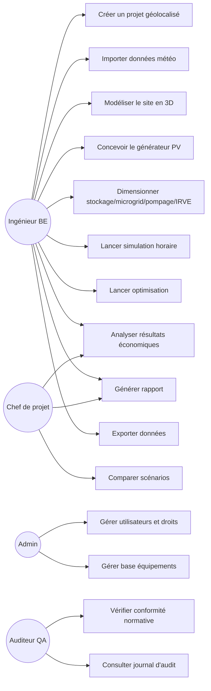

# 2. Analyse fonctionnelle

## 2.1 Acteurs

| Acteur | Description |
|---|---|
| Ingénieur BE | Utilisateur principal : crée, dimensionne, simule, optimise les projets |
| Chef de projet | Consulte, arbitre entre scénarios, valide les livrables |
| Administrateur organisation | Gère utilisateurs, licences, base équipements interne |
| Auditeur/QA | Contrôle la conformité normative et la traçabilité des calculs |
| Système météo externe | Fournit les données climatiques |
| Système SIG externe | Fournit les données géospatiales |
| IA HeliosPro | Acteur logiciel : propose, alerte, prévoit |

## 2.2 Diagramme de cas d'utilisation (vue synthétique)



## 2.3 Processus métier de référence (workflow bout-en-bout)

```mermaid
sequenceDiagram
  actor Ing as Ingénieur BE
  participant SIG as Service SIG
  participant Meteo as Service Météo
  participant Sim as Moteur Simulation
  participant Opt as Service Optimisation
  participant Econ as Service Économique
  participant Rep as Service Rapport

  Ing->>SIG: Localiser le site (adresse/coordonnées/parcelle)
  SIG-->>Ing: Emprise bâtiment, MNT/MNS, obstacles
  Ing->>Meteo: Récupérer TMY pour le site
  Meteo-->>Ing: Série horaire GHI/DNI/DHI/T°/vent
  Ing->>Sim: Définir générateur PV + BOS (modules, onduleurs, câblage)
  Ing->>Sim: Ajouter stockage/microgrid/pompage/IRVE (option)
  Ing->>Sim: Lancer simulation horaire annuelle
  Sim-->>Ing: Productible, pertes détaillées, indicateurs de performance
  opt Optimisation demandée
    Ing->>Opt: Définir objectifs et contraintes
    Opt->>Sim: Évaluer N configurations (parallèle)
    Opt-->>Ing: Front de Pareto des solutions optimales
  end
  Ing->>Econ: Lancer analyse financière
  Econ-->>Ing: LCOE, VAN, TRI, temps de retour
  Ing->>Rep: Générer rapport d'étude
  Rep-->>Ing: PDF/DOCX conforme, avec justificatifs normatifs
```

## 2.4 Règles de gestion (extrait)

| ID | Règle |
|---|---|
| RG-001 | Un projet ne peut être simulé sans données météo horaires complètes (8760 pas, valeurs manquantes < 1 % après contrôle qualité) |
| RG-002 | La tension de circuit ouvert corrigée en froid extrême d'une chaîne ne doit jamais dépasser la tension max. d'entrée de l'onduleur (vérification bloquante) |
| RG-003 | Le courant de court-circuit d'une chaîne corrigé en chaud ne doit pas dépasser le courant admissible du câble et du fusible associé |
| RG-004 | Toute modification d'un projet après génération d'un rapport « figé » crée une nouvelle révision tracée (jamais d'écrasement silencieux) |
| RG-005 | Un dimensionnement de stockage off-grid doit respecter un LPSP cible défini par l'utilisateur (défaut ≤ 2 %) |
| RG-006 | Les pertes totales simulées doivent être décomposées et justifiées poste par poste (aucune « perte forfaitaire » cachée) |
| RG-007 | Toute donnée d'équipement utilisée dans un calcul certifié doit provenir d'une fiche versionnée et horodatée de la base équipements |
| RG-008 | L'optimisation ne peut proposer une configuration violant une contrainte électrique bloquante (RG-002/RG-003) |
| RG-009 | Les résultats affichés en unités doivent respecter la préférence utilisateur (métrique/impérial) sans perte de précision interne (calcul toujours en SI) |

## 2.5 Spécification fonctionnelle par domaine (résumé — détail en §5)

- **Gestion de projet** : création, versionnage, clonage de scénarios, comparaison
  côte à côte, archivage, permissions par projet.
- **SIG et site** : localisation, import cadastre/MNT/MNS/LiDAR, tracé de toiture
  et d'obstacles, calcul d'ombrage 3D, calepinage assisté.
- **Météo** : sélection/fusion de sources, génération de TMY, contrôle qualité,
  interpolation spatiale, scénarios de changement climatique (option).
- **Dimensionnement PV** : sélection modules/onduleurs, câblage, protections,
  vérifications électriques normatives.
- **Stockage/Microgrid/Pompage/IRVE** : voir modules dédiés (§5).
- **Simulation** : moteur horaire multi-année avec dégradation, rapport de pertes.
- **Optimisation** : définition d'objectifs/contraintes, exploration automatique.
- **Économie** : hypothèses tarifaires, financement, cashflows, sensibilité.
- **Rapport** : templates personnalisables, export multi-format, justificatifs
  normatifs intégrés.
- **Administration** : utilisateurs, rôles, base équipements, audit.

## 2.6 Matrice de traçabilité exigences → fonctions (extrait)

| Exigence (§1) | Fonctions couvrant l'exigence |
|---|---|
| EF-001 | UC1 (Créer projet géolocalisé) |
| EF-003 | UC3 (Modéliser site 3D), Service SIG |
| EF-004, EF-017 | UC4 (Concevoir générateur PV), vérifications RG-002/RG-003 |
| EF-005 | UC6 (Simulation horaire) |
| EF-006–EF-009 | UC5 (Stockage/microgrid/pompage/IRVE) |
| EF-010 | UC8 (Analyse économique) |
| EF-011 | UC7 (Optimisation) |
| EF-012 | UC9 (Rapport) |
| EF-013 | UC10 (Export) |
| EF-014 | Acteur IA HeliosPro |
| EF-016 | UC13 (Gérer base équipements) |
