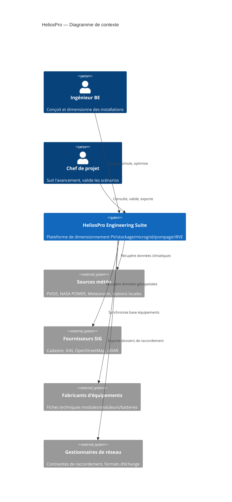
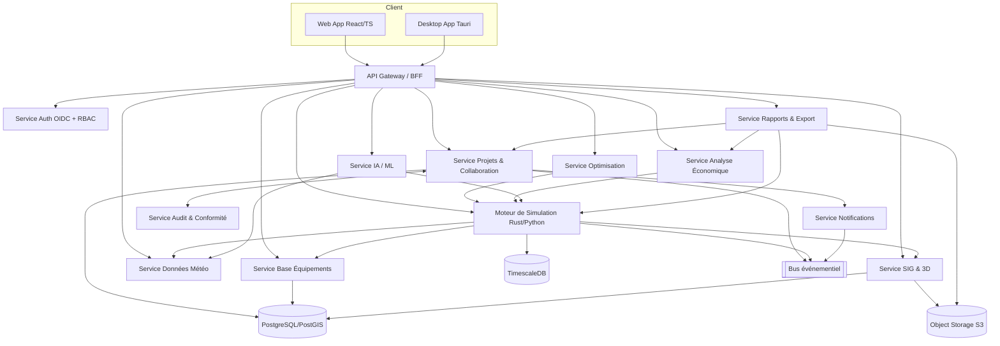

# 4. Architecture logicielle

## 4.1 Principes directeurs

- **Architecture hexagonale / Clean Architecture** par service : le domaine métier
  (modèles physiques, règles de dimensionnement) est isolé de toute dépendance
  technique (framework web, ORM, cloud provider).
- **Microservices métier découplés**, communication asynchrone privilégiée pour les
  traitements longs (simulation, optimisation), synchrone pour les opérations CRUD.
- **Séparation calcul / présentation** : le moteur de simulation est un service
  autonome, appelable en SaaS comme en desktop embarqué (même code, compilé
  différemment).
- **Cloud-agnostique** : conteneurisation Docker + orchestration Kubernetes,
  aucune dépendance à un service propriétaire non substituable.
- **API-first** : toute fonctionnalité de l'UI passe par l'API publique documentée
  (dogfooding), garantissant l'absence de fonctionnalité « cachée ».

## 4.2 Stack technologique

| Couche | Choix | Justification |
|---|---|---|
| Langage cœur de calcul | **Rust** (moteur physique/numérique) exposé via bindings (PyO3/WASM) | Performance native, sécurité mémoire, portabilité web (WASM) et desktop |
| Orchestration métier / API | **Python 3.12+ (FastAPI)** | Écosystème scientifique (NumPy/SciPy/pvlib-like), rapidité de développement |
| Calcul distribué / optimisation | **Python + Rust workers**, files de tâches **Celery/RQ sur Redis**, solveurs **OR-Tools / Pyomo + HiGHS** pour MILP | Optimisation multi-objectif à l'échelle |
| Frontend Web | **TypeScript, React, Vite**, cartographie **MapLibre GL / deck.gl**, 3D **Three.js/WebGL**, graphes **ECharts/D3** | Écosystème mature, rendu 3D/SIG performant |
| Desktop | **Tauri** (wrapper Rust autour du frontend web) | Empreinte légère, réutilisation du frontend, accès filesystem natif |
| Base de données relationnelle | **PostgreSQL + PostGIS** | Référence SIG open source, transactions ACID |
| Séries temporelles | **TimescaleDB** (extension PostgreSQL) | Compression et requêtes performantes sur 8760+ points/projet |
| Cache / files de messages | **Redis**, **NATS/RabbitMQ** pour l'event bus inter-services | Faible latence, patterns pub/sub |
| Stockage objets | **S3-compatible** (MinIO on-premise / S3 cloud) | Rapports, exports, données MNT/LiDAR volumineuses |
| IA / ML | **Python (PyTorch/scikit-learn)**, service d'inférence séparé, modèles de prévision (Prophet/LSTM), MLOps via **MLflow** | Isolation des cycles de vie ML vs. cœur métier |
| Authentification | **OIDC (Keycloak ou Auth0-compatible)**, RBAC/ABAC | Standard ouvert, SSO entreprise |
| Observabilité | **OpenTelemetry**, **Prometheus/Grafana**, **Loki** | Stack CNCF standard |
| CI/CD | **GitHub Actions / GitLab CI**, **Docker**, **Helm/Kustomize** | Portabilité multi-cloud |

## 4.3 Vue C4 — Niveau 1 (Contexte)

## 4.4 Vue C4 — Niveau 2 (Conteneurs / Microservices)

## 4.5 Description des services

| Service | Responsabilité | Interfaces |
|---|---|---|
| API Gateway / BFF | Routage, agrégation, rate-limiting, versioning API | REST/GraphQL public |
| Auth | Authentification OIDC/SAML, MFA, gestion RBAC/ABAC, licences | gRPC interne |
| Projets & Collaboration | CRUD projets, versionnage, édition collaborative (CRDT), permissions | REST + WebSocket (temps réel) |
| SIG & 3D | Import cadastre/MNT/MNS/LiDAR, calcul de masques, calepinage 2.5D/3D | REST + tuiles vectorielles |
| Données Météo | Agrégation multi-sources, génération TMY, interpolation spatiale | REST + cache |
| Moteur de Simulation | Modèles physiques PV/batterie/pompe/microgrid, simulation horaire | gRPC (haute performance) |
| Optimisation | Algorithmes génétiques/MILP, exploration de l'espace de conception | gRPC (jobs asynchrones) |
| Analyse Économique | LCOE, VAN/TRI, cashflows, scénarios tarifaires | REST |
| IA / ML | Prévision, détection d'anomalies, recommandations, chatbot d'aide | REST + streaming |
| Rapports & Export | Génération PDF/DOCX/Excel, templates personnalisables | REST + job asynchrone |
| Base Équipements | Référentiel modules/onduleurs/batteries/pompes/câbles, versionné | REST |
| Notifications | Emails, in-app, webhooks | Event-driven |
| Audit & Conformité | Journalisation immuable, vérification normative, traçabilité exigences | Event-driven + REST lecture |

## 4.6 Communication inter-services

- **Synchrone** (REST/GraphQL) pour les opérations CRUD et lectures rapides.
- **gRPC** pour les appels haute performance moteur de simulation ↔ orchestrateur
  (sérialisation Protobuf, faible latence, streaming pour résultats progressifs).
- **Bus événementiel** (NATS JetStream) pour les événements métier (`project.updated`,
  `simulation.completed`, `optimization.progress`) consommés par plusieurs services
  (audit, notifications, rapports) sans couplage direct.
- **Idempotence** : toute tâche asynchrone (simulation, optimisation) est identifiée
  par une clé d'idempotence pour permettre reprise/relance sans double exécution.

## 4.7 Sécurité

- OAuth2/OIDC avec PKCE, tokens courts + refresh tokens rotatifs.
- RBAC (rôles : Viewer, Engineer, Lead Engineer, Admin) + ABAC pour restrictions
  fines par projet/organisation.
- Chiffrement TLS 1.3 en transit, AES-256 at rest (bases + object storage).
- Isolation multi-tenant : schéma PostgreSQL par organisation + Row-Level Security
  en secours ; bucket S3 préfixé et politiques IAM par tenant.
- Journal d'audit immuable (append-only, hachage chaîné) pour toute modification
  d'un résultat de calcul certifié.
- Scans SAST/DAST et dépendances (Trivy/Snyk) intégrés en CI.
- Gestion des secrets via Vault/KMS, jamais en clair dans le code ou les logs.

## 4.8 Scalabilité et performance

- Moteur de simulation stateless, horizontalement scalable (pods Kubernetes,
  autoscaling sur file d'attente Celery/NATS).
- Parallélisation des optimisations multi-objectif (population d'individus évaluée
  en parallèle sur un pool de workers).
- Cache des données météo/SIG par zone géographique (évite les recalculs redondants).
- TimescaleDB avec compression native pour les séries temporelles (rétention
  configurable, hypertables partitionnées par projet/date).
- Pré-compilation du moteur Rust en WASM pour exécution client (mode léger/offline)
  quand la confidentialité ou la latence l'exigent.

## 4.9 Déploiement

- Conteneurs Docker, manifests Helm ; environnements Dev/Staging/Prod isolés.
- Mode SaaS multi-tenant (cloud public) et mode **on-premise** (Helm chart
  autonome, sans dépendance à un service cloud propriétaire) pour les BE à
  exigences de confidentialité renforcées (marchés publics, défense).
- Infrastructure as Code (Terraform) pour la reproductibilité des environnements.
- Stratégie de sauvegarde : snapshots PostgreSQL quotidiens + WAL continu,
  réplication cross-région pour le SaaS.

## 4.10 Observabilité

- Traces distribuées OpenTelemetry sur l'ensemble des appels inter-services.
- Métriques Prometheus (latence, taux d'erreur, durée des simulations) exposées
  par service, tableaux de bord Grafana.
- Logs structurés JSON centralisés (Loki), corrélés par `trace_id`/`project_id`.
- Alerting sur SLO (ex. p95 simulation < 5 s, disponibilité API > 99.5 %).
