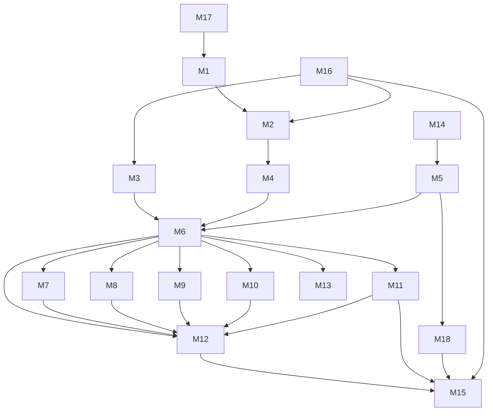

# 5. Modules du logiciel

Chaque module correspond à un domaine métier ou un service technique. Il précise
entrées, sorties, dépendances et responsabilités.

## M1 — Gestion de projet
- **Entrées** : métadonnées projet, site, utilisateurs.
- **Sorties** : projet versionné, scénarios, permissions.
- **Dépendances** : M16 (sécurité), M17 (audit).
- Fonctions : création, clonage, comparaison de scénarios, historique, archivage.

## M2 — SIG & Géolocalisation
- **Entrées** : adresse, coordonnées, parcelle cadastrale, fichiers SIG (Shapefile,
  GeoJSON, KML), MNT/MNS, nuages de points LiDAR.
- **Sorties** : géométrie du site, couches d'occupation du sol, horizon lointain.
- Fonctions : géocodage, calcul d'horizon, gestion des couches, export cartographique.

## M3 — Données météorologiques
- **Entrées** : coordonnées site, sources externes (PVGIS, NASA POWER, Meteonorm),
  fichiers TMY3/EPW/CSV importés.
- **Sorties** : série horaire GHI/DNI/DHI, température, vent, contrôle qualité.
- Fonctions : fusion multi-source, interpolation spatiale, génération de TMY,
  détection de valeurs aberrantes, désagrégation sub-horaire.

## M4 — Modélisation 3D & Ombrage
- **Entrées** : géométrie du site (M2), calepinage (M5).
- **Sorties** : facteurs d'ombrage horaires proches/lointains, vues 3D.
- Fonctions : ray-casting horizon, ombrage proche (structures, végétation),
  ombrage mutuel entre rangées (near-shading), backtracking trackers.

## M5 — Dimensionnement PV (générateur, onduleurs, câblage)
- **Entrées** : catalogue équipements (M14), contraintes site, objectifs de puissance.
- **Sorties** : configuration de chaînes, plan de câblage, vérifications électriques.
- Fonctions : calepinage assisté, dimensionnement onduleur (ratio DC/AC), calcul
  de sections de câbles, protections (fusibles, parafoudre, disjoncteurs DC/AC).

## M6 — Simulation énergétique horaire/sub-horaire
- **Entrées** : M3, M4, M5, profils de charge, paramètres de pertes.
- **Sorties** : productible horaire, bilan de pertes détaillé, indicateurs (PR,
  Yield spécifique, taux d'autoconsommation/autoproduction).
- Fonctions : moteur physique multi-année avec dégradation, comparaison scénarios.

## M7 — Stockage batteries
- **Entrées** : M6, profil de charge, stratégie de pilotage souhaitée.
- **Sorties** : profil SOC, cyclage, vieillissement (SOH), dimensionnement optimal.
- Fonctions : modélisation électrochimique simplifiée, stratégies de pilotage
  (autoconsommation max, effacement de pointe, arbitrage tarifaire, secours).

## M8 — Micro-réseaux (hybrid PV-stockage-diesel-réseau)
- **Entrées** : M6, M7, sources additionnelles (groupe électrogène, éolien option).
- **Sorties** : dispatch horaire, LPSP, consommation carburant, ilotage.
- Fonctions : moteur de dispatch (règles heuristiques ou optimisation MILP),
  gestion de la stabilité (réserve tournante simplifiée), scénarios de panne.

## M9 — Pompage solaire
- **Entrées** : M6, courbes pompe/moteur, hauteur manométrique, besoin en eau.
- **Sorties** : volume pompé horaire/journalier, taux de couverture du besoin.
- Fonctions : couplage direct PV-pompe, dimensionnement avec/sans stockage
  hydraulique ou batterie, choix de variateur/MPPT dédié pompe.

## M10 — Bornes de recharge VE (IRVE)
- **Entrées** : M6, M7, profils d'arrivée/départ des véhicules, puissance bornes.
- **Sorties** : taux de couverture solaire de la recharge, dimensionnement bornes.
- Fonctions : pilotage intelligent (solar-following), foisonnement multi-bornes,
  option V2G (roadmap V2+).

## M11 — Analyse économique & financière
- **Entrées** : coûts CAPEX/OPEX, hypothèses tarifaires, financement.
- **Sorties** : LCOE, VAN, TRI, temps de retour, cashflows, sensibilité.
- Fonctions : scénarios d'autoconsommation/revente/PPA, analyse de sensibilité
  Monte Carlo, comparaison multi-scénarios.

## M12 — Optimisation (dimensionnement multi-objectif)
- **Entrées** : espace de conception (variables), objectifs, contraintes.
- **Sorties** : front de Pareto, configurations recommandées.
- Fonctions : algorithme génétique (NSGA-II), MILP pour sous-problèmes linéaires,
  optimisation bayésienne pour variables coûteuses à évaluer.

## M13 — IA d'aide à la décision
- **Entrées** : historique de projets, résultats de simulation, données externes.
- **Sorties** : recommandations, alertes d'anomalies, prévisions.
- Fonctions : pré-dimensionnement automatique, détection d'anomalies de
  simulation (valeurs hors plage physique), prévision production/consommation,
  assistant conversationnel de dimensionnement.

## M14 — Base de données d'équipements
- **Entrées** : fiches techniques constructeurs, mises à jour communautaires/BE.
- **Sorties** : catalogue versionné modules/onduleurs/batteries/pompes/câbles.
- Fonctions : import de fiches (parsing PAN/OND-like, PDF datasheets assistée IA),
  validation des paramètres physiques, historique des versions.

## M15 — Rapports & documentation
- **Entrées** : résultats de M6-M12, template choisi.
- **Sorties** : PDF/DOCX/Excel, dossier de raccordement, notice technique.
- Fonctions : moteur de templates personnalisables, insertion automatique des
  justificatifs normatifs, export multi-langue.

## M16 — Import/Export & interopérabilité
- Fonctions : import météo (TMY3/EPW/CSV), SIG (Shapefile/GeoJSON/KML), BIM/CAO
  (IFC/DXF), export API REST/GraphQL, webhooks.

## M17 — Administration, sécurité, collaboration
- Fonctions : gestion utilisateurs/rôles, SSO/MFA, édition collaborative temps
  réel, gestion des licences, sauvegarde/restauration.

## M18 — Contrôle qualité / vérification normative
- **Entrées** : configuration électrique (M5), contexte réglementaire (pays).
- **Sorties** : rapport de conformité, liste des non-conformités bloquantes.
- Fonctions : moteur de règles normatives (IEC 60364/NF C 15-100, IEC 62548),
  traçabilité exigence → calcul → résultat (voir §8).

## Matrice de dépendances inter-modules

