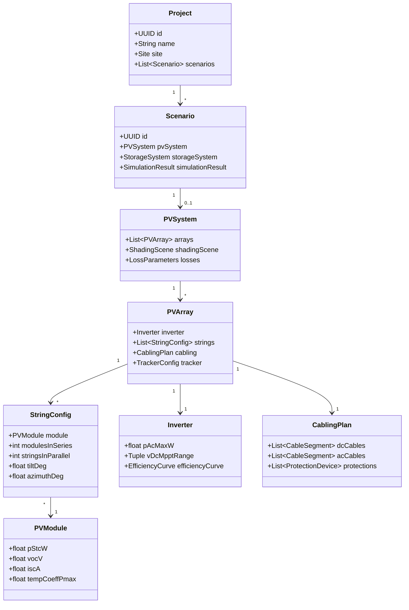
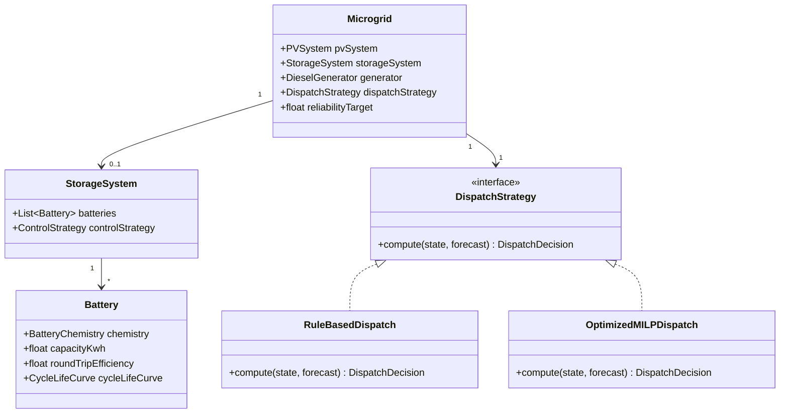
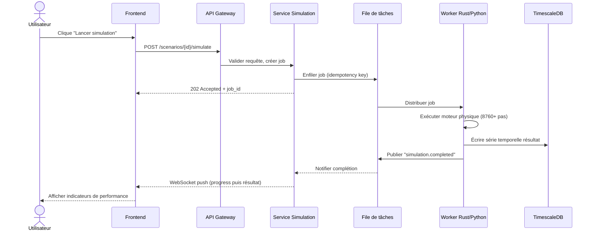
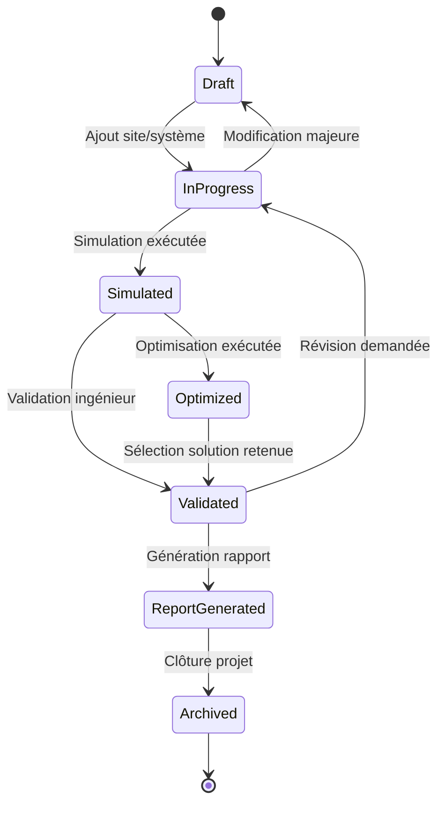
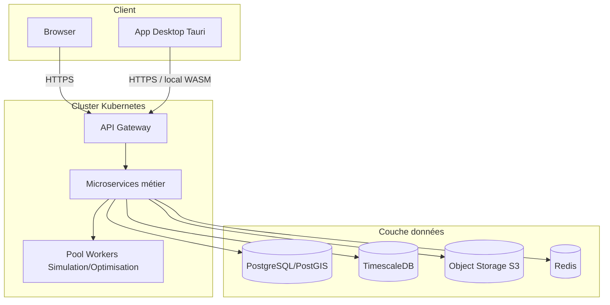
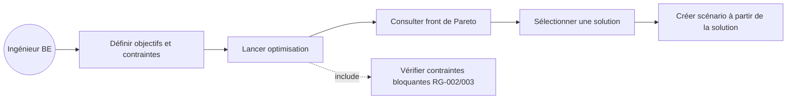

# 11. Diagrammes UML

## 11.1 Diagramme de classes — Domaine « Générateur PV »



## 11.2 Diagramme de classes — Domaine « Stockage & Microgrid »



## 11.3 Diagramme de séquence — Lancement d'une simulation



## 11.4 Diagramme d'état — Cycle de vie d'un projet



## 11.5 Diagramme de composants — Moteur de simulation

```mermaid
flowchart TB
  subgraph SimEngine[simulation-engine (Rust)]
    SG[solar-geometry]
    SH[shading]
    PVE[pv-electrical]
    INV[inverter]
    BAT[battery]
    HYD[hydraulics]
    DISP[microgrid-dispatch]
    CORE[core-sim orchestrator]
  end
  CORE --> SG
  CORE --> SH
  CORE --> PVE
  CORE --> INV
  CORE --> BAT
  CORE --> HYD
  CORE --> DISP
  PYBIND[Binding Python PyO3]
  WASMBIND[Binding WASM]
  CORE --> PYBIND
  CORE --> WASMBIND
  PYBIND --> APIService[Service Orchestration Python/FastAPI]
```

## 11.6 Diagramme de déploiement



## 11.7 Diagramme de cas d'utilisation détaillé (Optimisation)


