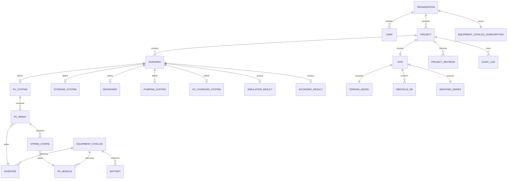

# 12. Bases de données

## 12.1 Stratégie générale

- **PostgreSQL 16 + PostGIS** comme base transactionnelle principale (métier +
  géospatial), un schéma par organisation (isolation multi-tenant) + Row-Level
  Security en défense en profondeur.
- **TimescaleDB** (extension PostgreSQL) pour les séries temporelles de
  simulation (hypertables partitionnées par `project_id` et temps).
- **Object Storage S3-compatible** pour les fichiers volumineux (nuages de
  points LiDAR, rapports générés, exports).
- **Redis** pour cache et files de tâches légères ; **NATS JetStream** pour le
  bus événementiel persistant.

## 12.2 Modèle entité-relation (cœur métier)



## 12.3 Schéma relationnel (extrait, PostgreSQL/PostGIS)

```sql
-- Projets et sites (schéma "core")
CREATE TABLE core.organization (
  id UUID PRIMARY KEY DEFAULT gen_random_uuid(),
  name TEXT NOT NULL,
  tenant_schema TEXT UNIQUE NOT NULL,
  created_at TIMESTAMPTZ NOT NULL DEFAULT now()
);

CREATE TABLE core.project (
  id UUID PRIMARY KEY DEFAULT gen_random_uuid(),
  organization_id UUID NOT NULL REFERENCES core.organization(id),
  name TEXT NOT NULL,
  status TEXT NOT NULL DEFAULT 'draft',
  created_by UUID NOT NULL,
  created_at TIMESTAMPTZ NOT NULL DEFAULT now(),
  updated_at TIMESTAMPTZ NOT NULL DEFAULT now()
);

CREATE TABLE core.site (
  id UUID PRIMARY KEY DEFAULT gen_random_uuid(),
  project_id UUID NOT NULL REFERENCES core.project(id) ON DELETE CASCADE,
  geom GEOGRAPHY(POINT, 4326) NOT NULL,
  altitude_m DOUBLE PRECISION,
  timezone TEXT NOT NULL,
  building_footprint GEOMETRY(POLYGON, 4326)
);
CREATE INDEX idx_site_geom ON core.site USING GIST (geom);

CREATE TABLE core.obstacle_3d (
  id UUID PRIMARY KEY DEFAULT gen_random_uuid(),
  site_id UUID NOT NULL REFERENCES core.site(id) ON DELETE CASCADE,
  mesh_ref TEXT NOT NULL,          -- pointeur vers Object Storage (glTF/OBJ)
  height_m DOUBLE PRECISION NOT NULL,
  obstacle_type TEXT NOT NULL
);

CREATE TABLE core.scenario (
  id UUID PRIMARY KEY DEFAULT gen_random_uuid(),
  project_id UUID NOT NULL REFERENCES core.project(id) ON DELETE CASCADE,
  name TEXT NOT NULL,
  config JSONB NOT NULL,           -- configuration complète PV/stockage/microgrid (versionnée)
  created_at TIMESTAMPTZ NOT NULL DEFAULT now()
);

CREATE TABLE core.project_revision (
  id UUID PRIMARY KEY DEFAULT gen_random_uuid(),
  project_id UUID NOT NULL REFERENCES core.project(id),
  revision_number INT NOT NULL,
  snapshot JSONB NOT NULL,
  created_by UUID NOT NULL,
  created_at TIMESTAMPTZ NOT NULL DEFAULT now(),
  UNIQUE (project_id, revision_number)
);

CREATE TABLE audit.audit_log (
  id BIGSERIAL PRIMARY KEY,
  project_id UUID,
  actor_id UUID NOT NULL,
  action TEXT NOT NULL,
  payload JSONB NOT NULL,
  prev_hash TEXT,
  hash TEXT NOT NULL,             -- hachage chaîné (append-only)
  created_at TIMESTAMPTZ NOT NULL DEFAULT now()
);
```

```sql
-- Base équipements (schéma "equipment")
CREATE TABLE equipment.pv_module (
  id UUID PRIMARY KEY DEFAULT gen_random_uuid(),
  manufacturer TEXT NOT NULL,
  model TEXT NOT NULL,
  p_stc_w DOUBLE PRECISION NOT NULL,
  voc_v DOUBLE PRECISION NOT NULL,
  isc_a DOUBLE PRECISION NOT NULL,
  vmpp_v DOUBLE PRECISION NOT NULL,
  impp_a DOUBLE PRECISION NOT NULL,
  temp_coeff_pmax DOUBLE PRECISION NOT NULL,
  technology TEXT NOT NULL,
  certifications TEXT[] NOT NULL DEFAULT '{}',
  version INT NOT NULL DEFAULT 1,
  valid_from TIMESTAMPTZ NOT NULL DEFAULT now(),
  valid_to TIMESTAMPTZ,           -- NULL = version courante (SCD type 2)
  UNIQUE (manufacturer, model, version)
);
-- Même pattern SCD2 (versionnement bitemporel) pour inverter, battery, pump_curve, cable_spec
```

```sql
-- Référentiel normatif (schéma "compliance")
CREATE TABLE compliance.rule (
  id TEXT PRIMARY KEY,             -- ex. "IEC-60364-712-VOC-MAX"
  standard_reference TEXT NOT NULL,
  jurisdiction TEXT NOT NULL,
  severity TEXT NOT NULL,
  check_expression TEXT NOT NULL,  -- DSL déclaratif
  version TEXT NOT NULL
);
```

```sql
-- TimescaleDB : séries temporelles de simulation (schéma "timeseries")
CREATE TABLE timeseries.simulation_point (
  project_id UUID NOT NULL,
  scenario_id UUID NOT NULL,
  ts TIMESTAMPTZ NOT NULL,
  pv_production_w DOUBLE PRECISION,
  load_w DOUBLE PRECISION,
  battery_soc_pct DOUBLE PRECISION,
  grid_import_w DOUBLE PRECISION,
  grid_export_w DOUBLE PRECISION,
  PRIMARY KEY (scenario_id, ts)
);
SELECT create_hypertable('timeseries.simulation_point', 'ts',
  partitioning_column => 'scenario_id', number_partitions => 16);
ALTER TABLE timeseries.simulation_point SET (
  timescaledb.compress, timescaledb.compress_segmentby = 'scenario_id'
);
SELECT add_compression_policy('timeseries.simulation_point', INTERVAL '30 days');
```

## 12.4 Stratégie d'indexation et de partitionnement

- Index GiST sur toutes les colonnes géospatiales (`geom`, `building_footprint`).
- Hypertables TimescaleDB partitionnées par `scenario_id` (hachage) et par temps
  (chunk hebdomadaire), compression automatique après 30 jours.
- Index JSONB (GIN) sur `scenario.config` pour les requêtes de filtrage
  d'optimisation (ex. recherche de scénarios par plage de puissance).
- Politique de rétention configurable par tenant pour les données brutes
  détaillées (sub-horaires), agrégation automatique en horaire au-delà de N mois.

## 12.5 Gouvernance et versionnement des données

- Catalogue équipements en **SCD type 2** (Slowly Changing Dimension) :
  toute fiche technique modifiée crée une nouvelle version horodatée, l'ancienne
  restant consultable pour les projets déjà calculés (traçabilité RG-007).
- Référentiel normatif versionné en base + miroir Git (`data/standards-rulesets/`)
  pour revue collégiale des évolutions normatives.
- Sauvegardes : snapshots quotidiens PostgreSQL + réplication continue (WAL
  shipping), rétention 35 jours SaaS, politique configurable on-premise.
