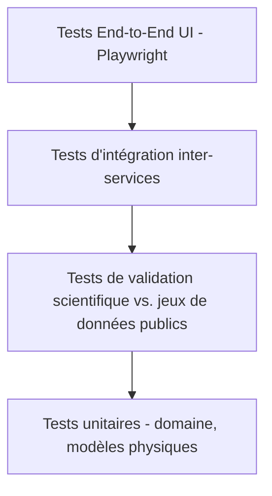

# 14. Stratégie de tests

## 14.1 Pyramide de tests

- **Tests unitaires** (base de la pyramide, exécution < 1 min) : chaque fonction
  pure du domaine (calcul position solaire, résolution I-V, dispatch batterie,
  etc.), isolée de toute dépendance I/O.
- **Tests de validation scientifique** : comparaison des sorties du moteur à des
  jeux de données publics de référence (mesures de sites documentés dans la
  littérature, données PVGIS/NREL en accès libre). Tolérances définies par
  modèle (§14.4). Exécutés en CI à chaque modification du moteur de simulation.
- **Tests d'intégration** : interactions réelles entre services (API Gateway →
  Simulation → TimescaleDB), bases de données de test conteneurisées (Testcontainers).
- **Tests end-to-end** : parcours utilisateur critiques (créer projet → simuler →
  générer rapport) automatisés en Playwright, exécutés sur chaque environnement
  de staging avant mise en production.

## 14.2 Couverture cible

| Périmètre | Couverture minimale |
|---|---|
| Modèles physiques (`simulation-engine`) | 95 % lignes, 100 % branches sur les formules critiques |
| Services métier (règles de gestion, compliance) | 90 % |
| API / contrôleurs | 85 % |
| Frontend (composants critiques : formulaires de dimensionnement, résultats) | 80 % |
| Global projet | ≥ 85 % |

## 14.3 Tests de non-régression sur simulations (« golden datasets »)

Un ensemble de scénarios de référence (site + météo + configuration système
figés) est rejoué à chaque changement du moteur ; toute variation de résultat
au-delà d'un seuil de tolérance (typiquement 0.1 % sur le productible annuel)
déclenche une revue obligatoire avant fusion (empêche les régressions
silencieuses sur un moteur scientifique).

## 14.4 Tolérances de validation scientifique (exemples)

| Modèle | Référence de comparaison | Tolérance |
|---|---|---|
| Position solaire (SPA) | Valeurs de référence NREL SPA | < 0.01° |
| Transposition Perez | Cas de test publiés (Perez et al. / pvlib validation suite — réimplémentation propre) | < 1 % sur irradiance plan incliné |
| Modèle électrique 5-paramètres | Courbes I-V mesurées de fiches techniques publiques | < 2 % sur Pmax |
| Productible annuel global | Sites de mesure documentés publiquement / PVGIS (comparaison croisée, non copie) | < 3 % |
| Modèle batterie (SOC) | Bilan énergétique analytique de contrôle | < 0.5 % (erreur de bilan) |

## 14.5 Tests de performance et de charge

- Benchmarks systématiques (Criterion.rs pour le moteur Rust, locust/k6 pour
  l'API) intégrés en CI avec seuils de non-régression de performance (ex. p95
  simulation annuelle < 5 s).
- Tests de charge SaaS : simulation de N utilisateurs concurrents, vérification
  de l'autoscaling et de l'absence de dégradation de SLO.
- Tests d'échelle : projet à 100 000+ modules, vérification des temps de réponse
  UI (rendu 3D, calepinage) et de simulation.

## 14.6 Tests de sécurité

- SAST (analyse statique) et scan de dépendances (Trivy/Snyk) sur chaque
  pull request.
- DAST (dynamic scanning) sur l'API en environnement de staging.
- Tests d'intrusion (pentest) périodiques par un tiers avant chaque montée de
  version majeure du SaaS, référentiel OWASP ASVS.
- Tests spécifiques d'isolation multi-tenant (vérification qu'aucune requête ne
  peut accéder aux données d'une autre organisation).

## 14.7 Tests d'accessibilité et d'ergonomie

- Audit automatisé WCAG 2.1 AA (axe-core) intégré aux tests E2E.
- Tests utilisateurs qualitatifs avec ingénieurs BE (panel de personas §3) à
  chaque jalon majeur de la feuille de route.

## 14.8 Processus qualité

- Revue de code obligatoire (2 approbateurs minimum sur le moteur de
  simulation et le moteur de conformité normative).
- CI bloquante : tests unitaires + validation scientifique + lint + SAST avant
  toute fusion sur la branche principale.
- Gestion des jeux de données de test : dossier versionné `data/reference-datasets/`
  (§9), avec licence et provenance documentées pour chaque jeu de données public
  utilisé.
- Option de certification/validation par un bureau de contrôle tiers avant
  usage en production réglementaire, documentée dans le rapport de conformité
  (§8.7).
