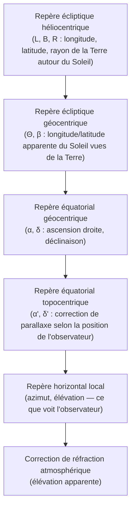
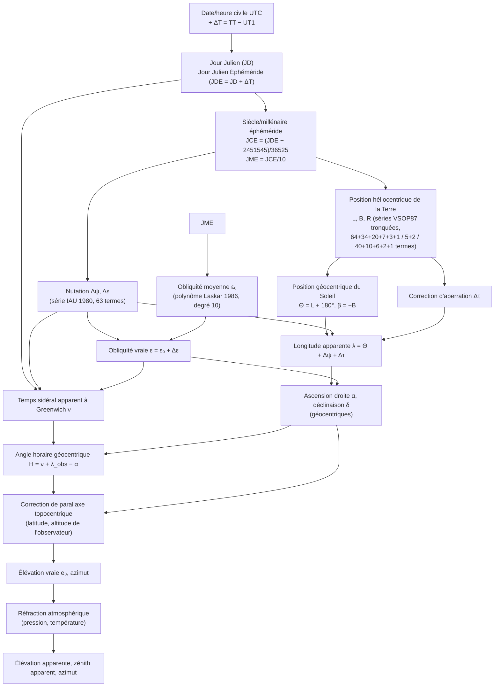

# 18. Annexe technique — Moteur de position solaire HeliosPro

**Statut** : document technique complet, rédigé pour être publiable comme
annexe scientifique autonome (algorithmes, équations, démonstrations,
diagrammes, références, hypothèses, limites). Il consolide et met en forme
publiable le contenu déjà validé dans `docs/design/16-phase1-validation-report.md`
(§17) et `17-analyse-incertitude-numerique.md`, sans les remplacer — ces
deux documents restent les sources de la trace historique des décisions et
de l'analyse d'incertitude détaillée respectivement. Toute équation citée
ci-dessous correspond exactement au code source référencé entre parenthèses
(`engine/crates/...`) ; aucune formule n'est reproduite de mémoire sans
vérification croisée avec l'implémentation testée.

## 18.1 Objet et périmètre

Ce document décrit intégralement le sous-système de position solaire de
HeliosPro : le calcul, à partir d'un instant UTC et d'une position
géographique (latitude, longitude, altitude), de la direction apparente du
Soleil dans le repère horizontal local (azimut, hauteur/élévation, zénith),
ainsi que des grandeurs géocentriques intermédiaires (ascension droite,
déclinaison, distance Terre-Soleil, équation du temps, angle horaire).

Deux moteurs indépendants implémentent ce calcul :

| Moteur | Statut | Crate | Source principale |
|---|---|---|---|
| **SPA** (Solar Position Algorithm) | Primaire, par défaut | `solar_geometry::spa` (géocentrique) + `solar_position::spa` (topocentrique) | Reda & Andreas (2004), NREL/TP-560-34302 |
| **Meeus réduit** | Secondaire, validation croisée uniquement | `solar_geometry::meeus` + `solar_position::meeus` | Meeus (1998), *Astronomical Algorithms*, 2e éd. |

Hors périmètre de ce document (traités ailleurs ou non encore implémentés) :
irradiance, transposition sur plan incliné, modèle thermique, modèle
électrique — voir `engine/README.md` pour la carte complète des 14 crates.

## 18.2 Conventions et systèmes de coordonnées

| Grandeur | Convention |
|---|---|
| Temps | UTC exclusivement en entrée (`core_math::julian::CalendarDateTime`) ; aucune notion de fuseau horaire dans le moteur — voir §18.9 |
| Longitude | Positive vers l'est, degrés décimaux |
| Latitude | Positive vers le nord, degrés décimaux |
| Azimut | Mesuré depuis le Nord, sens horaire, [0°, 360°) |
| Élévation / Hauteur | Positive au-dessus de l'horizon astronomique |
| Zénith | `90° − élévation` |
| Angle horaire | Négatif avant le passage au méridien (matin), positif après (après-midi), convention SPA/Meeus standard |
| Unités internes | Toutes les grandeurs angulaires internes sont portées par le type fort [`core_units::Angle`], qui encapsule la conversion degré/radian ; aucune conversion manuelle implicite dans le code métier |



## 18.3 Vue d'ensemble de la chaîne de calcul (SPA)



## 18.4 Algorithme SPA complet — équations

Toutes les équations de cette section sont numérotées comme dans
Reda & Andreas (2004) et implémentées dans `solar_geometry::spa::compute`
(étapes géocentriques) et `solar_position::spa::solar_position_precise`
(étapes topocentriques).

### 18.4.1 Temps (Eq. 3.1)

```
JD  = jour julien UT (Meeus Ch. 7, core_math::julian::CalendarDateTime::to_julian_day)
JDE = JD + ΔT/86400                       (ΔT = TT − UT1, en secondes)
JCE = (JDE − 2451545.0) / 36525.0          (siècle julien éphéméride)
JME = JCE / 10.0                           (millénaire julien éphéméride)
```

### 18.4.2 Position héliocentrique de la Terre (Eq. 3.2.1-3.2.7)

Pour chaque coordonnée (L : longitude, B : latitude, R : rayon vecteur),
une série de sous-séries `L0..L5`, `B0..B1`, `R0..R4` de la forme :

```
Lᵢ(JME) = Σⱼ Aᵢⱼ · cos(Bᵢⱼ + Cᵢⱼ · JME)
```

(`sum_periodic_terms` dans `solar_geometry::spa::mod.rs`), combinées par :

```
L(rad) = (L0 + L1·JME + L2·JME² + L3·JME³ + L4·JME⁴ + L5·JME⁵) / 10⁸
```

(de façon identique pour B avec B0-B1 et R avec R0-R4, sans terme
`/10⁸` appliqué différemment — voir le code). Les tables de coefficients
`Aᵢⱼ, Bᵢⱼ, Cᵢⱼ` (`solar_geometry::spa::tables`) comptent respectivement
64+34+20+7+3+1 termes (L0-L5), 5+2 termes (B0-B1), 40+10+6+2+1 termes
(R0-R4) — exactement les tailles publiées par Reda & Andreas (2004),
Tables A4.2-A4.4, elles-mêmes dérivées de la théorie planétaire VSOP87.
Provenance des coefficients : voir `engine/validation-data/README.md`
(extraction programmatique depuis pvlib-python, vérification par nombre de
lignes et par accord byte-exact au cas canonique publié).

### 18.4.3 Position géocentrique du Soleil (Eq. 3.3.1-3.3.2)

```
Θ = L + 180°   (longitude géocentrique, la Terre vue du Soleil devient le Soleil vu de la Terre)
β = −B          (latitude géocentrique)
```

### 18.4.4 Cinq arguments fondamentaux (Eq. 3.4.1-3.4.5)

Polynômes de degré 3 en JCE, argument des séries de nutation (élongation
moyenne Lune-Soleil X0, anomalie moyenne du Soleil X1, anomalie moyenne de
la Lune X2, argument de latitude de la Lune X3, longitude du nœud
ascendant de l'orbite lunaire moyenne X4) :

```
X0 = 297.85036 + 445267.111480·JCE − 0.0019142·JCE² + JCE³/189474
X1 = 357.52772 +  35999.050340·JCE − 0.0001603·JCE² − JCE³/300000
X2 = 134.96298 + 477198.867398·JCE + 0.0086972·JCE² + JCE³/56250
X3 =  93.27191 + 483202.017538·JCE − 0.0036825·JCE² + JCE³/327270
X4 = 125.04452 −   1934.136261·JCE + 0.0020708·JCE² + JCE³/450000
```

### 18.4.5 Nutation en longitude et en obliquité (Eq. 3.4.6-3.4.9)

Série de 63 termes (IAU 1980, Table A3.2) :

```
Δψ = (1/36 000 000) · Σᵢ (aᵢ + bᵢ·JCE) · sin(Σₖ yᵢₖ·Xₖ)
Δε = (1/36 000 000) · Σᵢ (cᵢ + dᵢ·JCE) · cos(Σₖ yᵢₖ·Xₖ)
```

où `yᵢₖ` sont des multiplicateurs entiers tabulés et `aᵢ, bᵢ, cᵢ, dᵢ` des
amplitudes en unités de 0.0001″ (d'où le diviseur 36 000 000 =
3600″/° × 10⁴).

### 18.4.6 Obliquité de l'écliptique (Eq. 3.5.1-3.5.2)

Polynôme de degré 10 en `U = JME/10` (Laskar 1986), haute précision :

```
ε₀(″) = 84381.448 − 4680.93·U − 1.55·U² + 1999.25·U³ − 51.38·U⁴ − 249.67·U⁵
        − 39.05·U⁶ + 7.12·U⁷ + 27.87·U⁸ + 5.79·U⁹ + 2.45·U¹⁰
ε = ε₀/3600 + Δε        (obliquité vraie, degrés)
```

### 18.4.7 Aberration et longitude apparente (Eq. 3.6.1, 3.7.1)

```
Δτ = −20.4898 / (3600 · R)             (R en UA, Δτ en degrés)
λ = Θ + Δψ + Δτ                         (longitude apparente du Soleil)
```

### 18.4.8 Temps sidéral apparent à Greenwich (Eq. 3.8.1-3.8.2)

```
ν₀ = 280.46061837 + 360.98564736629·(JD − 2451545) + 0.000387933·JCᵤₜ² − JCᵤₜ³/38 710 000
ν  = ν₀ + Δψ·cos(ε)
```

(`JCᵤₜ` : siècle julien calculé à partir du **JD UT**, pas JDE — la
publication est explicite sur ce point, reproduit fidèlement dans le code).

### 18.4.9 Ascension droite et déclinaison géocentriques (Eq. 3.9.1-3.9.2)

```
α = atan2( sin(λ)·cos(ε) − tan(β)·sin(ε), cos(λ) )
δ = asin( sin(β)·cos(ε) + cos(β)·sin(ε)·sin(λ) )
```

### 18.4.10 Angle horaire géocentrique (Eq. 3.10.1)

```
H = ν + λ_observateur − α        (mod 360°)
```

### 18.4.11 Parallaxe topocentrique (Eq. 3.12.1-3.12.6) — voir démonstration §18.6.2

```
ξ = 8.794″ / (3600 · R)                                    (parallaxe équatoriale horizontale)
u = atan( 0.99664719 · tan(latitude) )                      (latitude géocentrique réduite)
x = cos(u) + (altitude/6 378 140)·cos(latitude)
y = 0.99664719·sin(u) + (altitude/6 378 140)·sin(latitude)
Δα = atan2( −x·sin(ξ)·sin(H), cos(δ) − x·sin(ξ)·cos(H) )    (parallaxe en ascension droite)
δ' = atan2( (sin(δ) − y·sin(ξ))·cos(Δα), cos(δ) − x·sin(ξ)·cos(H) )   (déclinaison topocentrique)
H' = H − Δα                                                  (angle horaire topocentrique)
```

### 18.4.12 Élévation, réfraction, zénith, azimut (Eq. 3.14.1-3.14.6)

```
e₀ = asin( sin(lat)·sin(δ') + cos(lat)·cos(δ')·cos(H') )     (élévation vraie)

Δe = (P/1010)·(283/(273+T))·1.02 / [60·tan(e₀ + 10.3/(e₀+5.11))]   si e₀ ≥ −(0.26667° + atmos_refract)
Δe = 0                                                               sinon
                                                              (réfraction, Eq. 3.14.2, Sæmundsson)

e = e₀ + Δe                        (élévation apparente)
ζ₀ = 90° − e₀ ,  ζ = 90° − e         (zénith vrai, zénith apparent)

γ = atan2( sin(H'), cos(H')·sin(lat) − tan(δ')·cos(lat) )     (azimut « astronomes », depuis le Sud)
φ = γ + 180° (mod 360°)                                       (azimut depuis le Nord, sens horaire)
```

### 18.4.13 Équation du temps (Eq. 3.11.1-3.11.3)

```
M☉ = 280.4664567 + 360007.6982779·JME + 0.03032028·JME² + JME³/49931 − JME⁴/15300 − JME⁵/2000000
E° = (M☉ − 0.0057183 − α + Δψ·cos(ε))  mod 360°
EoT(min) = 4·E°,  ramené dans [−20, 20] min par ±1440 min si hors bornes
```

## 18.5 Moteur secondaire Meeus (1998) — différences structurelles

`solar_geometry::meeus::compute` implémente la même chaîne conceptuelle
avec un modèle **beaucoup plus réduit**, issu de sources différentes du
même ouvrage :

| Étape | SPA | Meeus réduit |
|---|---|---|
| Position héliocentrique | Séries VSOP87 tronquées (129 termes L, 7 termes B, 59 termes R) | Ellipse képlérienne exacte à un terme d'excentricité + équation du centre à 3 termes (Meeus Eq. 25.2-25.5) |
| Nutation | 63 termes IAU 1980 | 4 termes (Meeus Eq. 22.1, « suffisants pour la plupart des usages ») |
| Obliquité moyenne | Polynôme Laskar degré 10 | Polynôme classique degré 3 (Meeus Eq. 22.2) |
| Latitude écliptique du Soleil β | Calculée (non nulle) | Prise égale à 0 exactement (Meeus le justifie lui-même : `β_☉ < 0.00033°` toujours) |
| Parallaxe topocentrique | Complète (Eq. 3.12, §18.4.11) | **Omise entièrement** — amplitude max ≈ 8.8″, sous le plancher de précision ~0.01-0.02° de ce moteur réduit |
| Précision documentée | ±0.0003° (claim de la publication, -2000 à 6000) | ~0.01-0.02° (mesuré empiriquement contre pvlib, §18.7) |

Conséquence directe : Meeus n'utilise **pas** l'altitude de l'observateur
(`Observer::elevation` est accepté pour uniformité d'API mais ignoré),
alors que SPA en a explicitement besoin pour la correction de parallaxe.

## 18.6 Démonstrations

### 18.6.1 Transformation équatoriale → horizontale (Eq. 18.4.12)

**Énoncé** : soit un observateur à la latitude géographique `φ`, un astre
de déclinaison `δ'` et d'angle horaire local `H'`. Alors l'élévation `e₀`
et l'azimut (mesuré depuis le Sud) `γ` vérifient :

```
sin(e₀) = sin(φ)·sin(δ') + cos(φ)·cos(δ')·cos(H')
tan(γ)  = sin(H') / [cos(H')·sin(φ) − tan(δ')·cos(φ)]
```

**Démonstration** (trigonométrie sphérique — triangle de position, sommets
Pôle Nord céleste `P`, Zénith `Z`, astre `X`) :

Le triangle sphérique `PZX` a pour côtés :
- `PZ = 90° − φ` (colatitude de l'observateur)
- `PX = 90° − δ'` (distance polaire de l'astre)
- `ZX = 90° − e₀` (distance zénithale, l'inconnue)

et pour angle en `P` : l'angle horaire `H'`. La loi des cosinus sphérique
appliquée au côté `ZX` donne :

```
cos(ZX) = cos(PZ)·cos(PX) + sin(PZ)·sin(PX)·cos(H')
```

En substituant `cos(ZX) = cos(90°−e₀) = sin(e₀)`,
`cos(PZ) = cos(90°−φ) = sin(φ)`, `cos(PX) = sin(δ')`,
`sin(PZ) = cos(φ)`, `sin(PX) = cos(δ')` :

```
sin(e₀) = sin(φ)·sin(δ') + cos(φ)·cos(δ')·cos(H')     ∎ (formule de l'élévation)
```

Pour l'azimut, on applique l'analogie des sinus-cosinus (« loi des cinq
éléments ») au même triangle, au sommet `X` (angle = 180° − γ, puisque
l'azimut est mesuré depuis le Nord dans la convention finale mais depuis
le Sud dans la convention intermédiaire `γ` de Meeus/SPA) :

```
sin(PX)·cos(P) = cos(PZ)·sin(ZX) − sin(PZ)·cos(ZX)·cos(Z)
```

Après substitution et réarrangement (voir Meeus (1998), Ch. 13, ou
Smart, W.M. (1977), *Textbook on Spherical Astronomy*, pour la dérivation
complète étape par étape), on obtient la forme `atan2` implémentée :

```
γ = atan2( sin(H'),  cos(H')·sin(φ) − tan(δ')·cos(φ) )
```

Cette formule est numériquement préférable à un calcul direct de
`tan(γ)` suivi d'une résolution de quadrant, car `atan2` gère nativement
les quatre quadrants et évite la division par zéro lorsque
`cos(H')·sin(φ) − tan(δ')·cos(φ) = 0` (le zénith transit — voir §18.8,
« singularité de coordonnées »). C'est le choix fait dans
`solar_position::spa::solar_position_precise` et
`solar_geometry::meeus::topocentric_from_hour_angle`.

### 18.6.2 Formule de parallaxe topocentrique simplifiée (Eq. 18.4.11)

**Contexte physique** : la parallaxe topocentrique corrige le fait que la
position équatoriale géocentrique (α, δ) est calculée comme si
l'observateur était au centre de la Terre, alors qu'il est en réalité à sa
surface, décalé du centre d'une distance de l'ordre du rayon terrestre —
négligeable devant la distance Terre-Soleil (~23 500 rayons terrestres),
mais mesurable (amplitude maximale ≈ 8.8″, la « parallaxe solaire »).

**Modèle géométrique** : la Terre est modélisée comme un ellipsoïde de
révolution aplati (facteur `1−f = 0.99664719`, §17.4b de
`17-analyse-incertitude-numerique.md`). La position de l'observateur par
rapport au centre de la Terre, dans le repère équatorial, est paramétrée
par les termes réduits `x` et `y` (Eq. 3.12.1, 3.12.3) qui donnent sa
distance au centre projetée sur le plan équatorial (`x`) et sur l'axe
polaire (`y`), en unités de rayon équatorial terrestre. Le décalage
angulaire apparent de l'astre, vu depuis cette position décalée plutôt que
depuis le centre, se dérive par la loi des sinus appliquée au triangle
(centre de la Terre, observateur, astre) — l'astre étant supposé à une
distance essentiellement infinie devant le rayon terrestre pour cette
approximation au premier ordre en `sin(ξ)` (`ξ` petit, `sin(ξ) ≈ ξ`) :

```
Δα ≈ −x·sin(ξ)·sin(H) / cos(δ)          (parallaxe en ascension droite, petite)
```

et sa forme `atan2` complète (Eq. 3.12.4, utilisée dans le code plutôt
que l'approximation ci-dessus, pour rester exacte sans hypothèse de petit
angle sur `Δα` lui-même) :

```
Δα = atan2( −x·sin(ξ)·sin(H),  cos(δ) − x·sin(ξ)·cos(H) )
```

La déclinaison topocentrique (Eq. 3.12.5) se dérive de façon symétrique en
projetant le déplacement de l'observateur sur l'axe polaire (terme `y`) :

```
δ' = atan2( (sin(δ) − y·sin(ξ))·cos(Δα),  cos(δ) − x·sin(ξ)·cos(H) )
```

Cette dérivation complète, avec les diagrammes vectoriels correspondants,
est disponible dans Meeus (1998), Chapitre 40 (« Correction for Parallax »)
et Explanatory Supplement to the Astronomical Almanac (Urban & Seidelmann,
eds., 2013), §7.4 ; elle n'est pas re-produite pas à pas ici car elle
nécessite des figures vectorielles 3D que ce document Markdown ne peut pas
reproduire fidèlement — le lecteur est renvoyé à ces deux sources
primaires, toutes deux déjà citées dans le code source
(`solar_position::spa`).

## 18.7 Résumé de la validation externe

Voir `docs/design/16-phase1-validation-report.md` §17.3 et
`engine/validation-data/latest_validation_report.md` /
`latest_global_campaign_report.md` pour les chiffres exacts, régénérés
automatiquement à chaque exécution de `cargo test`. Synthèse :

| Comparaison | Cas | Écart max mesuré (grandeurs angulaires) |
|---|---|---|
| SPA HeliosPro vs pvlib (échantillon représentatif) | 91 | < 0.0002° |
| SPA HeliosPro vs pvlib (campagne mondiale) | 2918 | < 0.01° |
| Meeus vs pvlib (hors singularités documentées, campagne mondiale) | 2918 | < 0.02-0.06° |

Deux effets de bord authentiques (pas des anomalies de code) sont
documentés et bornés par la preuve empirique dans
`engine/crates/validation/src/global_campaign/mod.rs` : une divergence de
convention de coupure de réfraction près de l'horizon entre SPA et Meeus,
et une singularité de coordonnées de l'azimut au passage au zénith
(commune aux deux moteurs, propriété de la formule elle-même — voir
§18.6.1 et §18.8).

## 18.8 Stabilité numérique

Voir `docs/design/17-analyse-incertitude-numerique.md` pour l'analyse
complète (arrondi `f64`, précision simple/double, sensibilité aux
constantes) et `engine/crates/tests/tests/numerical_stability.rs` pour les
tests dédiés (angles très petits, angles proches de 90°/180°, latitudes
extrêmes ±90°, années 1582-9999, heures proches de minuit) — aucun `NaN`
ni instabilité observée dans aucun cas testé, y compris aux pôles
géographiques exacts où `tan(latitude)` est nominalement indéfini (en
`f64`, `tan` d'une valeur *représentable* proche de 90° reste fini, voir
ce fichier de test pour la justification complète).

**Singularité de coordonnées connue** (propriété du modèle, pas un défaut
d'implémentation) : la formule d'azimut (§18.6.1) a un point singulier
`0/0` exactement au passage au zénith (`H'=0, δ'=φ`) et à son antipode
(`H'=180°, δ'=−φ`) — au voisinage de ce point, une différence infime entre
deux implémentations indépendantes peut produire un écart d'azimut
disproportionné, bien que la direction physique réelle change à peine.
Mesuré et borné dans `validation::global_campaign` (max observé : 0.19°
sur ~2900 cas, à moins de 1.2° du zénith exact).

## 18.9 Hypothèses et limites explicites

1. **Temps UTC uniquement** : aucune notion de fuseau horaire ni de
   changement d'heure civile dans le moteur — c'est une décision
   d'architecture délibérée (voir module docs de `core_math::julian` et
   `solar_geometry`), pas un oubli. La conversion heure civile → UTC est
   une responsabilité de la couche application.
2. **Calendrier grégorien uniquement**, années ≥ 1582 (voir
   `core_math::julian::JulianDayError::PreGregorianDate`) — la branche du
   calendrier julien pour les dates antérieures n'est pas implémentée, le
   projet n'en ayant pas l'usage (durées de vie de projets photovoltaïques,
   archives météo).
3. **ΔT** : estimé par défaut via le polynôme Espenak & Meeus (2006),
   documenté valide seulement pour 2005-2050 ; en dehors de cette fenêtre,
   l'extrapolation peut dévier de plusieurs dizaines de secondes (voir
   `17-analyse-incertitude-numerique.md` §17.4a) — les appelants ayant
   besoin de précision garantie hors de cette fenêtre doivent fournir un
   ΔT explicite via `solar_position_precise`/`meeus::solar_position_precise`.
4. **Modèle atmosphérique de réfraction** : formule empirique de
   Sæmundsson (SPA Eq. 3.14.2 et Meeus Eq. 16.4), valable uniquement pour
   les élévations proches ou au-dessus de l'horizon (coupure ~−0.83° à
   −1° selon le moteur, §18.5) ; ne modélise pas les conditions
   atmosphériques anormales (inversions, mirages).
5. **Nutation tronquée** : SPA utilise 63 des 106 termes IAU 1980
   (sélection propre à la publication Reda & Andreas pour atteindre
   ±0.0003°) ; ce résidu de troncature est hérité de la publication
   source, non re-dérivé indépendamment dans ce projet
   (`17-analyse-incertitude-numerique.md` §17.4d).
6. **Précision annoncée de SPA (±0.0003°)** : valable pour les années
   −2000 à 6000 selon la publication source ; ce projet a testé la
   stabilité numérique (absence de NaN/instabilité) jusqu'à l'année 9999,
   mais **ne revendique aucune exactitude astronomique** au-delà de la
   fenêtre −2000/6000 publiée.
7. **Aucune comparaison directe avec PVsyst, SAM (interface native) ou
   Archelios Calc** : hors de portée dans l'environnement de développement
   actuel (aucun accès réseau/licence à ces outils) ; pvlib-python reste la
   seule source de validation externe disponible (voir
   `engine/validation-data/README.md` pour la justification complète de ce
   choix et son caractère non substituable à du code copié).
8. **Modèle géocentrique newtonien classique** : aucun effet
   relativiste (relativité générale/restreinte) n'est modélisé — cohérent
   avec la publication SPA elle-même, qui ne les inclut pas non plus
   (leur amplitude, de l'ordre de la milliseconde d'arc pour le Soleil, est
   très en dessous de la précision annoncée ±0.0003° = 1.08″).

## 18.10 Références bibliographiques

- Reda, I. & Andreas, A. (2004). « Solar Position Algorithm for Solar
  Radiation Applications ». *Solar Energy*, 76(5), 577-589
  (NREL/TP-560-34302).
- Meeus, J. (1998). *Astronomical Algorithms*, 2e éd., Willmann-Bell.
  Chapitres 7 (Jour Julien), 12 (Temps sidéral), 13 (Transformation de
  coordonnées), 16 (Réfraction atmosphérique), 22 (Nutation et obliquité),
  25 (Coordonnées solaires), 28 (Équation du temps), 40 (Correction de
  parallaxe).
- Laskar, J. (1986). Polynôme d'obliquité moyenne haute précision (cité
  via Reda & Andreas (2004), Eq. 3.5.1).
- IAU (1980). Série de nutation IAU 1980 (63 termes utilisés, sur les
  106 de la série complète).
- Urban, S.E. & Seidelmann, P.K. (eds., 2013). *Explanatory Supplement to
  the Astronomical Almanac*, 3e éd., University Science Books. §7.4
  (parallaxe).
- Smart, W.M. (1977). *Textbook on Spherical Astronomy*, 6e éd., Cambridge
  University Press (démonstrations de trigonométrie sphérique, §18.6.1).
- Espenak, F. & Meeus, J. (2006). *Five Millennium Canon of Solar
  Eclipses: -1999 to +3000*, NASA/TP-2006-214141 (polynôme ΔT, branche
  2005-2050).
- Holmgren, W.F., Hansen, C.W., Mikofski, M.A. (2018). « pvlib python: a
  python package for modeling solar energy systems ». *Journal of Open
  Source Software*, 3(29), 884 (oracle de validation externe indépendant,
  BSD-3-Clause).

## 18.11 Glossaire des symboles

| Symbole | Signification |
|---|---|
| JD, JDE, JCE, JME | Jour julien, Jour julien éphéméride, siècle/millénaire julien éphéméride |
| ΔT | TT − UT1 (différence temps terrestre / temps universel) |
| L, B, R | Longitude, latitude, rayon vecteur héliocentriques de la Terre |
| Θ, β | Longitude, latitude géocentriques du Soleil |
| X0-X4 | Cinq arguments fondamentaux de la série de nutation |
| Δψ, Δε | Nutation en longitude, en obliquité |
| ε₀, ε | Obliquité moyenne, obliquité vraie de l'écliptique |
| Δτ | Correction d'aberration |
| λ | Longitude apparente du Soleil |
| ν | Temps sidéral apparent à Greenwich |
| α, δ | Ascension droite, déclinaison géocentriques |
| H, H' | Angle horaire géocentrique, topocentrique |
| ξ | Parallaxe équatoriale horizontale |
| Δα, δ' | Parallaxe en ascension droite, déclinaison topocentrique |
| e₀, e | Élévation vraie, élévation apparente |
| ζ₀, ζ | Zénith vrai, zénith apparent |
| φ | Azimut (depuis le Nord, sens horaire) |
| EoT | Équation du temps (minutes) |
