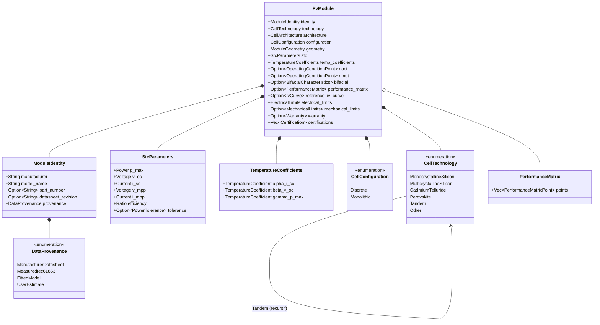
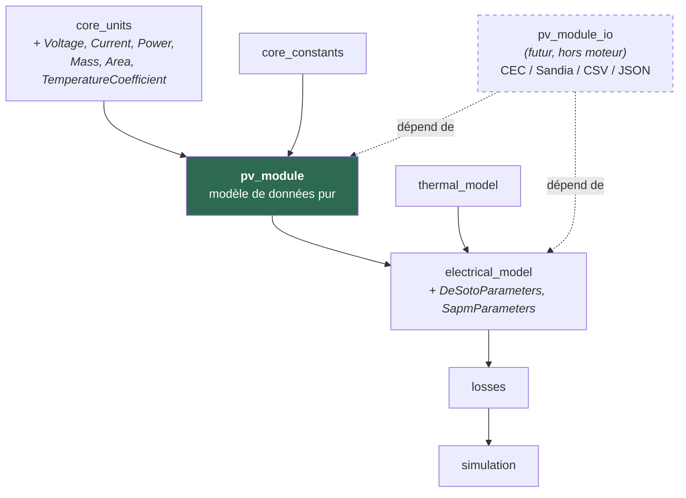
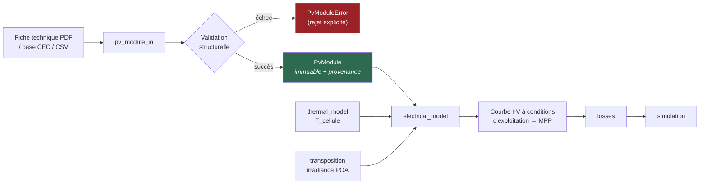

# 24. Revue d'architecture — `pv_module`

**Statut** : revue d'architecture, **aucune logique métier écrite**.
Complète et approfondit `docs/design/23-plan-pv-module.md` (plan général
déjà validé comme base de travail). Décisions structurantes consignées
dans `docs/adr/0004-pv-module-architecture.md`.

`pv_module` deviendra la fondation de tout le périmètre électrique de
HeliosPro (`electrical_model`, `losses`, puis `bifacial`, `shading`,
`tracking`). Une erreur d'architecture ici se propagerait à l'ensemble du
produit ; d'où le niveau de détail de cette revue avant toute ligne de
code.

---

## 0. Constats préalables — inspection du code existant

Trois faits établis par inspection directe du workspace (pas des
hypothèses), qui contraignent la conception :

### C-1. `core_units` ne couvre pas les grandeurs électriques

`engine/crates/core_units/src/lib.rs` expose exactement 7 types :
`Angle`, `Irradiance`, `Length`, `Pressure`, `Ratio`, `Temperature`,
`Velocity`. **Aucun type de tension, courant, puissance, masse ou
surface n'existe.** Or un module PV est décrit principalement par des
tensions (V), des courants (A), une puissance (W), une masse (kg) et une
surface (m²).

`pv_module` ne peut donc pas être écrit sans **étendre `core_units`**.
C'est un ajout strictement additif au sens de
`docs/design/19-politique-semver-api.md` §19.3.2 (nouveaux types, aucune
signature existante modifiée) — donc autorisé sur un crate gelé, mais
justifiant un incrément MINOR et un ADR (ADR-0004, §Décision 2).

### C-2. `Ratio` est borné à `[0, 1]` — inutilisable pour les coefficients thermiques

`core_units::Ratio::new` panique hors de `[0, 1]`
(`engine/crates/core_units/src/ratio.rs`). Or les coefficients de
température d'un module PV sont **négatifs** pour deux des trois
(β\_Voc et γ\_Pmax sont négatifs ; α\_Isc est positif ; ordres de
grandeur usuels de la littérature pour le silicium cristallin : α\_Isc
≈ +0.04 à +0.06 %/°C, β\_Voc ≈ −0.25 à −0.35 %/°C, γ\_Pmax ≈ −0.29 à
−0.40 %/°C — valeurs indicatives, à confirmer fiche par fiche).

`Ratio` est donc structurellement inadapté à ces champs. Un type dédié
signé est nécessaire (§2.6).

### C-3. `thermal_model` consomme le NOCT en `f64` nu

`thermal_model::noct::cell_temperature(ambient, poa_global, noct_celsius: f64)`
prend le NOCT comme `f64` brut, alors que c'est une température — un
écart mineur au principe « unités SI »
(`docs/scientific-principles.md` §7) hérité de la Phase 1.

**Conséquence pour cette revue** : `pv_module` stockera le NOCT comme
`Temperature` (typé, correct), et l'appelant fera `.celsius()` à la
frontière. Aucune modification de `thermal_model` n'est proposée ici —
le moteur solaire est gelé, et ce point ne relève pas du « bug
critique ». Il est enregistré comme dette (§9, DEBT-015 proposée) plutôt
que corrigé silencieusement.

---

## 1. Architecture interne

### 1.1 Responsabilité unique

> `pv_module` **représente** un module photovoltaïque tel que décrit par
> son fabricant ou par une mesure normalisée. Il ne **calcule** aucune
> performance.

Ce crate est un *modèle de domaine* typé, validé structurellement, et
traçable. Toute évaluation physique (courbe I-V à conditions
arbitraires, extraction de paramètres, MPP) appartient à
`electrical_model`. Cette séparation reproduit la discipline déjà en
vigueur : `core_constants` et `core_units` ne calculent rien non plus.

**Test de la frontière** : si une fonction a besoin d'une irradiance ou
d'une température *d'exploitation* en entrée, elle n'appartient pas à
`pv_module`. Les conditions STC/NOCT/NMOT stockées ici sont des
*conditions de mesure de référence*, pas des conditions d'exploitation.

### 1.2 Interfaces publiques

| Élément | Nature | Rôle |
|---|---|---|
| `PvModule` | struct (agrégat racine) | Le module complet, immuable une fois construit |
| `PvModuleBuilder` | struct | Construction incrémentale + validation à la finalisation |
| `ModuleIdentity` | struct | Fabricant, référence, version de fiche, provenance |
| `CellTechnology` | enum `#[non_exhaustive]` | Technologie de cellule (§6) |
| `CellArchitecture` | enum `#[non_exhaustive]` | PERC / TOPCon / HJT / IBC / monolithique |
| `ModuleGeometry` | struct | Dimensions, masse, surfaces |
| `CellConfiguration` | enum | Cellules discrètes (c-Si) vs monolithique (couches minces) |
| `StcParameters` | struct | Point STC complet |
| `OperatingConditionPoint` | struct | NOCT (IEC 61215) ou NMOT (IEC 61853-2) |
| `TemperatureCoefficients` | struct | α\_Isc, β\_Voc, γ\_Pmax |
| `BifacialCharacteristics` | struct | Facteur de bifacialité et grandeurs arrière |
| `PerformanceMatrix` | struct | Matrice IEC 61853-1 |
| `IvCurve`, `IvPoint` | structs | Courbe I-V mesurée (P-V dérivée, §2.11) |
| `ElectricalLimits` | struct | Tension système max, fusible, courant inverse |
| `MechanicalLimits` | struct | Charges avant/arrière, grêle |
| `Warranty` | struct | Garanties produit et performance |
| `Certification` | enum `#[non_exhaustive]` | Normes attestées |
| `DataProvenance` | enum | Origine et statut épistémique de chaque bloc (§1.5) |
| `PvModuleError` | enum | Erreurs de validation structurelle |

### 1.3 Interfaces internes

Aucune API `pub` n'est prévue au-delà de la liste ci-dessus. Les
helpers de validation (cohérence Voc > Vmpp, etc.) restent
`pub(crate)`. Conformément à
`docs/design/19-politique-semver-api.md` §19.6, ce crate n'exposera
**aucune API classée « interne »** au sens du gel : tout ce qui est
`pub` ici est destiné à un usage applicatif direct.

### 1.4 Dépendances

**Autorisées** :

| Dépendance | Justification |
|---|---|
| `core_units` | Tous les champs physiques sont typés (principe §7) |
| `core_constants` | Conditions de référence STC (1000 W/m², 25 °C, AM1.5) si elles y sont ajoutées |

**Interdites, et pourquoi** :

| Interdit | Raison |
|---|---|
| `electrical_model` | Dépendance inverse — c'est `electrical_model` qui consomme `pv_module` |
| `thermal_model` | Idem ; `pv_module` fournit le NOCT, il ne l'utilise pas |
| `solar_position`, `solar_geometry`, `irradiance`, `transposition` | Aucun rapport : un module PV existe indépendamment du soleil qui l'éclaire |
| `simulation` | Couche d'orchestration, strictement en aval |
| Toute crate externe (`serde`, `csv`, …) | ADR-0002 (zéro dépendance hors bibliothèque standard) |
| Tout I/O (`std::fs`, `std::net`) | Principe de déterminisme (§6) ; l'import de fichiers est externalisé (§4) |

`pv_module` est donc une **feuille** de l'arbre de dépendances, au même
niveau que `core_units` — exactement comme annoncé dans le plan §3.

### 1.5 Traçabilité de la donnée : `DataProvenance`

Décision structurante propre à cette revue. Un même champ (par exemple
`Pmax` à STC) peut provenir de sources d'autorité très différentes :

- une **fiche technique** fabricant (valeur nominale, avec tolérance) ;
- une **mesure** en laboratoire selon IEC 61853-1 (valeur mesurée,
  incertitude connue) ;
- un **ajustement de modèle** (base CEC : paramètres issus d'une
  régression, pas d'une mesure directe) ;
- une **estimation** de l'utilisateur.

Confondre ces quatre statuts dans un `f64` unique violerait le principe
de transparence (`docs/scientific-principles.md` §3). Chaque bloc de
données porte donc sa provenance :

```
DataProvenance {
    ManufacturerDatasheet { revision: Option<String>, date: Option<...> },
    MeasuredIec61853 { laboratory: Option<String>, ... },
    FittedModel { source: FittedModelSource },   // CEC, Sandia, ...
    UserEstimate { rationale: String },
}
```

Cela permettra plus tard à `electrical_model` de refuser — ou de signaler
— un calcul de rendement énergétique appuyé sur des valeurs estimées
présentées comme mesurées.

---

## 2. Modèle de données — justification champ par champ

Notation : `Option<T>` signifie **« absent est un état représentable »**,
jamais une valeur par défaut arbitraire (exigence du plan §5, critère 6).

### 2.1 `ModuleIdentity`

| Champ | Type | Justification |
|---|---|---|
| `manufacturer` | `String` | Traçabilité ; deux fabricants peuvent employer la même référence commerciale |
| `model_name` | `String` | Référence commerciale (ex. série + puissance) |
| `part_number` | `Option<String>` | Certaines bases (CEC) indexent par référence exacte, d'autres non |
| `datasheet_revision` | `Option<String>` | Une fiche technique est révisée ; deux révisions donnent des valeurs différentes pour la même référence |
| `provenance` | `DataProvenance` | §1.5 |

### 2.2 `CellTechnology` et `CellArchitecture`

Séparation délibérée en **deux** dimensions orthogonales, parce que la
matière du semi-conducteur et l'architecture de contact évoluent
indépendamment (un TOPCon et un PERC sont tous deux du silicium
monocristallin) :

```
CellTechnology  ::= MonocrystallineSilicon | MulticrystallineSilicon
                  | CadmiumTelluride | CopperIndiumGalliumSelenide
                  | AmorphousSilicon | Perovskite
                  | Tandem { top: Box<CellTechnology>, bottom: Box<CellTechnology> }
                  | Other { name: String }            // #[non_exhaustive]

CellArchitecture ::= Alu-BSF | PERC | TOPCon | HeterojunctionHJT
                   | InterdigitatedBackContact | MonolithicThinFilm
                   | Other { name: String }            // #[non_exhaustive]
```

Justification de `Tandem` récursif : une cellule tandem
pérovskite/silicium est littéralement l'empilement de deux technologies ;
la modéliser par une variante plate `PerovskiteSiliconTandem` obligerait
à ajouter une variante par combinaison future. La récursion couvre
l'espace entier sans modification ultérieure (exigence §6).

### 2.3 `CellConfiguration` — le point de divergence structurel c-Si / couche mince

C'est **la** difficulté architecturale de ce modèle. Un module
cristallin est un assemblage de cellules discrètes dénombrables ; un
module CdTe (First Solar) est une plaque monolithique gravée au laser en
bandes. « Nombre de cellules en série » n'a pas le même sens dans les
deux cas, et le modèle à diode unique n'utilise ce nombre que pour
calculer la tension thermique du module.

```
CellConfiguration ::=
    Discrete {
        cells_in_series: u32,          // requis par De Soto (tension thermique)
        cells_in_parallel: u32,        // 1 pour la quasi-totalité des modules
        cell_division: CellDivision,   // Full | Half | Third | Shingled
        substrings: u32,               // sections délimitées par diodes bypass
        bypass_diodes: u32,            // requis plus tard par le modèle d'ombrage
    }
  | Monolithic {
        series_segments: u32,          // bandes gravées en série
    }
```

`cell_division` est indispensable : un module « 144 demi-cellules » est
électriquement équivalent à 72 cellules pleines en série avec deux
demi-modules en parallèle. Stocker uniquement « 144 » sans dire qu'il
s'agit de demi-cellules conduirait `electrical_model` à calculer une
tension thermique fausse d'un facteur 2. **Ce champ n'est pas
décoratif : il est nécessaire à la justesse du calcul.**

### 2.4 `ModuleGeometry`

| Champ | Type | Justification |
|---|---|---|
| `length`, `width`, `depth` | `Length` | Calepinage, charge au vent, encombrement |
| `mass` | `Mass` (nouveau type) | Contrainte de charge de toiture ; logistique |
| `gross_area` | `Area` (nouveau type) | ~~Surface hors-tout = `length × width` — **stockée**, pas recalculée~~ — **position révisée**, voir l'encadré ci-dessous |
| `aperture_area` | `Option<Area>` | Surface active réelle ; base du rendement d'ouverture, distinct du rendement hors-tout |

> **Révision (ADR-0005, Décision 2)** : la position ci-dessus — stocker
> `gross_area` — a été **abandonnée** lors de la spécification détaillée.
> Stocker `length`, `width` *et* `gross_area` crée trois champs dont deux
> déterminent le troisième, rendant une incohérence représentable sans
> règle d'arbitrage — la situation « deux sources de vérité » que ce même
> document refuse pourtant pour la courbe P-V (§2.11). La position
> retenue est : `gross_area` **dérivé** de `length × width`, valeur
> affichée conservée séparément sous `stated_gross_area` pour recoupement
> uniquement. Même traitement pour `efficiency`. Voir
> `docs/design/25-specification-pv-module.md` §3.4.

Le rendement **n'est pas** stocké ici mais dans `StcParameters` (§2.5),
car il est défini à une condition de mesure donnée.

### 2.5 `StcParameters` — conditions STC (IEC 61215 / IEC 60904-3)

STC = 1000 W/m², température de cellule 25 °C, spectre AM1.5G.

| Champ | Type | Justification |
|---|---|---|
| `p_max` | `Power` (nouveau) | Puissance nominale — la grandeur commerciale de référence |
| `v_oc` | `Voltage` (nouveau) | Dimensionnement des chaînes (tension max à froid) |
| `i_sc` | `Current` (nouveau) | Dimensionnement des protections, courant inverse |
| `v_mpp` | `Voltage` | Plage MPPT de l'onduleur |
| `i_mpp` | `Current` | Idem |
| `efficiency` | `Ratio` | Borné [0,1] ✔ — `Ratio` convient ici |
| `power_tolerance` | `Option<PowerTolerance>` | Fiches modernes : « 0/+5 W ». Une tolérance asymétrique n'est pas représentable par un seul `f64` |

**Invariants validés à la construction** (structurels, pas physiques) :
`v_oc > v_mpp > 0`, `i_sc > i_mpp > 0`, et cohérence
`p_max ≈ v_mpp × i_mpp` à une tolérance documentée près (les fiches
arrondissent ; l'écart typique est de l'ordre du pourcent — un écart
supérieur signale une fiche mal saisie).

### 2.6 `TemperatureCoefficients` — et le type dédié qu'ils imposent

Constat C-2 : `Ratio` est inutilisable (signé). Deux représentations
coexistent dans l'industrie :

- **relative** : %/°C rapportée à la valeur STC (quasi universelle sur
  les fiches) ;
- **absolue** : A/°C pour α, V/°C pour β (utilisée par le modèle Sandia,
  et requise par De Soto).

Le modèle stocke la forme **relative** (celle qui est publiée) dans un
type dédié signé, et expose la conversion vers l'absolu, qui exige la
valeur STC correspondante :

```
TemperatureCoefficient(f64)   // fraction par kelvin, signée, non bornée
    ::from_percent_per_celsius(v) / ::from_per_kelvin(v)
    ::per_kelvin() / ::percent_per_celsius()

TemperatureCoefficients {
    alpha_i_sc: TemperatureCoefficient,   // > 0 attendu
    beta_v_oc:  TemperatureCoefficient,   // < 0 attendu
    gamma_p_max: TemperatureCoefficient,  // < 0 attendu
}
```

Les signes attendus sont **testés comme invariants avertisseurs**, pas
comme erreurs bloquantes : une technologie future pourrait légitimement
en différer, et rejeter la donnée serait une décision physique déguisée
en validation de format.

Note d'unité : %/°C et %/K ont la même valeur numérique (un coefficient
porte sur une *différence* de température) — le type documente les deux
sans conversion.

### 2.7 `OperatingConditionPoint` — NOCT **et** NMOT

Deux conditions normalisées distinctes coexistent :

- **NOCT** (IEC 61215) : 800 W/m², 20 °C ambiant, vent 1 m/s, circuit
  ouvert ;
- **NMOT** (IEC 61853-2) : condition analogue mais définie
  différemment ; les fiches récentes publient de plus en plus NMOT.

Les confondre introduirait une erreur systématique de température de
cellule. Le modèle stocke donc les deux séparément, chacun optionnel,
chacun accompagné de son point de fonctionnement mesuré :

```
OperatingConditionPoint {
    kind: NoctIec61215 | NmotIec61853_2,
    cell_temperature: Temperature,        // typé (constat C-3)
    p_max: Option<Power>,
    v_oc: Option<Voltage>, i_sc: Option<Current>,
    v_mpp: Option<Voltage>, i_mpp: Option<Current>,
}
```

### 2.8 `BifacialCharacteristics` (optionnel)

Absent ⇒ module monofacial. Présent ⇒ conforme à IEC TS 60904-1-2.

| Champ | Type | Justification |
|---|---|---|
| `bifaciality_factor` | `Ratio` | φ = rendement arrière / rendement avant ; borné [0,1] ✔ |
| `rear_p_max`, `rear_v_oc`, `rear_i_sc` | `Option<…>` | Certaines fiches donnent les grandeurs arrière explicitement plutôt que φ seul |
| `bifacial_gain_reference` | `Option<Ratio>` | Gain annoncé à un albédo de référence — valeur **commerciale**, à ne jamais utiliser en calcul (marquée comme telle) |

### 2.9 `PerformanceMatrix` — IEC 61853-1

Matrice de puissance mesurée à plusieurs couples (irradiance,
température). C'est le jeu de validation le plus riche pour
`electrical_model`, et le seul qui permette une extraction de paramètres
robuste plutôt qu'une extrapolation depuis le seul point STC.

```
PerformanceMatrix {
    points: Vec<PerformanceMatrixPoint>,
}
PerformanceMatrixPoint {
    irradiance: Irradiance,
    cell_temperature: Temperature,
    p_max: Power,
    v_mpp: Option<Voltage>, i_mpp: Option<Current>,
    v_oc: Option<Voltage>,  i_sc: Option<Current>,
}
```

Structure **liste de points**, pas tableau à dimensions fixes : la norme
ne requiert pas toutes les combinaisons du produit cartésien
(irradiances × températures), certaines cases étant physiquement
inatteignables. Une liste représente naturellement une matrice creuse ;
un tableau fixe forcerait des `Option` partout ou des valeurs
inventées.

> **À vérifier à l'implémentation** : le jeu exact des couples
> (irradiance, température) requis par IEC 61853-1 doit être lu dans le
> texte de la norme et non reproduit de mémoire, conformément au
> critère 1 de `docs/governance/scientific-review-process.md`.

### 2.10 `ElectricalLimits`

| Champ | Type | Justification |
|---|---|---|
| `max_system_voltage` | `Voltage` | Limite de sécurité IEC 61730 ; contraint la longueur maximale des chaînes |
| `max_series_fuse` | `Current` | Dimensionnement des protections (IEC 62548) |
| `max_reverse_current` | `Option<Current>` | Tenue au courant inverse en cas de défaut |
| `max_operating_temperature` / `min_` | `Option<Temperature>` | Plage de fonctionnement déclarée |

Ces champs seront consommés par le futur moteur de conformité
électrique (EF-017 de la matrice de traçabilité), pas par
`electrical_model`.

### 2.11 `IvCurve` — et pourquoi il n'y a pas de `PvCurve`

Une courbe I-V mesurée est stockée comme une suite de points
`(voltage, current)` avec leurs conditions de mesure.

**Décision : aucune structure `PvCurve` n'est définie.** La courbe P-V
est exactement `P(V) = V · I(V)` — une vue dérivée, pas une donnée
indépendante. La stocker séparément créerait deux sources de vérité
susceptibles de diverger. `electrical_model` exposera une *vue* P-V
calculée à la demande. C'est une application directe du principe de
priorité à la physique : on ne stocke pas ce qui se déduit.

### 2.12 `MechanicalLimits` et `Warranty`

| Champ | Type | Justification |
|---|---|---|
| `max_front_load`, `max_rear_load` | `Pressure` | Charges neige/vent (Pa) — `Pressure` existe déjà ✔ |
| `hail_impact_diameter` / `_velocity` | `Option<…>` | Essai grêle IEC 61215 |
| `product_warranty_years` | `u32` | Garantie produit |
| `performance_warranty_years` | `u32` | Garantie de performance |
| `first_year_degradation` | `Ratio` | Chute initiale (LID/LeTID), distincte de la pente annuelle |
| `annual_degradation` | `Ratio` | Pente linéaire garantie |
| `end_of_warranty_retention` | `Option<Ratio>` | Puissance résiduelle garantie en fin de période |

Les garanties ne sont **pas** des grandeurs physiques mesurées : elles
sont contractuelles. Elles sont conservées parce qu'elles alimenteront
`economic_analysis` (LCOE sur la durée de vie), avec une provenance
`ManufacturerDatasheet` qui empêche de les confondre avec une
dégradation mesurée.

---

## 3. Compatibilité fabricants

Objectif : **aucun constructeur ne doit nécessiter de modification de
l'architecture.** Analyse des familles structurellement distinctes plutôt
que d'une liste de références commerciales (qui changent chaque année).

| Fabricant | Famille technologique | Particularité structurelle | Couvert par |
|---|---|---|---|
| LONGi | c-Si mono, PERC → TOPCon | Demi-cellules, bifacial verre-verre fréquent | `Discrete{ cell_division: Half }` + `BifacialCharacteristics` |
| Jinko | c-Si mono, PERC → TOPCon | Idem | Idem |
| JA Solar | c-Si mono, PERC → TOPCon | Idem | Idem |
| Trina | c-Si mono, TOPCon | Idem ; grands formats | Idem (aucune limite de dimension imposée) |
| Canadian Solar | c-Si mono | Idem | Idem |
| Qcells | c-Si mono (PERC/TOPCon) | Idem | Idem |
| REC | c-Si **HJT** | Hétérojonction : coefficient thermique nettement meilleur | `CellArchitecture::HeterojunctionHJT` |
| SunPower / Maxeon | c-Si **IBC** | Contacts arrière interdigités ; garanties longues | `CellArchitecture::InterdigitatedBackContact` |
| **First Solar** | **CdTe couche mince** | **Pas de cellules discrètes** ; monolithique gravé | **`CellConfiguration::Monolithic`** (§2.3) |

**Le cas dimensionnant est First Solar.** Une architecture qui
supposerait « tout module a un nombre entier de cellules discrètes en
série » aurait exigé une refonte pour accueillir le CdTe. La variante
`Monolithic` est présente **dès la conception** précisément pour cette
raison — et non ajoutée après coup.

Deuxième cas dimensionnant : les modules bifaciaux verre-verre, qui
imposent que `BifacialCharacteristics` soit un bloc optionnel de premier
niveau et non un ajout tardif.

Les autres fabricants (« etc. » de la demande) relèvent des mêmes
familles ; un fabricant apportant une technologie réellement nouvelle
serait absorbé par les variantes `#[non_exhaustive]` `Other { name }` de
`CellTechnology` / `CellArchitecture`, sans changement d'architecture.

---

## 4. Compatibilité bases de données

### 4.1 Principe : l'import vit **hors** de `pv_module`

`pv_module` ne lit aucun fichier (§1.4). Les adaptateurs d'import vivront
dans un crate distinct — proposition : `pv_module_io` — qui **dépend de**
`pv_module` et le construit via `PvModuleBuilder`.

```
pv_module_io  ──dépend de──►  pv_module
   (parsers CEC / Sandia / PAN / CSV / JSON)      (modèle pur, zéro I/O)
```

Cette inversion garantit littéralement l'exigence « importer sans
modifier le modèle interne » : `pv_module` ignore jusqu'à l'existence des
formats. Ajouter un format = ajouter un module dans `pv_module_io`,
zéro ligne modifiée dans `pv_module`.

Bénéfice secondaire : les parsers pourront, si nécessaire, faire l'objet
d'un ADR dérogeant à la politique zéro-dépendance (un parseur JSON
robuste écrit à la main est coûteux) **sans contaminer le moteur
scientifique**, qui reste à zéro dépendance.

### 4.2 Condition de suffisance : le modèle doit être un sur-ensemble

Pour qu'aucun format n'exige de modification, le modèle interne doit
couvrir l'union sémantique des sources. Analyse :

| Source | Nature | Contenu | Absorbé par |
|---|---|---|---|
| **CEC** | Base publique (CSV) | STC + **paramètres De Soto ajustés** (courant photogénéré, courant de saturation, résistances série/shunt, facteur d'idéalité, ajustement) | STC → `StcParameters` ; paramètres ajustés → **hors `pv_module`** (§4.3) |
| **Sandia** | Base (SAND2004-3535) | STC + **coefficients SAPM** (polynômes masse d'air, angle d'incidence, C0…C7…) | Idem §4.3 |
| **PAN** | **Format propriétaire PVsyst** | Description complète de module | §4.4 — précaution |
| **IEC 61853** | Mesure normalisée | Matrice de performance | `PerformanceMatrix` ✔ |
| **CSV / JSON** | Formats génériques | Selon schéma | Tout le modèle ✔ |

### 4.3 Décision : les coefficients de modèle ajusté ne vont **pas** dans `pv_module`

Point d'architecture le plus délicat de cette revue.

Les paramètres De Soto (CEC) et SAPM (Sandia) ne sont **pas des
propriétés physiques du module** : ce sont les paramètres d'un *modèle
particulier*, obtenus par régression, et **non convertibles entre eux
sans perte**. Les stocker dans `pv_module` reviendrait à faire dépendre
la description d'un objet physique du choix d'un modèle de simulation.

**Décision** : `pv_module` décrit ce qui est mesurable ; les jeux de
coefficients ajustés vivent avec le modèle qui les interprète, dans
`electrical_model` (`DeSotoParameters`, `SapmParameters`).

Un import CEC produit donc un couple :

```
pv_module_io::cec::import(...) -> (PvModule, Option<DeSotoParameters>)
```

**Contrepartie assumée** (transparence, §3 des principes) : l'import
d'un enregistrement CEC touche deux crates au lieu d'un. C'est le prix
d'un découpage honnête ; l'alternative (tout mettre dans `pv_module`)
aurait rendu ce crate dépendant conceptuellement de chaque modèle
électrique futur. Alternative pesée et rejetée — voir ADR-0004,
Décision 4.

### 4.4 Précaution explicite sur le format PAN

`.PAN` est le format de PVsyst. **Il n'est pas, à notre connaissance, un
format ouvert publiquement spécifié.** Aucune implémentation ne sera
entreprise avant :

1. vérification du statut juridique du format et des conditions
   d'utilisation ;
2. un ADR dédié tranchant l'opportunité de le supporter.

Cette précaution est cohérente avec la règle fondatrice du projet
(aucun code ni interface copié de PVsyst / PV\*SOL / Archelios Calc) et
avec le traitement déjà réservé à ce point dans le plan §4.

### 4.5 Champs absents : `Option`, jamais valeur par défaut

Aucune source ne remplit tous les champs. Une base CEC ne contient ni
masse, ni garanties, ni charges mécaniques. La règle est absolue :
**champ absent ⇒ `None`**, jamais `0.0` ni une valeur « typique »
inventée. Un `0.0` silencieux se propagerait comme une donnée réelle
dans tout le moteur — exactement le type de défaut que le principe de
transparence existe pour empêcher.

---

## 5. Validation scientifique — champ ↔ définition ↔ unité ↔ mesure ↔ référence

| Champ | Définition physique | Unité SI | Méthode de mesure | Référence / norme |
|---|---|---|---|---|
| `p_max` (STC) | Puissance maximale du produit V·I sur la courbe I-V | W | Traçage I-V sous simulateur solaire | IEC 60904-1 (tracé), IEC 61215 (STC) |
| `v_oc` (STC) | Tension aux bornes à courant nul | V | Traçage I-V | IEC 60904-1 |
| `i_sc` (STC) | Courant à tension nulle | A | Traçage I-V | IEC 60904-1 |
| `v_mpp`, `i_mpp` | Coordonnées du point de puissance maximale | V, A | Traçage I-V | IEC 60904-1 |
| `efficiency` | P\_max / (surface × irradiance incidente) | — (sans dimension) | Calculée à partir de P\_max et de la surface | IEC 61215 |
| Conditions STC | 1000 W/m², T\_cellule 25 °C, spectre AM1.5G | W/m², K | Simulateur solaire classé | IEC 60904-3 (spectre), IEC 60904-1 |
| `alpha_i_sc` | Variation relative de I\_sc avec la température | K⁻¹ | Mesures à températures échelonnées | IEC 60891, IEC 61215 |
| `beta_v_oc` | Variation relative de V\_oc avec la température | K⁻¹ | Idem | IEC 60891, IEC 61215 |
| `gamma_p_max` | Variation relative de P\_max avec la température | K⁻¹ | Idem | IEC 60891, IEC 61215 |
| `noct` | Température de cellule à 800 W/m², 20 °C ambiant, vent 1 m/s, circuit ouvert | K | Essai en extérieur normalisé | IEC 61215 |
| `nmot` | Température de module en conditions nominales de fonctionnement | K | Essai normalisé | IEC 61853-2 |
| `PerformanceMatrix` | P\_max mesurée sur une grille (irradiance × température) | W, W/m², K | Traçages I-V répétés en conditions contrôlées | IEC 61853-1 |
| `bifaciality_factor` | Rapport du rendement arrière au rendement avant | — | Mesure des deux faces | IEC TS 60904-1-2 |
| `cells_in_series` | Nombre de jonctions en série | — (entier) | Comptage / spécification constructeur | Requis par De Soto et al. (2006) |
| `max_system_voltage` | Tension système maximale admissible | V | Qualification sécurité | IEC 61730-1/2 |
| `max_series_fuse` | Calibre maximal de protection en série | A | Spécification constructeur | IEC 61730, IEC 62548 |
| `max_front_load` / `_rear_load` | Charge mécanique surfacique admissible | Pa | Essai de charge mécanique | IEC 61215 |
| `mass` | Masse du module | kg | Pesée | — (donnée constructeur) |
| `length`, `width`, `depth` | Dimensions hors-tout | m | Métrologie dimensionnelle | — (donnée constructeur) |
| Garanties | Engagement contractuel de performance résiduelle | — / années | **Non mesuré** — contractuel | Aucune (marqué `ManufacturerDatasheet`) |

> Les numéros de norme ci-dessus (IEC 60891, 60904-1, 60904-3, 61215,
> 61730, 61853-1/2, TS 60904-1-2, 62548) devront être **vérifiés dans le
> texte des normes** au moment de l'implémentation (critères 1 et 2 de
> `docs/governance/scientific-review-process.md`). Ils sont ici le
> résultat d'une revue documentaire préalable, pas d'une consultation du
> texte normatif intégral — distinction consignée conformément au
> principe de transparence.

---

## 6. Extensibilité

Mécanisme unique et systématique : **`#[non_exhaustive]` + variante
`Other { name: String }`** sur les énumérations de classification, et
**blocs `Option<…>` de premier niveau** pour les caractéristiques
facultatives.

| Extension future | Absorbée par | Modification d'architecture requise |
|---|---|---|
| **TOPCon** | `CellArchitecture::TOPCon` (prévu dès l'origine) | Aucune |
| **HJT** | `CellArchitecture::HeterojunctionHJT` | Aucune |
| **IBC** | `CellArchitecture::InterdigitatedBackContact` | Aucune |
| **Pérovskites** | `CellTechnology::Perovskite` | Aucune |
| **Tandem** | `CellTechnology::Tandem { top, bottom }` (récursif, §2.2) | Aucune |
| **Bifacial** | `BifacialCharacteristics` optionnel (§2.8) | Aucune |
| **Flexible** | Champ `mounting_form: Rigid \| Flexible` + `min_bend_radius: Option<Length>` | Ajout d'un champ optionnel |
| **Flottant** | Aucun champ propre au module ; les spécificités (corrosion, humidité, refroidissement par l'eau) relèvent de `losses` et `thermal_model`, pas de la fiche technique | Aucune |
| **Agrivoltaïque** | Idem : la transmission lumineuse au sol est une propriété de **l'installation**, pas du module ; sauf pour les modules semi-transparents, couverts par `light_transmittance: Option<Ratio>` | Ajout d'un champ optionnel |

**Point d'honnêteté** : « flottant » et « agrivoltaïque » ne sont pas des
propriétés d'un module PV mais des **contextes d'installation**. Les
inscrire dans `pv_module` serait une erreur de modélisation. Ils sont
listés ici pour établir explicitement qu'ils ont été considérés et
délibérément placés ailleurs — pas oubliés.

`#[non_exhaustive]` sur ces énumérations est une **inflexion assumée** par
rapport à `docs/design/19-politique-semver-api.md` §19.4, qui constatait
qu'aucun type du workspace ne l'était. La justification est spécifique :
la liste des technologies de cellules **changera certainement** (la
tandem pérovskite/silicium est en industrialisation), et sans
`#[non_exhaustive]` chaque nouvelle technologie serait un changement
cassant pour tout code appelant faisant un `match` exhaustif. Voir
ADR-0004, Décision 3.

---

## 7. Diagrammes

### 7.1 Diagramme de classes (UML)



### 7.2 Diagramme de dépendances



Les flèches vont **du fournisseur vers le consommateur**. `pv_module`
n'a aucune flèche entrante depuis un crate de calcul : c'est la
propriété qui garantit qu'il reste une feuille.

### 7.3 Diagramme de flux — de la fiche technique au calcul



Lecture : `pv_module` est **inerte** dans ce flux — il ne transforme
rien, il porte une donnée validée et traçable. Toute la physique se
produit à droite de `PvModule`.

---

## 8. Ce que cette revue ne tranche pas

Points explicitement laissés ouverts, à trancher avant ou pendant
l'implémentation :

1. **Nom du crate d'import** (`pv_module_io` proposé) et sa politique de
   dépendances — ADR dédié au moment de sa création.
2. **Support du format PAN** — §4.4, ADR dédié, après vérification
   juridique.
3. **Jeu exact des points IEC 61853-1** — §2.9, lecture de la norme
   requise.
4. **Représentation des certifications** — liste d'énumérations ou texte
   libre ; dépend de l'usage qu'en fera le futur moteur de conformité
   (EF-017).
5. **Identité et déduplication** — deux fiches du même module de deux
   sources différentes : politique de fusion non définie ici.

---

## 9. Dette scientifique proposée

Une entrée à ajouter à `docs/scientific-debt-register.md` **au moment de
l'implémentation** (pas avant : le registre consigne l'existant, pas les
intentions) :

- **DEBT-015 (proposée)** — `thermal_model::noct::cell_temperature`
  accepte le NOCT en `f64` nu plutôt qu'en `Temperature`, écart mineur au
  principe « unités SI ». Constat C-3. Non corrigé : le moteur solaire
  est gelé et ce point ne constitue pas un bug critique.

---

## 10. Critères de sortie de la revue

Cette revue est complète lorsque les huit points demandés sont traités :

| # | Demande | Section |
|---|---|---|
| 1 | Architecture interne (responsabilités, interfaces, dépendances) | §1 |
| 2 | Modèle de données justifié champ par champ | §2 |
| 3 | Compatibilité fabricants | §3 |
| 4 | Compatibilité bases de données | §4 |
| 5 | Validation scientifique (définition, unité, mesure, référence, norme) | §5 |
| 6 | Extensibilité | §6 |
| 7 | Diagrammes UML / dépendances / flux | §7 |
| 8 | ADR | `docs/adr/0004-pv-module-architecture.md` |

**Aucune logique métier n'a été écrite.** `engine/crates/pv_module/`
reste le squelette documenté livré en Phase 1, inchangé.

L'implémentation ne commencera qu'après validation explicite de cette
revue.
