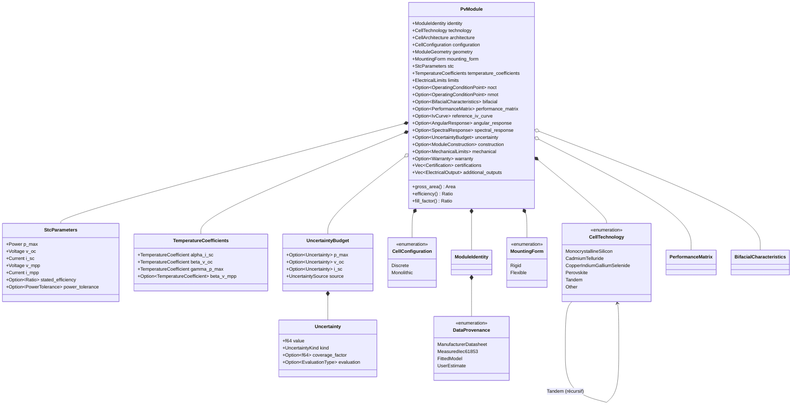
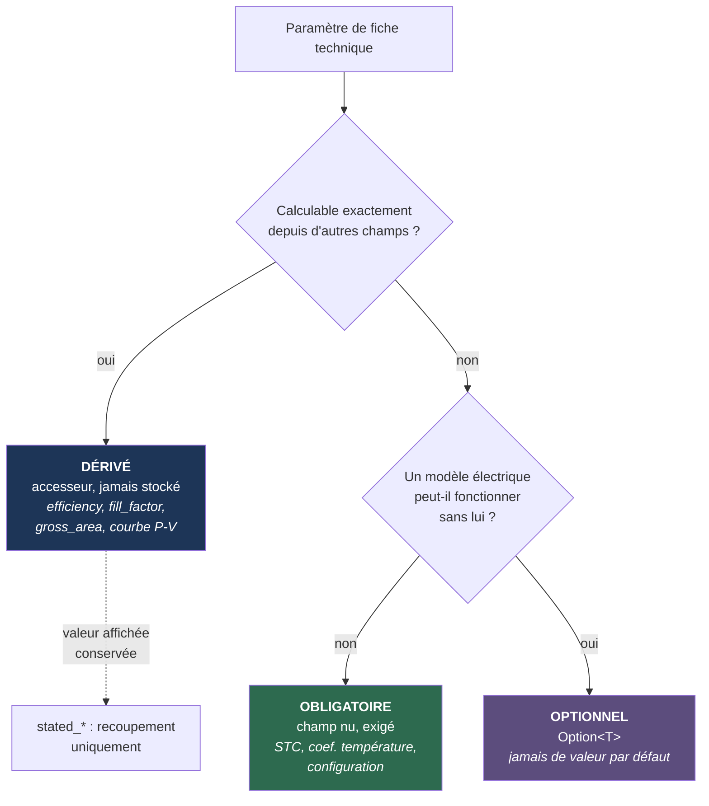
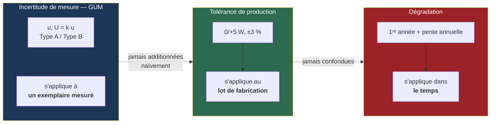

# 25. Spécification scientifique complète — `pv_module`

**Statut** : spécification d'architecture, **destinée à rendre
l'implémentation réalisable sans ambiguïté**. Aucun code Rust, aucune
logique métier, aucun calcul.

**Position dans la série** :

| Document | Rôle |
|---|---|
| `23-plan-pv-module.md` | Plan général (validé comme base) |
| `24-revue-architecture-pv-module.md` | Revue d'architecture (périmètre, dépendances, décisions structurantes) |
| **`25-specification-pv-module.md`** (ce document) | **Spécification détaillée : inventaire exhaustif, taxonomie, incertitudes, tableau des champs** |
| `docs/adr/0004-…` | ADR architecture |
| `docs/adr/0005-…` | ADR modèle de données et incertitudes |

**Objectif déclaré** : représenter n'importe quel module PV commercial
des 30 prochaines années sans modification d'architecture. Le §12
énonce honnêtement ce qui *forcerait* malgré tout une modification —
sans cette section, l'objectif ne serait pas vérifiable.

---

## 1. Analyse des fiches techniques de fabricants majeurs

### 1.1 Méthode et limite de cette analyse

Cette section décrit la **structure** des fiches techniques telle
qu'elle est standardisée dans l'industrie, pas les valeurs numériques
d'un modèle particulier. Deux raisons :

1. Les valeurs changent à chaque révision de fiche et à chaque nouvelle
   série commerciale ; les figer dans un document d'architecture serait
   périmé en un an.
2. Cet environnement de développement n'a pas d'accès réseau aux
   fiches PDF des fabricants. Reproduire des valeurs de mémoire violerait
   le principe de transparence (`docs/scientific-principles.md` §3).

**Ce qui est affirmé ici** : la liste des *rubriques* et des *grandeurs*
que ces fiches contiennent, qui est remarquablement stable d'un fabricant
à l'autre parce qu'elle est dictée par les normes IEC 61215 / 61730 et
par les besoins de dimensionnement électrique.

**Ce qui devra être fait à l'implémentation** : télécharger au moins cinq
fiches techniques réelles couvrant des familles distinctes, et vérifier
champ par champ que le modèle les absorbe sans perte — critère 3 de
`docs/governance/scientific-review-process.md` (jeux de validation).

### 1.2 Structure canonique d'une fiche technique

Les neuf rubriques ci-dessous se retrouvent, sous des intitulés variables,
chez la quasi-totalité des fabricants :

| # | Rubrique | Contenu |
|---|---|---|
| A | Caractéristiques électriques à STC | Pmax, Voc, Isc, Vmpp, Impp, rendement, tolérance de puissance |
| B | Caractéristiques électriques à NMOT / NOCT | Les mêmes grandeurs, à la condition nominale de fonctionnement |
| C | Coefficients de température | α(Isc), β(Voc), γ(Pmax) — parfois aussi sur Vmpp |
| D | Caractéristiques mécaniques | Type et nombre de cellules, dimensions, masse, verre, cadre, boîte de jonction, câbles, connecteurs |
| E | Valeurs limites (*maximum ratings*) | Plage de température, tension système max, calibre de fusible, charges mécaniques, grêle, classes feu et sécurité |
| F | Données bifaciales (si applicable) | Facteur de bifacialité, gains à divers albédos, données à irradiance arrière |
| G | Garanties | Garantie produit, garantie de performance, dégradation 1ʳᵉ année et annuelle, puissance résiduelle |
| H | Certifications | Normes IEC attestées, certifications ISO du fabricant |
| I | Conditionnement | Quantités par palette / conteneur — **hors périmètre** (logistique, pas physique) |

### 1.3 Familles structurellement distinctes

Ce qui compte pour l'architecture n'est pas le nom du fabricant mais la
**famille structurelle**, car seules quatre divergences réelles existent :

| Divergence | Familles concernées | Impact architectural |
|---|---|---|
| **Cellules discrètes vs monolithique** | c-Si (tous) vs CdTe, CIGS | `CellConfiguration` à deux variantes (§4.4) — divergence majeure |
| **Monofacial vs bifacial** | Verre-verre modernes | Bloc `BifacialCharacteristics` optionnel |
| **Rigide vs flexible** | CIGS souple, a-Si souple | `MountingForm`, limites mécaniques différentes |
| **Deux bornes vs quatre bornes** | Tandems 4-terminaux (recherche) | `additional_outputs` (§4.9) — anticipation |

| Fabricant | Famille | Divergence structurelle activée |
|---|---|---|
| LONGi, Jinko, JA Solar, Trina, Canadian Solar, Qcells | c-Si mono, PERC → TOPCon | Discrètes, demi-cellules, souvent bifacial |
| REC | c-Si HJT | Discrètes ; `CellArchitecture::HeterojunctionHJT` |
| SunPower / Maxeon | c-Si IBC | Discrètes ; `CellArchitecture::InterdigitatedBackContact` |
| **First Solar** | **CdTe** | **Monolithique** — le cas dimensionnant |
| Avancis, Solibro, fabricants CIGS souples | CIGS | Monolithique **et** parfois flexible |

---

## 2. Inventaire exhaustif des paramètres de fiche technique

Chaque ligne indique le nom retenu dans le modèle, la rubrique de la
fiche dont elle provient, et sa nature. La colonne « Nature » utilise la
taxonomie du §3.

### 2.A Électrique à STC

| Paramètre fiche | Nom modèle | Nature |
|---|---|---|
| Maximum Power / Pmax / Pnom | `stc.p_max` | Obligatoire |
| Open Circuit Voltage / Voc | `stc.v_oc` | Obligatoire |
| Short Circuit Current / Isc | `stc.i_sc` | Obligatoire |
| Voltage at Pmax / Vmp / Vmpp | `stc.v_mpp` | Obligatoire |
| Current at Pmax / Imp / Impp | `stc.i_mpp` | Obligatoire |
| Module Efficiency | `stc.stated_efficiency` | **Dérivé** (valeur affichée conservée pour recoupement) |
| Power Tolerance (0/+5 W, ±3 %) | `stc.power_tolerance` | Optionnel |
| Fill Factor | — | **Dérivé** (`Pmax / (Voc·Isc)`) |

### 2.B Électrique à NMOT / NOCT

| Paramètre fiche | Nom modèle | Nature |
|---|---|---|
| NOCT (IEC 61215) | `noct.cell_temperature` | Optionnel |
| NMOT (IEC 61853-2) | `nmot.cell_temperature` | Optionnel |
| Pmax, Voc, Isc, Vmpp, Impp à NMOT/NOCT | `noct.*` / `nmot.*` | Optionnel |

> NOCT et NMOT sont **deux conditions normalisées distinctes** et ne sont
> jamais confondues dans le modèle (§4.6). Les traiter comme
> interchangeables introduirait une erreur systématique de température de
> cellule.

### 2.C Coefficients de température

| Paramètre fiche | Nom modèle | Nature |
|---|---|---|
| Temperature Coefficient of Isc (α) | `temperature_coefficients.alpha_i_sc` | Obligatoire |
| Temperature Coefficient of Voc (β) | `temperature_coefficients.beta_v_oc` | Obligatoire |
| Temperature Coefficient of Pmax (γ) | `temperature_coefficients.gamma_p_max` | Obligatoire |
| Temperature Coefficient of Vmpp | `temperature_coefficients.beta_v_mpp` | Optionnel (publié par une minorité) |

### 2.D Mécanique et construction

| Paramètre fiche | Nom modèle | Nature |
|---|---|---|
| Cell Type / Technology | `technology` + `architecture` | Obligatoire |
| Number of Cells (ex. « 144 demi-cellules ») | `configuration` | Obligatoire |
| Dimensions (L × l × ép.) | `geometry.length/width/depth` | Obligatoire (L, l) / Optionnel (ép.) |
| Weight | `geometry.mass` | Optionnel |
| Front Glass (épaisseur, traitement) | `construction.front_cover` | Optionnel |
| Frame (matériau) | `construction.frame` | Optionnel |
| Junction Box (indice IP) | `construction.junction_box` | Optionnel |
| Cable (longueur, section) | `construction.cable` | Optionnel |
| Connector (type) | `construction.connector` | Optionnel |
| Backsheet / verre arrière | `construction.rear_cover` | Optionnel |
| Encapsulant (EVA / POE) | `construction.encapsulant` | Optionnel |
| Bypass diodes (nombre) | `configuration.bypass_diodes` | Optionnel |

### 2.E Valeurs limites

| Paramètre fiche | Nom modèle | Nature |
|---|---|---|
| Operating Temperature Range | `limits.min/max_operating_temperature` | Optionnel |
| Maximum System Voltage | `limits.max_system_voltage` | Obligatoire |
| Max Series Fuse Rating | `limits.max_series_fuse` | Optionnel |
| Maximum Reverse Current | `limits.max_reverse_current` | Optionnel |
| Static Load, front / rear | `mechanical.max_front/rear_load` | Optionnel |
| Hail impact (Ø @ vitesse) | `mechanical.hail_impact` | Optionnel |
| Fire Rating / Class | `certifications` | Optionnel |
| Safety Class | `certifications` | Optionnel |

### 2.F Bifacial

| Paramètre fiche | Nom modèle | Nature |
|---|---|---|
| Bifaciality Factor (φ) | `bifacial.bifaciality_factor` | Optionnel (bloc entier) |
| Rear Pmax / Voc / Isc | `bifacial.rear_*` | Optionnel |
| Bifacial gain @ albédo donné | `bifacial.stated_gain` | Optionnel, **valeur commerciale** (§8.5) |

### 2.G Garanties

| Paramètre fiche | Nom modèle | Nature |
|---|---|---|
| Product Warranty | `warranty.product_years` | Optionnel |
| Performance Warranty | `warranty.performance_years` | Optionnel |
| First Year Degradation | `warranty.first_year_degradation` | Optionnel |
| Annual Degradation | `warranty.annual_degradation` | Optionnel |
| End-of-warranty retention | `warranty.end_retention` | Optionnel |

### 2.H Certifications

| Paramètre fiche | Nom modèle | Nature |
|---|---|---|
| IEC 61215, 61730, 61701, 62716… | `certifications: Vec<Certification>` | Optionnel |

### 2.I Données absentes des fiches mais issues d'essais normalisés

Ces grandeurs ne figurent pas sur une fiche commerciale mais existent
dans les rapports d'essai ou les bases de données. Le modèle doit les
accueillir **dès maintenant**, sinon leur ajout ultérieur serait une
modification d'architecture :

| Grandeur | Nom modèle | Source |
|---|---|---|
| Matrice de performance (G × T) | `performance_matrix` | IEC 61853-1 |
| Courbe I-V mesurée | `reference_iv_curve` | IEC 60904-1 |
| Réponse angulaire (IAM) | `angular_response` | IEC 61853-2 |
| Réponse spectrale | `spectral_response` | IEC 61853-3, IEC 60904-8 |
| Budget d'incertitude | `uncertainty` | JCGM 100:2008 (GUM) |

---

## 3. Taxonomie : obligatoire / optionnel / dérivé

### 3.1 Les trois catégories et leur règle d'appartenance

| Catégorie | Règle | Conséquence en Rust |
|---|---|---|
| **Obligatoire** | Sans ce champ, aucun modèle électrique ne peut produire de résultat, ou l'objet ne peut pas être identifié | Champ non-`Option`, exigé par le constructeur |
| **Optionnel** | Absent de certaines sources ; son absence dégrade la précision ou interdit certains modèles, mais pas tous | `Option<T>` — **jamais** une valeur par défaut |
| **Dérivé** | Calculable exactement à partir de champs obligatoires | **Non stocké** comme valeur autoritaire ; exposé par un accesseur |

### 3.2 Le noyau obligatoire (« module minimal viable »)

Un `PvModule` ne peut pas être construit sans :

1. `identity.manufacturer`, `identity.model_name` — sans quoi l'objet
   n'est pas identifiable ni traçable ;
2. `technology`, `architecture`, `configuration` — sans quoi le
   comportement physique est indéterminé (une cellule CdTe et une
   cellule c-Si ne se comportent pas de même) ;
3. `geometry.length`, `geometry.width` — sans quoi le rendement et la
   densité de puissance sont incalculables ;
4. `stc` : les cinq grandeurs `p_max`, `v_oc`, `i_sc`, `v_mpp`, `i_mpp` —
   c'est l'entrée minimale de l'extraction de paramètres De Soto ;
5. `temperature_coefficients` : α, β, γ — sans eux, aucune extrapolation
   hors des 25 °C de référence n'est possible, ce qui rend le module
   inutilisable en simulation horaire ;
6. `limits.max_system_voltage` — sans quoi aucun dimensionnement de
   chaîne conforme n'est possible.

**Justification du caractère obligatoire de γ(Pmax)** : De Soto n'en a
pas strictement besoin (il dérive la dépendance en température de Pmax
depuis les autres paramètres), mais le modèle SAPM et les modèles
simplifiés l'exigent, et **toutes** les fiches techniques le publient.
L'exiger coûte donc zéro en couverture et garantit qu'aucun modèle
électrique futur ne sera bloqué.

### 3.3 Les dérivés — et pourquoi ils ne sont pas stockés

| Dérivé | Formule | Pourquoi ne pas le stocker |
|---|---|---|
| `gross_area` | `length × width` | Deux sources de vérité divergentes sinon (§3.4) |
| `efficiency` | `p_max / (gross_area × 1000 W/m²)` | Idem ; la valeur affichée est arrondie |
| `fill_factor` | `p_max / (v_oc × i_sc)` | Indicateur de qualité, jamais une donnée d'entrée |
| Coefficients absolus α, β | `coef_relatif × valeur_STC` | Conversion pure, dépend d'un champ déjà présent |
| Courbe P-V | `P(V) = V · I(V)` | Vue de la courbe I-V, pas une donnée indépendante |
| Densité de puissance | `p_max / gross_area` | Indicateur commercial |

### 3.4 Révision d'une position du document 24

Le document 24 §2.4 proposait de **stocker** `gross_area` « parce que
certaines fiches donnent une surface qui n'est pas exactement le produit
L × l ».

**Cette position est révisée ici.** Stocker à la fois `length`, `width`
et `gross_area` crée trois champs dont deux déterminent le troisième :
une incohérence devient représentable, et le moteur n'aurait aucune règle
pour trancher. La solution correcte est :

- `gross_area` **dérivé** de `length × width` — valeur autoritaire ;
- `stated_gross_area: Option<Area>` — la valeur affichée sur la fiche,
  conservée **uniquement pour recoupement** ;
- un contrôle de cohérence à la construction qui signale un écart
  supérieur à un seuil documenté (typiquement quelques pour mille dus aux
  arrondis) comme un défaut de saisie.

Le même raisonnement s'applique à `efficiency`, traité identiquement.
Cette révision est consignée dans ADR-0005, Décision 2.

---

## 4. Structures de données internes

Notation : pseudo-code descriptif, **pas du Rust compilable**.

### 4.1 Racine

```
PvModule {
    identity:                ModuleIdentity,            // obligatoire
    technology:              CellTechnology,            // obligatoire
    architecture:            CellArchitecture,          // obligatoire
    configuration:           CellConfiguration,         // obligatoire
    geometry:                ModuleGeometry,            // obligatoire
    mounting_form:           MountingForm,              // obligatoire (défaut Rigid)
    stc:                     StcParameters,             // obligatoire
    temperature_coefficients:TemperatureCoefficients,   // obligatoire
    limits:                  ElectricalLimits,          // obligatoire (partiellement)

    noct:                    Option<OperatingConditionPoint>,
    nmot:                    Option<OperatingConditionPoint>,
    bifacial:                Option<BifacialCharacteristics>,
    performance_matrix:      Option<PerformanceMatrix>,
    reference_iv_curve:      Option<IvCurve>,
    angular_response:        Option<AngularResponse>,
    spectral_response:       Option<SpectralResponse>,
    uncertainty:             Option<UncertaintyBudget>,
    construction:            Option<ModuleConstruction>,
    mechanical:              Option<MechanicalLimits>,
    warranty:                Option<Warranty>,
    certifications:          Vec<Certification>,        // vide ≠ absent : « aucune déclarée »
    additional_outputs:      Vec<ElectricalOutput>,     // vide pour ~100 % des modules (§4.9)
}
```

### 4.2 `ModuleIdentity` et provenance

```
ModuleIdentity {
    manufacturer:        String,
    model_name:          String,
    part_number:         Option<String>,
    datasheet_revision:  Option<String>,
    provenance:          DataProvenance,
}

DataProvenance =
    | ManufacturerDatasheet { revision: Option<String> }
    | MeasuredIec61853     { laboratory: Option<String>, report_id: Option<String> }
    | FittedModel          { source: FittedModelSource }   // Cec | Sandia | Other
    | UserEstimate         { rationale: String }           // justification exigée
```

`UserEstimate` **exige** une justification textuelle : une estimation sans
motif consigné est précisément ce que le principe de transparence
interdit.

### 4.3 Technologie et architecture

```
CellTechnology =                                   // #[non_exhaustive]
    | MonocrystallineSilicon | MulticrystallineSilicon
    | CadmiumTelluride | CopperIndiumGalliumSelenide | AmorphousSilicon
    | Perovskite
    | Tandem { top: Box<CellTechnology>, bottom: Box<CellTechnology> }
    | Other { name: String }

CellArchitecture =                                 // #[non_exhaustive]
    | AluminiumBackSurfaceField | PERC | TOPCon
    | HeterojunctionHJT | InterdigitatedBackContact
    | MonolithicThinFilm
    | Other { name: String }
```

Deux dimensions **orthogonales** : la matière (`CellTechnology`) et
l'architecture de contact (`CellArchitecture`). Un PERC et un TOPCon sont
tous deux du silicium monocristallin ; les fusionner en une énumération
unique produirait un produit cartésien de variantes ingérable.

### 4.4 Configuration cellulaire — la divergence majeure

```
CellConfiguration =
    | Discrete {
          cells_in_series:  u32,           // requis : tension thermique du modèle à diode
          cells_in_parallel: u32,          // 1 pour la quasi-totalité
          cell_division:    CellDivision,  // Full | Half | Third | Shingled
          substrings:       Option<u32>,   // sections délimitées par diodes bypass
          bypass_diodes:    Option<u32>,   // requis par le futur modèle d'ombrage
      }
    | Monolithic {
          series_segments:  u32,           // bandes gravées en série
      }

CellDivision = Full | Half | Third | Shingled | Other { divisor: u32 }
```

`cell_division` **n'est pas décoratif** : un module annoncé
« 144 demi-cellules » est électriquement équivalent à 72 cellules pleines
en série, avec deux demi-modules en parallèle. Ignorer cette information
conduirait `electrical_model` à calculer une tension thermique fausse
d'un facteur ≈ 2 — une erreur de modèle silencieuse et grossière.

### 4.5 Géométrie et forme

```
ModuleGeometry {
    length:              Length,           // obligatoire
    width:               Length,           // obligatoire
    depth:               Option<Length>,
    mass:                Option<Mass>,
    aperture_area:       Option<Area>,     // non dérivable : dépend du calepinage cellulaire
    stated_gross_area:   Option<Area>,     // recoupement seulement (§3.4)
}
// gross_area() : dérivé = length × width

MountingForm =
    | Rigid    { frame: Option<FrameSpec> }
    | Flexible { min_bend_radius: Option<Length> }
```

### 4.6 Points de fonctionnement

```
StcParameters {                            // 1000 W/m², 25 °C cellule, AM1.5G
    p_max: Power, v_oc: Voltage, i_sc: Current,
    v_mpp: Voltage, i_mpp: Current,
    stated_efficiency: Option<Ratio>,      // recoupement (§3.4)
    power_tolerance:   Option<PowerTolerance>,
}

PowerTolerance =
    | Symmetric  { relative: Ratio }              // ±3 %
    | Asymmetric { minimum: Power, maximum: Power } // 0/+5 W
```

Une tolérance asymétrique **ne se représente pas** par un scalaire ; les
fiches modernes utilisent presque exclusivement la forme `0/+5 W`. Le
type à deux variantes est donc nécessaire, pas un raffinement.

```
OperatingConditionPoint {
    kind: NoctIec61215 | NmotIec61853_2,
    cell_temperature: Temperature,         // typé (cf. constat C-3 du doc 24)
    p_max: Option<Power>, v_oc: Option<Voltage>, i_sc: Option<Current>,
    v_mpp: Option<Voltage>, i_mpp: Option<Current>,
}
```

### 4.7 Coefficients de température

```
TemperatureCoefficients {
    alpha_i_sc:   TemperatureCoefficient,  // > 0 attendu
    beta_v_oc:    TemperatureCoefficient,  // < 0 attendu
    gamma_p_max:  TemperatureCoefficient,  // < 0 attendu
    beta_v_mpp:   Option<TemperatureCoefficient>,
}
```

`TemperatureCoefficient` est un **type dédié signé et non borné**
(K⁻¹). `core_units::Ratio` est borné `[0, 1]` et ne peut donc pas
porter β ni γ, qui sont négatifs (constat C-2 du document 24).

Les signes attendus sont vérifiés comme **avertissements**, pas comme
erreurs bloquantes : une technologie future pourrait légitimement en
différer, et rejeter la donnée serait une décision physique déguisée en
validation de format.

### 4.8 Blocs optionnels de caractérisation

```
BifacialCharacteristics {
    bifaciality_factor: Ratio,                  // φ ∈ [0,1] — Ratio convient
    rear_p_max: Option<Power>,
    rear_v_oc:  Option<Voltage>,
    rear_i_sc:  Option<Current>,
    stated_gain: Option<StatedBifacialGain>,    // valeur commerciale, marquée (§8.5)
}

PerformanceMatrix { points: Vec<PerformanceMatrixPoint> }   // liste creuse, pas tableau fixe
PerformanceMatrixPoint {
    irradiance: Irradiance, cell_temperature: Temperature,
    p_max: Power,
    v_mpp: Option<Voltage>, i_mpp: Option<Current>,
    v_oc:  Option<Voltage>, i_sc:  Option<Current>,
}

IvCurve {
    points: Vec<IvPoint>,                       // (Voltage, Current)
    irradiance: Irradiance, cell_temperature: Temperature,
}

AngularResponse =
    | AshraeB0 { b0: f64 }                      // IAM = 1 − b0·(1/cos θ − 1)
    | MeasuredTable { points: Vec<(Angle, Ratio)> }

SpectralResponse {
    points: Vec<(Wavelength, SpectralResponsivity)>,
}
```

`PerformanceMatrix` est une **liste de points**, pas un tableau à
dimensions fixes : IEC 61853-1 ne requiert pas toutes les combinaisons du
produit cartésien (irradiance × température), certaines cases étant
physiquement inatteignables. Un tableau fixe imposerait des `Option`
partout ou des valeurs inventées.

### 4.9 Sorties électriques additionnelles — anticipation des tandems 4-terminaux

```
ElectricalOutput {
    label: String,                    // « top cell », « bottom cell »
    stc: StcParameters,
    temperature_coefficients: TemperatureCoefficients,
}
```

Un tandem **2-terminaux** (empilement monolithique) présente une seule
paire (Voc, Isc) : il est couvert par le champ `stc` normal. Un tandem
**4-terminaux** (empilement mécanique) présente **deux sorties
électriques indépendantes**, chacune avec sa propre courbe I-V.

Une architecture supposant « un module = un couple (Voc, Isc) » ne
pourrait pas représenter ce cas et exigerait une refonte. `additional_outputs`
est vide pour l'intégralité des modules commerciaux actuels ; il coûte un
`Vec` vide et supprime un risque de refonte à dix ans. C'est
précisément le type d'anticipation qu'exige l'objectif « 30 ans ».

---

## 5. Gestion des dix technologies

| Technologie | `CellTechnology` | `CellArchitecture` | `CellConfiguration` | Particularité à modéliser |
|---|---|---|---|---|
| **Mono PERC** | `MonocrystallineSilicon` | `PERC` | `Discrete` | Cas de référence |
| **TOPCon** | `MonocrystallineSilicon` | `TOPCon` | `Discrete` | Bifacialité élevée fréquente |
| **HJT** | `MonocrystallineSilicon` | `HeterojunctionHJT` | `Discrete` | Coefficient γ sensiblement meilleur (moins négatif) que PERC — capté par le champ, aucune structure spécifique |
| **IBC** | `MonocrystallineSilicon` | `InterdigitatedBackContact` | `Discrete` | Contacts en face arrière ; **incompatible avec une bifacialité standard** |
| **CdTe** | `CadmiumTelluride` | `MonolithicThinFilm` | **`Monolithic`** | Pas de cellules discrètes ; réponse spectrale distincte (bande interdite plus large) → `spectral_response` pertinent |
| **CIGS** | `CopperIndiumGalliumSelenide` | `MonolithicThinFilm` | **`Monolithic`** | Idem CdTe ; variantes **flexibles** → `MountingForm::Flexible` |
| **Tandem** | `Tandem { top, bottom }` | selon la sous-cellule | selon | 2-terminaux : `stc` seul ; 4-terminaux : `additional_outputs` (§4.9). Sensibilité spectrale forte → `spectral_response` important |
| **Pérovskite** | `Perovskite` | `Other` ou variante future | selon | Profil de dégradation non linéaire — **voir avertissement ci-dessous** |
| **Bifacial** | (orthogonal) | (orthogonal) | (orthogonal) | Bloc `BifacialCharacteristics` optionnel |
| **Flexible** | (orthogonal) | (orthogonal) | (orthogonal) | `MountingForm::Flexible` ; limites mécaniques différentes (pas de charge statique au sens IEC 61215 rigide) |

### 5.1 Avertissement — pérovskites et modèle de dégradation

Le modèle de garantie (`Warranty`) suppose une dégradation
**linéaire** : une chute la première année, puis une pente annuelle
constante. C'est la forme sous laquelle les garanties du silicium
cristallin sont contractuellement exprimées.

Les pérovskites présentent des mécanismes de dégradation
qualitativement différents (sensibilité à l'humidité, à l'oxygène, aux
UV, effets réversibles jour/nuit). **Un profil linéaire pourrait ne pas
les représenter fidèlement.**

Cela n'invalide pas l'architecture : `Warranty` décrit un **engagement
contractuel**, pas un modèle physique de vieillissement. Le vieillissement
réel relèvera d'un futur moteur de dégradation, distinct, avec ses propres
modèles par technologie. Cette distinction est consignée ici pour qu'elle
ne soit pas redécouverte comme un défaut plus tard.

### 5.2 Ce que l'orthogonalité garantit

Bifacialité, flexibilité et technologie sont **trois axes indépendants**.
Un module CIGS flexible bifacial est représentable sans variante dédiée,
parce qu'aucun des trois axes n'est encodé dans les deux autres. C'est le
mécanisme principal qui rend l'architecture stable dans le temps.

---

## 6. Compatibilité normative et bases de données

### 6.1 IEC 61215 — qualification de conception

Fournit les **conditions STC** et les essais de qualification. Absorbé
par : `StcParameters` (conditions de mesure), `noct` (NOCT),
`mechanical` (charges, grêle), `certifications`.

### 6.2 IEC 61853 — évaluation énergétique

| Partie | Contenu | Absorbé par |
|---|---|---|
| 61853-1 | Matrice de performance (irradiance × température) | `performance_matrix` |
| 61853-2 | Mesures d'angle d'incidence, spectre, NMOT | `angular_response`, `nmot` |
| 61853-3 | Calcul d'évaluation énergétique | *(consommateur, pas producteur de données)* |
| 61853-4 | Profils climatiques de référence | *(hors `pv_module` : c'est une donnée météo)* |

> **À vérifier à l'implémentation** : le jeu exact des couples
> (irradiance, température) de la matrice 61853-1 doit être lu dans le
> texte de la norme, pas reproduit de mémoire — critère 1 de
> `docs/governance/scientific-review-process.md`.

### 6.3 CEC et Sandia — bases de paramètres ajustés

Ces bases fournissent, **en plus** des grandeurs mesurées, des
paramètres de modèle obtenus par régression :

- **CEC** : les cinq paramètres du modèle à diode unique De Soto ;
- **Sandia** : les coefficients du modèle SAPM (polynômes de masse d'air,
  d'angle d'incidence, coefficients C₀…Cₙ).

**Décision, reprise du document 24 §4.3 et confirmée** : ces jeux de
coefficients ne sont **pas** stockés dans `pv_module`. Ce ne sont pas des
propriétés physiques du module, ce sont les paramètres d'un *ajustement*
propre à un modèle donné, non inter-convertibles sans perte. Ils vivent
avec le modèle qui les interprète, dans `electrical_model`.

Un import CEC produit donc un couple `(PvModule, Option<DeSotoParameters>)`.
Contrepartie assumée et documentée : l'import traverse deux crates.

### 6.4 PAN — précaution maintenue

`.PAN` est le format de PVsyst. **Il n'est pas, à notre connaissance, un
format ouvert publiquement spécifié.** Aucune implémentation ne sera
entreprise avant vérification du statut juridique du format **et** un ADR
dédié. Cohérent avec la règle fondatrice interdisant toute reprise de
PVsyst / PV\*SOL / Archelios Calc.

### 6.5 La couche d'import reste extérieure

Rappel de la décision 5 d'ADR-0004 : les analyseurs de format vivent dans
un crate distinct en aval (`pv_module_io` proposé), qui dépend de
`pv_module`. Ajouter un format = **zéro ligne modifiée** dans
`pv_module`. C'est ce qui rend l'exigence « importer sans modifier le
modèle interne » structurelle plutôt que disciplinaire.

---

## 7. Gestion des unités SI

### 7.1 Règle

Toute grandeur physique franchit une frontière publique sous un type fort
de `core_units`, jamais sous forme de `f64` nu
(`docs/scientific-principles.md` §7).

### 7.2 Types existants réutilisés

| Type | Unité SI interne | Usage dans `pv_module` |
|---|---|---|
| `Length` | m | Dimensions, rayon de courbure |
| `Temperature` | K | NOCT, NMOT, plage de fonctionnement |
| `Irradiance` | W/m² | Matrice de performance, conditions de mesure |
| `Pressure` | Pa | Charges mécaniques |
| `Ratio` | — | Bifacialité, rendement, dégradation |
| `Angle` | rad | Réponse angulaire |

### 7.3 Types à ajouter à `core_units`

Constat C-1 du document 24 : aucun type électrique n'existe. Ajouts
nécessaires, **strictement additifs** (aucune signature existante
modifiée), justifiant un incrément MINOR :

| Type | Unité SI | Constructeurs usuels | Justification |
|---|---|---|---|
| `Voltage` | V | `from_volts` | Voc, Vmpp, tension système |
| `Current` | A | `from_amperes` | Isc, Impp, fusible |
| `Power` | W | `from_watts` | Pmax |
| `Mass` | kg | `from_kilograms` | Masse du module |
| `Area` | m² | `from_square_metres`, `from_square_millimetres` | Surfaces, section de câble |
| `TemperatureCoefficient` | K⁻¹ | `from_percent_per_celsius`, `from_per_kelvin` | α, β, γ — **signé, non borné** |
| `Wavelength` | m | `from_nanometres` | Réponse spectrale |

> Note d'unité : %/°C et %/K ont la même valeur numérique — un
> coefficient porte sur une *différence* de température, et l'écart entre
> les deux échelles est un décalage constant. Le type documente les deux
> sans conversion.

Ces ajouts ne touchent **aucun** fichier de `solar_geometry` ni
`solar_position` : le gel de la Phase 1 est respecté.

### 7.4 Ordre d'implémentation imposé

`core_units` doit être étendu **avant** que `pv_module` puisse être écrit.
C'est une dépendance d'ordonnancement, pas un choix.

---

## 8. Gestion des incertitudes de mesure

### 8.1 Trois dispersions à ne jamais confondre

C'est le point le plus fréquemment mal traité dans les outils PV, et
il justifie à lui seul une structure dédiée :

| Dispersion | Nature | Origine | Champ modèle |
|---|---|---|---|
| **Incertitude de mesure** | Métrologique | Limite de l'instrument et de la méthode (simulateur solaire, cellule de référence, mesure de température) | `uncertainty` |
| **Tolérance de production** | Statistique de fabrication | Dispersion entre exemplaires d'une même référence, gérée par tri en classes de puissance | `stc.power_tolerance` |
| **Dégradation** | Temporelle | Vieillissement physique du module | `warranty.*` (contractuel) / futur moteur de dégradation |

Les fusionner en un unique « ±X % » produirait des résultats faux et
non interprétables : elles ne se combinent pas de la même façon, ne
s'appliquent pas au même objet (un exemplaire vs un lot vs une date), et
n'ont pas la même signification décisionnelle.

### 8.2 Cadre normatif retenu : le GUM

Le cadre de référence international pour l'expression de l'incertitude de
mesure est le **GUM** — JCGM 100:2008, *Evaluation of measurement data —
Guide to the expression of uncertainty in measurement* (BIPM/ISO/IEC).

Vocabulaire retenu, conforme au GUM :

- **incertitude-type** `u` : écart-type estimé de la grandeur mesurée ;
- **incertitude élargie** `U = k · u` : intervalle de confiance étendu ;
- **facteur d'élargissement** `k` : usuellement 2, correspondant à un
  niveau de confiance d'environ 95 % sous hypothèse de distribution
  approximativement normale ;
- **évaluation de Type A** : par analyse statistique de mesures répétées ;
- **évaluation de Type B** : par tout autre moyen (certificat
  d'étalonnage, spécification constructeur, jugement fondé).

### 8.3 Structure

```
UncertaintyBudget {
    p_max:       Option<Uncertainty>,
    v_oc:        Option<Uncertainty>,
    i_sc:        Option<Uncertainty>,
    v_mpp:       Option<Uncertainty>,
    i_mpp:       Option<Uncertainty>,
    efficiency:  Option<Uncertainty>,
    alpha_i_sc:  Option<Uncertainty>,
    beta_v_oc:   Option<Uncertainty>,
    gamma_p_max: Option<Uncertainty>,
    source:      UncertaintySource,
}

Uncertainty {
    value:            f64,            // exprimée selon `kind`
    kind:             Absolute | Relative,
    coverage_factor:  Option<f64>,    // k ; None ⇒ incertitude-type (k = 1)
    evaluation:       Option<TypeA | TypeB | Combined>,
}

UncertaintySource =
    | AccreditedLaboratory { accreditation: Option<String>, report_id: Option<String> }
    | ManufacturerStated
    | Estimated { rationale: String }
```

### 8.4 Pourquoi un bloc parallèle et non un `Measured<T>` générique

Deux conceptions étaient possibles :

**A — `Measured<T> { value: T, uncertainty: Option<Uncertainty> }`**
appliqué à chaque grandeur. Uniforme et rigoureux, mais impose
`.value()` sur **tous** les accès dans le cas courant où aucune
incertitude n'est connue, et compose mal avec les champs déjà
`Option<T>` (on obtient `Option<Measured<T>>`).

**B — Bloc `UncertaintyBudget` optionnel, parallèle.** Le chemin courant
reste direct ; l'incertitude, qui n'est disponible que dans les rapports
d'essai accrédités (une minorité des sources), ne pèse pas sur les 99 %
des cas.

**Décision : B.** Critère : l'incertitude est une donnée *rare* ; faire
payer sa complexité à chaque champ de chaque module serait un coût
permanent pour un bénéfice occasionnel. Consigné dans ADR-0005,
Décision 3.

### 8.5 Valeurs commerciales : marquées, jamais utilisées en calcul

Certaines grandeurs de fiche technique sont des **arguments de vente**,
pas des mesures : le « gain bifacial » annoncé à un albédo choisi par le
fabricant en est l'exemple type. Elles sont conservées (traçabilité) mais
typées de façon à ne jamais pouvoir alimenter un calcul :

```
StatedBifacialGain {
    gain: Ratio,
    reference_albedo: Option<Ratio>,
    note: &'static str,   // « valeur commerciale — ne pas utiliser en simulation »
}
```

Le gain bifacial réel doit être **calculé** par le futur moteur
`bifacial` à partir de φ, de l'albédo du site et de la géométrie
d'installation — jamais lu sur la fiche.

### 8.6 Ce que ce modèle ne fait pas

Il **stocke** des incertitudes ; il ne les **propage** pas. La
propagation d'incertitude à travers la chaîne de simulation (loi de
propagation du GUM, ou Monte-Carlo selon JCGM 101) est un travail
distinct, qui relèvera de `simulation` ou d'un module dédié, et qui
n'est pas dans le périmètre de `pv_module`. Distinction énoncée
explicitement pour ne pas laisser croire à une capacité inexistante.

---

## 9. Diagrammes UML

### 9.1 Diagramme de classes — vue complète



### 9.2 Taxonomie des champs



### 9.3 Les trois dispersions



---

## 10. Tableau exhaustif des champs du modèle

Légende **Nature** : **O** = obligatoire · **Opt** = optionnel ·
**D** = dérivé (non stocké).
Unité « — » = grandeur sans dimension ou non physique.

### 10.1 Identité

| Champ | Type | Unité | Nature | Justification scientifique | Référence |
|---|---|---|---|---|---|
| `identity.manufacturer` | `String` | — | O | Sans fabricant, l'objet n'est pas traçable ; deux fabricants peuvent partager une référence | Traçabilité, principes §5 |
| `identity.model_name` | `String` | — | O | Référence commerciale, clé d'identification usuelle | — |
| `identity.part_number` | `Option<String>` | — | Opt | Certaines bases (CEC) indexent par référence exacte | Base CEC |
| `identity.datasheet_revision` | `Option<String>` | — | Opt | Deux révisions d'une même référence donnent des valeurs différentes | Traçabilité |
| `identity.provenance` | `DataProvenance` | — | O | Distingue mesure, fiche, ajustement et estimation — statut épistémique | Principes §3 (transparence) |

### 10.2 Classification technologique

| Champ | Type | Unité | Nature | Justification scientifique | Référence |
|---|---|---|---|---|---|
| `technology` | `CellTechnology` | — | O | La matière du semi-conducteur détermine bande interdite, réponse spectrale, comportement thermique | Physique des semi-conducteurs |
| `architecture` | `CellArchitecture` | — | O | L'architecture de contact conditionne le coefficient thermique et la bifacialité possible | Littérature PV |
| `configuration` | `CellConfiguration` | — | O | Nombre de jonctions en série ⇒ tension thermique du modèle à diode | De Soto et al. (2006) |
| `configuration.cells_in_series` | `u32` | — | O (variante `Discrete`) | Multiplie la tension thermique dans l'équation de la diode | De Soto et al. (2006) |
| `configuration.cells_in_parallel` | `u32` | — | O (variante `Discrete`) | Multiplie le courant ; ≠ 1 pour certaines topologies | De Soto et al. (2006) |
| `configuration.cell_division` | `CellDivision` | — | O (variante `Discrete`) | 144 demi-cellules ≡ 72 pleines en série : ignorer ⇒ erreur d'un facteur 2 sur la tension thermique | Topologie module |
| `configuration.substrings` | `Option<u32>` | — | Opt | Sections délimitées par diodes bypass | IEC 61215 |
| `configuration.bypass_diodes` | `Option<u32>` | — | Opt | Requis par le futur modèle d'ombrage partiel | IEC 61215 |
| `configuration.series_segments` | `u32` | — | O (variante `Monolithic`) | Bandes gravées en série d'un module couche mince | Technologie couche mince |
| `mounting_form` | `MountingForm` | — | O | Rigide vs flexible : limites mécaniques de nature différente | IEC 61215 (rigide) |
| `mounting_form.min_bend_radius` | `Option<Length>` | m | Opt | Contrainte d'installation des modules souples | Donnée constructeur |

### 10.3 Géométrie

| Champ | Type | Unité | Nature | Justification scientifique | Référence |
|---|---|---|---|---|---|
| `geometry.length` | `Length` | m | O | Base du calcul de surface et du calepinage | Métrologie dimensionnelle |
| `geometry.width` | `Length` | m | O | Idem | Idem |
| `geometry.depth` | `Option<Length>` | m | Opt | Encombrement, calcul de charge au vent | Donnée constructeur |
| `geometry.mass` | `Option<Mass>` | kg | Opt | Contrainte de charge de toiture, logistique | Donnée constructeur |
| `geometry.aperture_area` | `Option<Area>` | m² | Opt | Surface active réelle — **non dérivable** : dépend du calepinage cellulaire | IEC 61215 |
| `geometry.stated_gross_area` | `Option<Area>` | m² | Opt | Valeur affichée, **recoupement uniquement** ; l'autorité est `gross_area()` | §3.4 |
| `gross_area()` | `Area` | m² | **D** | `length × width` | §3.4 |

### 10.4 Point STC

| Champ | Type | Unité | Nature | Justification scientifique | Référence |
|---|---|---|---|---|---|
| `stc.p_max` | `Power` | W | O | Puissance maximale du produit V·I sur la courbe I-V ; grandeur commerciale de référence | IEC 60904-1, IEC 61215 |
| `stc.v_oc` | `Voltage` | V | O | Tension à courant nul ; dimensionne la longueur de chaîne à froid | IEC 60904-1 |
| `stc.i_sc` | `Current` | A | O | Courant à tension nulle ; dimensionne protections et câblage | IEC 60904-1 |
| `stc.v_mpp` | `Voltage` | V | O | Tension au point de puissance maximale ; plage MPPT de l'onduleur | IEC 60904-1 |
| `stc.i_mpp` | `Current` | A | O | Courant au point de puissance maximale | IEC 60904-1 |
| `stc.stated_efficiency` | `Option<Ratio>` | — | Opt | Valeur affichée, **recoupement uniquement** | §3.4 |
| `stc.power_tolerance` | `Option<PowerTolerance>` | W ou — | Opt | Dispersion **de production**, distincte de l'incertitude de mesure | §8.1 |
| `efficiency()` | `Ratio` | — | **D** | `p_max / (gross_area × 1000 W/m²)` | IEC 61215 |
| `fill_factor()` | `Ratio` | — | **D** | `p_max / (v_oc × i_sc)` ; indicateur de qualité | Littérature PV |

Conditions STC associées : 1000 W/m², température de cellule 25 °C,
spectre AM1.5G — IEC 60904-3 (spectre), IEC 61215 (conditions).

### 10.5 Coefficients de température

| Champ | Type | Unité | Nature | Justification scientifique | Référence |
|---|---|---|---|---|---|
| `temperature_coefficients.alpha_i_sc` | `TemperatureCoefficient` | K⁻¹ | O | Variation relative de Isc avec la température ; positif | IEC 60891, IEC 61215 |
| `temperature_coefficients.beta_v_oc` | `TemperatureCoefficient` | K⁻¹ | O | Variation relative de Voc ; négatif ; dimensionne la tension max à froid | IEC 60891, IEC 61215 |
| `temperature_coefficients.gamma_p_max` | `TemperatureCoefficient` | K⁻¹ | O | Variation relative de Pmax ; négatif ; pilote la perte thermique annuelle | IEC 60891, IEC 61215 |
| `temperature_coefficients.beta_v_mpp` | `Option<TemperatureCoefficient>` | K⁻¹ | Opt | Publié par une minorité de fabricants ; utile aux modèles empiriques | IEC 60891 |

### 10.6 Conditions nominales de fonctionnement

| Champ | Type | Unité | Nature | Justification scientifique | Référence |
|---|---|---|---|---|---|
| `noct.cell_temperature` | `Temperature` | K | Opt | Température de cellule à 800 W/m², 20 °C ambiant, vent 1 m/s, circuit ouvert | IEC 61215 |
| `nmot.cell_temperature` | `Temperature` | K | Opt | Condition nominale au sens 61853-2, **distincte** du NOCT | IEC 61853-2 |
| `noct/nmot.p_max, v_oc, i_sc, v_mpp, i_mpp` | `Option<…>` | W, V, A | Opt | Point de fonctionnement mesuré à la condition nominale | IEC 61215 / 61853-2 |

### 10.7 Limites électriques et mécaniques

| Champ | Type | Unité | Nature | Justification scientifique | Référence |
|---|---|---|---|---|---|
| `limits.max_system_voltage` | `Voltage` | V | O | Limite de sécurité ; contraint la longueur maximale de chaîne | IEC 61730-1/2 |
| `limits.max_series_fuse` | `Option<Current>` | A | Opt | Dimensionnement des protections | IEC 61730, IEC 62548 |
| `limits.max_reverse_current` | `Option<Current>` | A | Opt | Tenue au courant inverse en défaut | IEC 61730 |
| `limits.min_operating_temperature` | `Option<Temperature>` | K | Opt | Plage de fonctionnement déclarée | Donnée constructeur |
| `limits.max_operating_temperature` | `Option<Temperature>` | K | Opt | Idem | Donnée constructeur |
| `mechanical.max_front_load` | `Option<Pressure>` | Pa | Opt | Charge neige/vent admissible face avant | IEC 61215 |
| `mechanical.max_rear_load` | `Option<Pressure>` | Pa | Opt | Charge admissible face arrière | IEC 61215 |
| `mechanical.hail_impact_diameter` | `Option<Length>` | m | Opt | Essai grêle : diamètre du projectile | IEC 61215 |
| `mechanical.hail_impact_velocity` | `Option<Velocity>` | m/s | Opt | Essai grêle : vitesse d'impact | IEC 61215 |

### 10.8 Bifacialité

| Champ | Type | Unité | Nature | Justification scientifique | Référence |
|---|---|---|---|---|---|
| `bifacial.bifaciality_factor` | `Ratio` | — | Opt (bloc) | φ = rendement arrière / rendement avant | IEC TS 60904-1-2 |
| `bifacial.rear_p_max` | `Option<Power>` | W | Opt | Certaines fiches donnent les grandeurs arrière plutôt que φ | IEC TS 60904-1-2 |
| `bifacial.rear_v_oc` | `Option<Voltage>` | V | Opt | Idem | IEC TS 60904-1-2 |
| `bifacial.rear_i_sc` | `Option<Current>` | A | Opt | Idem | IEC TS 60904-1-2 |
| `bifacial.stated_gain` | `Option<StatedBifacialGain>` | — | Opt | **Valeur commerciale**, jamais utilisée en calcul | §8.5 |

### 10.9 Caractérisation étendue

| Champ | Type | Unité | Nature | Justification scientifique | Référence |
|---|---|---|---|---|---|
| `performance_matrix.points[].irradiance` | `Irradiance` | W/m² | Opt | Abscisse de la matrice de performance | IEC 61853-1 |
| `performance_matrix.points[].cell_temperature` | `Temperature` | K | Opt | Ordonnée de la matrice | IEC 61853-1 |
| `performance_matrix.points[].p_max` | `Power` | W | Opt | Puissance mesurée au point ; jeu de validation le plus riche pour `electrical_model` | IEC 61853-1 |
| `reference_iv_curve.points[]` | `(Voltage, Current)` | V, A | Opt | Courbe I-V mesurée ; la courbe P-V en est **dérivée** | IEC 60904-1 |
| `angular_response` | `AngularResponse` | — / rad | Opt | Modificateur d'angle d'incidence (IAM) | IEC 61853-2 ; ASHRAE 93 (forme b₀) |
| `spectral_response.points[]` | `(Wavelength, Responsivity)` | m, A/W | Opt | Réponse spectrale ; critique pour CdTe et tandems | IEC 60904-8, IEC 61853-3 |

### 10.10 Incertitudes

| Champ | Type | Unité | Nature | Justification scientifique | Référence |
|---|---|---|---|---|---|
| `uncertainty.<grandeur>` | `Option<Uncertainty>` | selon | Opt | Incertitude de mesure associée à une grandeur donnée | JCGM 100:2008 (GUM) |
| `Uncertainty.value` | `f64` | selon `kind` | O (dans le bloc) | Valeur de l'incertitude | GUM §2.3 |
| `Uncertainty.kind` | `Absolute \| Relative` | — | O (dans le bloc) | Une incertitude relative et absolue ne se combinent pas identiquement | GUM |
| `Uncertainty.coverage_factor` | `Option<f64>` | — | Opt | `k` ; absent ⇒ incertitude-type (k = 1) | GUM §6.2 |
| `Uncertainty.evaluation` | `Option<TypeA \| TypeB \| Combined>` | — | Opt | Distingue évaluation statistique et non statistique | GUM §4.2, §4.3 |
| `uncertainty.source` | `UncertaintySource` | — | O (dans le bloc) | Un laboratoire accrédité et une estimation n'ont pas la même autorité | GUM ; principes §3 |

### 10.11 Construction, garanties, certifications

| Champ | Type | Unité | Nature | Justification scientifique | Référence |
|---|---|---|---|---|---|
| `construction.front_cover` | `Option<CoverSpec>` | m (épaisseur) | Opt | Transmission optique, tenue mécanique | IEC 61215 |
| `construction.rear_cover` | `Option<CoverSpec>` | m | Opt | Verre-verre vs backsheet : conditionne la bifacialité | IEC 61215 |
| `construction.frame` | `Option<FrameSpec>` | — | Opt | Matériau ; tenue mécanique et mise à la terre | IEC 61730 |
| `construction.junction_box` | `Option<JunctionBoxSpec>` | — | Opt | Indice IP ; tenue environnementale | IEC 61730 |
| `construction.cable` | `Option<CableSpec>` | m, m² | Opt | Longueur et section : entrent dans le calcul de pertes câblage | IEC 62548 |
| `construction.connector` | `Option<String>` | — | Opt | Compatibilité d'assemblage | Donnée constructeur |
| `construction.encapsulant` | `Option<String>` | — | Opt | EVA/POE : influence la dégradation (PID, corrosion) | Littérature PV |
| `warranty.product_years` | `Option<u32>` | a | Opt | Engagement **contractuel**, non mesuré | Fiche technique |
| `warranty.performance_years` | `Option<u32>` | a | Opt | Idem | Fiche technique |
| `warranty.first_year_degradation` | `Ratio` | — | Opt | Chute initiale (LID/LeTID), distincte de la pente annuelle | Fiche technique |
| `warranty.annual_degradation` | `Ratio` | a⁻¹ | Opt | Pente linéaire garantie ; alimentera `economic_analysis` | Fiche technique |
| `warranty.end_retention` | `Option<Ratio>` | — | Opt | Puissance résiduelle garantie en fin de période | Fiche technique |
| `certifications` | `Vec<Certification>` | — | Opt | Normes attestées ; vide = « aucune déclarée », pas « inconnu » | IEC 61215, 61730, 61701, 62716 |
| `additional_outputs` | `Vec<ElectricalOutput>` | — | Opt | Sorties indépendantes d'un tandem 4-terminaux ; vide pour ~100 % des modules actuels | §4.9 |

> **Vérification normative requise à l'implémentation** : les numéros de
> normes de ce tableau (IEC 60891, 60904-1/-3/-8, 61215, 61701, 61730,
> 61853-1/-2/-3, 62548, 62716, TS 60904-1-2 ; JCGM 100:2008) résultent
> d'une revue documentaire, **pas** d'une lecture du texte normatif
> intégral — cet environnement n'y donne pas accès. Ils doivent être
> confirmés sur le texte des normes avant fusion, conformément aux
> critères 1 et 2 de `docs/governance/scientific-review-process.md`.

---

## 11. Ordre d'implémentation

1. **`core_units`** : ajouter `Voltage`, `Current`, `Power`, `Mass`,
   `Area`, `TemperatureCoefficient`, `Wavelength` + tests unitaires.
   *Prérequis absolu* (§7.4).
2. **`pv_module`** : types de classification (`CellTechnology`,
   `CellArchitecture`, `CellConfiguration`, `MountingForm`) + tests.
3. Noyau obligatoire : `ModuleIdentity`, `ModuleGeometry`,
   `StcParameters`, `TemperatureCoefficients`, `ElectricalLimits`.
4. Constructeur `PvModuleBuilder` + validations structurelles
   (Voc > Vmpp > 0, Isc > Impp > 0, cohérence `p_max ≈ v_mpp · i_mpp`,
   signes attendus des coefficients).
5. Blocs optionnels : `noct`/`nmot`, `bifacial`, `performance_matrix`,
   `reference_iv_curve`, `angular_response`, `spectral_response`.
6. `UncertaintyBudget`.
7. `construction`, `mechanical`, `warranty`, `certifications`.
8. Accesseurs dérivés (`gross_area`, `efficiency`, `fill_factor`).
9. Documentation complète + audit `RUSTFLAGS="-D missing_docs"`.
10. Validation sur ≥ 5 fiches techniques réelles de familles distinctes
    (§1.1).
11. Rapport de clôture de sous-phase
    (`docs/templates/phase-closure-report-template.md`).

---

## 12. Ce qui forcerait malgré tout une modification d'architecture

L'objectif « 30 ans sans modification » n'est vérifiable que si l'on
énonce ses conditions de réfutation. Quatre évolutions
l'invalideraient — elles sont listées ici pour être honnête sur la
portée de la garantie, pas pour la relativiser :

1. **Un module dont les caractéristiques électriques dépendraient d'un
   état interne commandable** (électronique de puissance intégrée au
   module, optimiseur ou micro-onduleur inséparable). Le modèle suppose
   un dipôle passif caractérisé par une courbe I-V. Un module actif
   exigerait un modèle de commande — architecture différente.
2. **Un module à plus de deux sorties électriques indépendantes.**
   `additional_outputs` couvre le cas 4-terminaux ; au-delà, la
   structure tiendrait mais la sémantique demanderait une révision.
3. **Un changement de nature des conditions de référence normalisées**
   (abandon des STC au profit d'une caractérisation intrinsèquement
   spectrale et angulaire). Le modèle porte déjà `spectral_response` et
   `angular_response`, mais `StcParameters` resterait un point
   obligatoire — il deviendrait dérivé.
4. **Une technologie dont la sortie ne serait pas électrique** (module
   hybride photovoltaïque-thermique produisant chaleur *et*
   électricité). Le modèle ne porte aucune grandeur thermique de
   production ; un PV-T exigerait un bloc supplémentaire.

Les cas 1 et 4 sont les plus plausibles à l'échelle de 30 ans. Aucun des
deux n'est traité aujourd'hui, et c'est un choix : les modéliser
maintenant, sans cas d'usage ni donnée de validation, produirait une
abstraction spéculative — exactement ce que le principe de priorité à la
physique déconseille.

---

## 13. Critères de sortie de cette spécification

| # | Demande | Section |
|---|---|---|
| 1 | Analyse des fiches techniques de fabricants majeurs | §1 |
| 2 | Inventaire exhaustif des paramètres | §2 |
| 3 | Obligatoire / optionnel / dérivé | §3 |
| 4 | Structures de données internes | §4 |
| 5 | Gestion des 10 technologies | §5 |
| 6 | Compatibilité IEC 61215 / 61853 / CEC / Sandia / PAN | §6 |
| 7 | Gestion des unités SI | §7 |
| 8 | Gestion des incertitudes de mesure | §8 |
| 9 | Diagrammes UML | §9 |
| 10 | ADR détaillé | `docs/adr/0005-pv-module-data-model.md` |
| — | Tableau exhaustif des champs | §10 |

**Aucun code Rust n'a été écrit.** `engine/crates/pv_module/` reste le
squelette documenté livré en Phase 1, à zéro élément public.
L'implémentation ne commencera qu'après validation explicite de cette
spécification.
