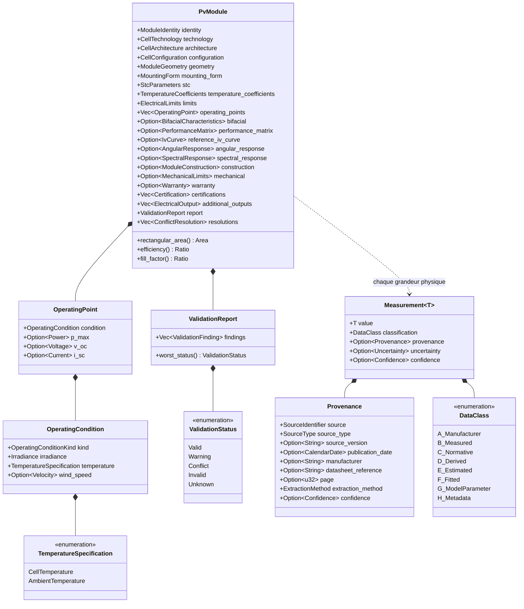
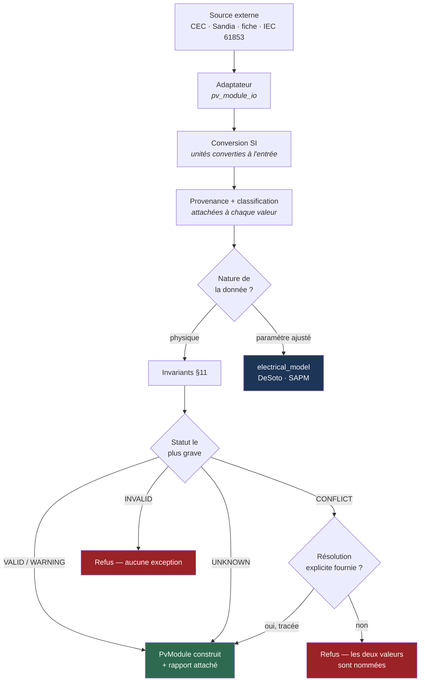
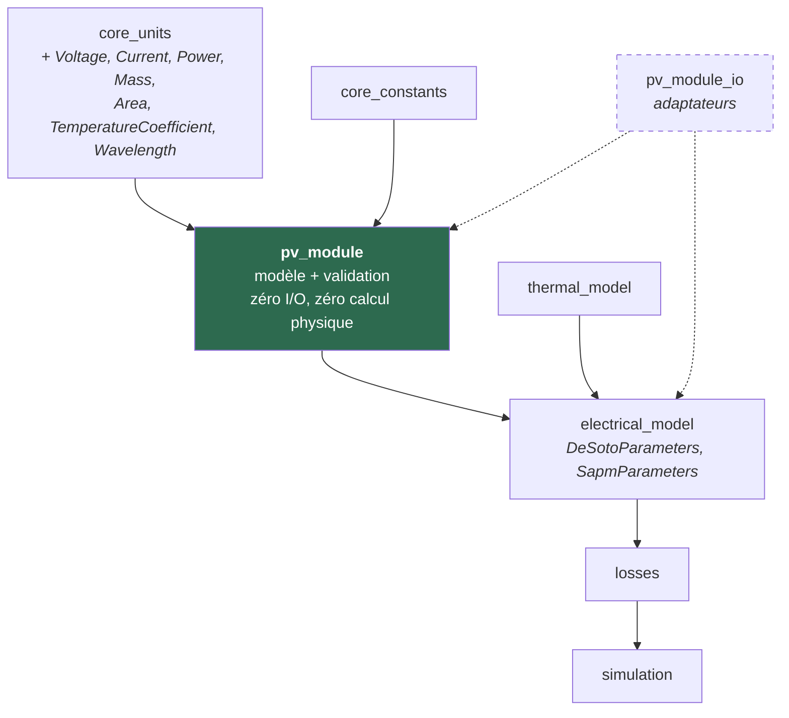

# 27. Spécification finale physique — `pv_module`

**Statut** : spécification finale avant implémentation. **Aucun code
métier, aucune logique de calcul.**

Ce document est l'autorité finale sur le modèle de données `pv_module`.
Il consolide et, là où c'est nécessaire, **corrige** les documents 23 à
26. En cas de divergence, ce document prime.

| Document | Rôle | Statut |
|---|---|---|
| 23 | Plan général | Historique |
| 24 | Revue d'architecture | Valide sauf §2.4 (corrigé) |
| 25 | Spécification détaillée | Valide sauf §3.4 (corrigé par 26 et 27) |
| 26 | Validation empirique CEC/Sandia | Valide |
| **27** (ce document) | **Spécification finale physique** | **Autorité** |
| 28 | Plan de tests | Complément |
| ADR 0004, 0005, 0006 | Décisions | 0006 remplace 0005 §D-3 |

---

## 0. Le principe fondateur

> **DONNÉE SOURCE ≠ MODÈLE PHYSIQUE ≠ PARAMÈTRE DE MODÈLE ≠ DONNÉE
> DÉRIVÉE ≠ RÉSULTAT CALCULÉ.**

Ni le CEC, ni Sandia, ni une fiche constructeur ne constituent une
vérité physique absolue. Ce sont des **sources**, avec une autorité,
une date, une méthode et une incertitude propres. Le document 26 l'a
démontré expérimentalement : 29 modules de la base CEC portent des
dimensions incohérentes avec leur propre surface déclarée, d'un facteur
allant jusqu'à 2.

Ce principe se traduit par cinq mécanismes, chacun spécifié ci-dessous :

| Mécanisme | Section | Répond à |
|---|---|---|
| Classification épistémique des données (A–H) | §1 | « quelle est la nature de cette valeur ? » |
| Provenance attachée à la valeur | §2 | « d'où vient-elle, avec quelle confiance ? » |
| Système formel de conflits | §3 | « que faire quand deux sources se contredisent ? » |
| Séparation stricte module / paramètres de modèle | §4 | « est-ce une propriété du module ou d'un modèle ? » |
| Conditions de référence explicites et distinctes | §5 | « dans quelles conditions cette valeur est-elle vraie ? » |

**Règle absolue, validée** : *une donnée en conflit n'est jamais arbitrée
silencieusement.*

---

## 1. Classification des données (A–H)

### 1.1 Les huit classes

| Classe | Nom | Définition | Autorité |
|---|---|---|---|
| **A** | Donnée constructeur | Valeur publiée par le fabricant sur une fiche technique. Valeur **nominale** d'un type de produit, pas d'un exemplaire | Commerciale, engageante contractuellement |
| **B** | Donnée mesurée | Résultat d'un essai sur un exemplaire physique selon une méthode normalisée | Métrologique, incertitude quantifiable |
| **C** | Donnée normalisée | Valeur fixée par une norme, non mesurée (1000 W/m², 25 °C, AM1.5G) | Normative, exacte par définition |
| **D** | Donnée dérivée | Calculée exactement à partir d'autres champs du modèle | Aucune propre : hérite de ses entrées |
| **E** | Donnée estimée | Fournie par un utilisateur ou déduite par jugement, sans mesure ni publication | Faible, justification obligatoire |
| **F** | Paramètre ajusté | Issu d'une régression sur des mesures, propre à un modèle donné | Conditionnelle au modèle |
| **G** | Paramètre de modèle | Constante ou coefficient définissant un modèle, non spécifique à un module | Celle de la publication du modèle |
| **H** | Métadonnée | N'est pas une grandeur physique (nom, référence, date, certification) | Documentaire |

### 1.2 Constat central : la classe n'est pas toujours une propriété du champ

Une lecture naïve associerait une classe fixe à chaque champ. **C'est
faux pour la majorité des champs électriques.**

`v_oc` vaut :

- **A** (donnée constructeur) s'il provient d'une fiche technique ;
- **B** (donnée mesurée) s'il provient d'un rapport d'essai IEC 61853 ;
- **E** (donnée estimée) si un utilisateur l'a saisi de mémoire.

**C'est la même grandeur physique, avec trois autorités radicalement
différentes.** Un moteur qui les confondrait présenterait une estimation
comme une mesure.

La classification se répartit donc en deux familles :

- **Classe fixe** — intrinsèque au champ, connue à la conception ;
- **Classe variable** — déterminée par la provenance de la valeur, donc
  portée par la valeur elle-même (§2).

C'est la raison technique pour laquelle la classification doit voyager
**avec la valeur** et non dans une table statique — et l'une des deux
raisons du renversement décrit en §10 et ADR-0006.

### 1.3 Classification par champ

**Classe fixe** (jamais autre chose) :

| Champ | Classe | Justification |
|---|---|---|
| `identity.manufacturer`, `model_name`, `part_number`, `datasheet_revision` | **H** | Identification, pas grandeur physique |
| `identity.building_integrated` | **H** | Destination d'usage |
| `certifications` | **H** | Attestation documentaire |
| `technology`, `architecture` | **H** | Classification descriptive (§7) |
| `configuration.*` (nombres de cellules, division, diodes) | **A** | Décrit la construction ; seul le fabricant en est la source |
| Conditions des points de référence (1000 W/m², 25 °C, AM1.5G, 800 W/m², vent 1 m/s) | **C** | Fixées par IEC 61215 / 60904-3 / 61853-2, exactes par définition |
| `gross_area()`, `efficiency()`, `fill_factor()`, coefficients absolus, courbe P-V | **D** | Calculés exactement depuis d'autres champs |
| `warranty.*` | **H** | Engagement contractuel, ni mesuré ni physique |
| `electrical_model::DeSotoParameters`, `SapmParameters` | **F** | Régression, propre à un modèle (§4) |
| Constantes des modèles (exposants, seuils publiés) | **G** | Définissent le modèle, pas le module |

**Classe variable** (A, B ou E selon la provenance) :

| Champ | Classes possibles | Cas typique |
|---|---|---|
| `stc.p_max`, `v_oc`, `i_sc`, `v_mpp`, `i_mpp` | A / B / E | A depuis une fiche, B depuis un essai |
| `temperature_coefficients.*` | A / B / E | A depuis une fiche, B depuis IEC 60891 |
| `noct/nmot/ptc.*` | A / B / E | A depuis une fiche, B depuis IEC 61853-2 |
| `geometry.*` (dimensions, masse, surfaces déclarées) | A / B / E | A depuis une fiche, B si métrologie |
| `bifacial.*` | A / B / E | B depuis IEC TS 60904-1-2 |
| `performance_matrix` | **B** en pratique | Provient d'un essai normalisé par nature |
| `reference_iv_curve`, `spectral_response`, `angular_response` | **B** en pratique | Idem |
| `limits.*`, `mechanical.*` | A | Déclarés par le fabricant |

> `performance_matrix` et les courbes sont notés « B en pratique » : rien
> n'interdit qu'un utilisateur les saisisse à la main (E). Leur classe
> reste donc portée par la provenance, comme les autres.

---

## 2. Stratégie de provenance

### 2.1 Structure

```
Provenance {
    source:              SourceIdentifier,      // qui
    source_type:         SourceType,            // quelle nature
    source_version:      Option<String>,        // quelle version/millésime
    publication_date:    Option<CalendarDate>,  // quand
    manufacturer:        Option<String>,        // fabricant déclarant
    datasheet_reference: Option<String>,        // référence du document
    page:                Option<u32>,           // localisation dans le document
    extraction_method:   ExtractionMethod,      // comment obtenue
    confidence:          Option<Confidence>,    // quelle confiance
}

SourceType =                                    // #[non_exhaustive]
    | ManufacturerDatasheet
    | TestReport { standard: Option<String> }   // IEC 61853, 60904-1…
    | PublicDatabase { name: String }           // CEC, Sandia
    | ProprietaryDatabase { name: String }
    | UserInput
    | Derived                                   // calculé par HeliosPro

ExtractionMethod =                              // #[non_exhaustive]
    | AutomatedImport { adapter: String, adapter_version: String }
    | ManualTranscription
    | OpticalCharacterRecognition
    | ComputedByEngine
    | Unknown

Confidence = High | Medium | Low | Unspecified
```

### 2.2 Ce qui est exigé dès l'implémentation initiale

Conformément à l'instruction (« ne pas forcément implémenter toute la
provenance maintenant, mais l'architecture doit la permettre ») :

| Élément | Phase initiale | Justification |
|---|---|---|
| `source_type`, `extraction_method` | **Obligatoire** | Sans eux, la classification A/B/E (§1.2) est indéterminable — c'est le minimum pour ne pas confondre mesure et estimation |
| `source`, `source_version`, `publication_date` | Structure définie, remplissage optionnel | Reproductibilité |
| `manufacturer`, `datasheet_reference`, `page` | Structure définie, remplissage optionnel | Traçabilité documentaire fine |
| `confidence` | Structure définie, remplissage optionnel | Interprétation |

**Le point non négociable** : la structure `Provenance` doit exister et
être attachable dès la première version, même largement vide. L'ajouter
plus tard obligerait à modifier chaque signature portant une valeur —
exactement le type de refonte que cette phase de conception existe pour
éviter.

### 2.3 Granularité : par valeur, pas par module

Un même `PvModule` peut légitimement agréger des valeurs de provenances
différentes : STC issu d'une fiche, matrice de performance issue d'un
essai, masse estimée par l'utilisateur. Une provenance unique au niveau
du module serait donc fausse dès qu'une valeur est complétée depuis une
autre source.

C'est la seconde raison du renversement de §10 : la provenance par
valeur impose un porteur par valeur.

---

## 3. Système formel de gestion des conflits

### 3.1 Les cinq statuts

| Statut | Signification | Effet sur la construction |
|---|---|---|
| **VALID** | Invariant satisfait | Aucun |
| **WARNING** | Satisfait mais atypique — physiquement possible, statistiquement suspect | Construction **acceptée**, rapport attaché |
| **CONFLICT** | Deux sources ou deux champs se contredisent ; le moteur **ne peut pas** trancher | Construction **refusée** sauf résolution explicite (§3.3) |
| **INVALID** | Physiquement impossible ou structurellement incohérent | Construction **refusée**, sans exception |
| **UNKNOWN** | Invariant non évaluable — champ requis absent | Aucun ; consigné |

Distinction essentielle entre **CONFLICT** et **INVALID** :

- **INVALID** — `v_oc < v_mpp` : aucune valeur ne peut être correcte, il
  n'y a rien à arbitrer.
- **CONFLICT** — `A_c` contredit `L × l` : **les deux valeurs sont
  individuellement plausibles**, l'une est fausse, et rien dans le
  modèle ne dit laquelle. C'est exactement le cas mesuré au document 26.

### 3.2 Structure du rapport

```
ValidationFinding {
    invariant_id:    &'static str,        // « INV-GEO-002 »
    status:          ValidationStatus,
    fields:          Vec<&'static str>,   // champs impliqués
    observed:        Option<String>,      // valeurs constatées
    expected:        Option<String>,      // attendu / tolérance
    explanation:     String,              // en langage clair, obligatoire
}

ValidationReport {
    findings: Vec<ValidationFinding>,
}
// worst_status(), findings_at(status), is_constructible()
```

Le champ `explanation` est **obligatoire** : un statut sans explication
laisserait l'utilisateur devant un refus opaque, ce qui reviendrait à
arbitrer sans le dire.

Le rapport est **attaché au `PvModule` construit**, pas jeté : un
module portant des WARNING doit rester inspectable par les moteurs
en aval.

### 3.3 Résolution explicite d'un conflit

Un CONFLICT bloque la construction. Il reste franchissable — mais
seulement par une décision **enregistrée** :

```
ConflictResolution {
    invariant_id: &'static str,
    decision:     ResolutionDecision,   // UseFirst | UseSecond | UseOverride(value) | Ignore
    resolved_by:  String,               // opérateur ou politique nommée
    rationale:    String,               // obligatoire
}
```

Le constructeur accepte une liste de résolutions. Sans résolution
correspondante, le conflit reste bloquant. La résolution est conservée
dans le module construit et devient elle-même une donnée de provenance.

C'est l'opérationnalisation exacte du principe validé : **le moteur ne
choisit jamais ; un humain ou une politique nommée choisit, et sa
décision est tracée.**

### 3.4 Les six conflits nommés

| ID | Conflit | Statut | Détail |
|---|---|---|---|
| `INV-GEO-002` | `L × l` ≠ surface constructeur | CONFLICT au-delà de 1 % | Doc 26 §1 : 29 modules CEC, jusqu'à ×2 |
| `INV-ELE-010` | `v_oc` incompatible avec `cells_in_series` | WARNING hors plage 0,4–0,8 V/cellule | Dépend de la technologie : plage large, indicatif |
| `INV-ELE-004` | `p_max` ≠ `v_mpp × i_mpp` | WARNING > 1 %, CONFLICT > 5 % | Les fiches arrondissent ; un écart fort signale une saisie fautive |
| `INV-DER-001` | `stated_efficiency` ≠ `p_max / (surface × 1000)` | CONFLICT au-delà de 2 % | Dépend de quelle surface : recoupement croisé avec `INV-GEO-002` |
| `INV-TMP-005` | Unité ambiguë d'un coefficient thermique | CONFLICT | Doc 26 §2.4 : le CEC mêle absolu et relatif dans une même ligne |
| `INV-BIF-001` | Bifacialité déclarée sans facteur φ | WARNING | Doc 26 §2.2 : cas normal d'un import CEC, pas une anomalie |

Le détail complet des invariants figure en §11.

### 3.5 Cas particulier : l'unité ambiguë d'un coefficient thermique

`INV-TMP-005` mérite une règle propre, parce que l'ambiguïté n'est pas
détectable sur la valeur seule.

Un coefficient de −0,159 peut être −0,159 V/°C (absolu) ou −0,159 %/°C
(relatif) — deux grandeurs différant d'un facteur ≈ 280 pour un module
44 V. Le document 26 a établi que la base CEC utilise **les deux dans la
même ligne**.

**Règle** : l'unité est portée par le type (`TemperatureCoefficient`
construit explicitement en absolu ou en relatif). Un adaptateur qui ne
peut pas déterminer l'unité de sa source **ne construit pas la valeur** :
il émet un CONFLICT. Il ne devine pas à partir de l'ordre de grandeur —
une heuristique serait un arbitrage silencieux.

---

## 4. Données physiques contre paramètres de modèle

### 4.1 Règle

| Appartient à `pv_module` | Appartient au crate du modèle |
|---|---|
| Ce qui est **mesurable sur le module** indépendamment de tout modèle | Ce qui n'a de sens **qu'à l'intérieur d'un modèle** |
| `v_oc`, `i_sc`, `v_mpp`, `i_mpp`, `p_max`, `cells_in_series`, dimensions, masse, coefficients thermiques, matrice IEC 61853, courbe I-V | De Soto (`a_ref`, `I_L_ref`, `I_o_ref`, `R_s`, `R_sh_ref`, `Adjust`), SAPM (`C0`–`C7`, `A0`–`A4`, `B0`–`B5`, `Mbvoc`, `Mbvmp`, …) |

### 4.2 Preuve empirique (doc 26)

- Base CEC : **6 des 25 champs** sont des paramètres De Soto ajustés.
- Base Sandia : **28 des 42 champs** sont propres au modèle SAPM.
- `Mbvoc` et `Mbvmp` (dépendance à l'irradiance du coefficient thermique
  de tension) **ne figurent sur aucune fiche technique** et n'ont aucun
  équivalent De Soto.

Deux tiers d'un enregistrement Sandia n'est donc pas une description de
module : c'est la paramétrisation d'un modèle. Les stocker dans
`pv_module` rendrait ce crate dépendant de la forme de chaque modèle
électrique existant et futur.

### 4.3 Conséquence sur les imports

```
CECAdapter::import(...)    -> (PvModule, Option<DeSotoParameters>, ValidationReport)
SandiaAdapter::import(...) -> (PvModule, Option<SapmParameters>,   ValidationReport)
```

Contrepartie assumée : un import traverse deux crates. Elle est
préférable à la contamination de `pv_module` par tous les modèles.

### 4.4 Un paramètre ajusté n'est jamais promu en propriété physique

Interdiction explicite : aucun code ne doit lire un paramètre ajusté
(classe F) puis le présenter comme une grandeur mesurée (classe B).
Exemple concret d'erreur à éviter : dériver un `v_oc` « physique » depuis
les paramètres De Soto d'un enregistrement CEC et l'écrire dans
`stc.v_oc`. La valeur obtenue serait une **sortie de modèle**, pas une
mesure — sa classe serait D au mieux, jamais A ni B.

---

## 5. Conditions de référence — abstraction générique

### 5.1 La distinction physique que l'abstraction doit porter

Toutes les conditions normalisées ne contraignent pas la même
température :

| Condition | Irradiance | Température **imposée** | Vent | État électrique |
|---|---|---|---|---|
| **STC** | 1000 W/m² | **cellule** 25 °C | — | — |
| **NOCT** (61215) | 800 W/m² | **ambiante** 20 °C | 1 m/s | circuit ouvert |
| **NMOT** (61853-2) | 800 W/m² | **ambiante** 20 °C | 1 m/s | au point de puissance max |
| **PTC** (PVUSA) | 1000 W/m² | **ambiante** 20 °C | 1 m/s | — |
| **IEC 61853-1** | grille | **cellule** imposée | — | — |
| Utilisateur | libre | libre | libre | libre |

Les STC imposent la température de **cellule** ; NOCT, NMOT et PTC
imposent la température **ambiante** et laissent la température de
cellule s'établir. Une abstraction qui ne distinguerait pas ces deux
natures serait physiquement fausse — et rendrait NOCT et STC
faussement comparables.

### 5.2 Structure

```
OperatingCondition {
    kind:             OperatingConditionKind,
    irradiance:       Irradiance,
    temperature:      TemperatureSpecification,
    spectrum:         Option<Spectrum>,           // AM1.5G par défaut aux STC
    wind_speed:       Option<Velocity>,
    electrical_state: Option<ElectricalState>,    // OpenCircuit | MaximumPowerPoint
}

TemperatureSpecification =
    | CellTemperature(Temperature)      // STC, IEC 61853-1
    | AmbientTemperature(Temperature)   // NOCT, NMOT, PTC

OperatingConditionKind =                          // #[non_exhaustive]
    | Stc | NoctIec61215 | NmotIec61853_2 | PtcPvusa
    | Iec61853Matrix
    | UserDefined { name: String }

OperatingPoint {
    condition: OperatingCondition,
    p_max: Option<Power>, v_oc: Option<Voltage>, i_sc: Option<Current>,
    v_mpp: Option<Voltage>, i_mpp: Option<Current>,
    cell_temperature: Option<Temperature>,   // mesurée si la condition impose l'ambiante
}
```

`PvModule` porte alors une **liste** `operating_points: Vec<OperatingPoint>`,
dont le point STC reste par ailleurs obligatoire et directement
accessible.

**Ce qui est ainsi garanti** : ajouter une condition future (une norme
révisée, un référentiel régional) est un ajout de variante, jamais une
modification de structure. Les conditions ne sont jamais mélangées :
chaque point porte sa condition complète.

---

## 6. Bifacialité

### 6.1 Structure

```
BifacialCharacteristics {
    is_bifacial:          bool,                    // toujours vrai si le bloc existe
    bifaciality_factor:   Option<Ratio>,           // φ ; absent dans un import CEC
    rear_side_parameters: Option<RearSideParameters>,
    rear_shading_factor:  Option<Ratio>,           // masquage par cadre/structure
    measurement_standard: Option<String>,          // IEC TS 60904-1-2
    stated_gain:          Option<StatedBifacialGain>,  // commercial, jamais calculatoire
}

RearSideParameters {
    p_max: Option<Power>, v_oc: Option<Voltage>, i_sc: Option<Current>,
    v_mpp: Option<Voltage>, i_mpp: Option<Current>,
    temperature_coefficients: Option<TemperatureCoefficients>,
}
```

`is_bifacial` est conservé bien que redondant avec la présence du bloc :
un import CEC (drapeau sans φ) produit un bloc où **tout est `None` sauf
`is_bifacial`**. Sans ce champ, ce bloc serait indiscernable d'un bloc
vide.

### 6.2 Ce qui n'appartient pas à `pv_module`

L'instruction cite `rear_irradiance_model` et `rear_temperature_model`.
**Ces deux éléments sont des modèles, pas des propriétés du module** — au
sens exact du principe fondateur (§0, §4).

L'irradiance reçue en face arrière dépend de l'albédo du site, de la
hauteur de structure, de l'espacement des rangées et de la géométrie
d'installation. Elle ne dépend **pas** du module. Le choix du modèle qui
la calcule appartient au futur moteur `bifacial`.

Ce que `pv_module` porte légitimement, ce sont les **propriétés du
module qui alimentent ce modèle** : φ, les grandeurs électriques
arrière, et le facteur de masquage arrière propre à la construction du
module (cadre, boîte de jonction). C'est la répartition retenue.

Placer un choix de modèle dans le descripteur d'objet physique aurait
été la première entorse au principe fondateur — signalée plutôt
qu'appliquée.

---

## 7. Technologie : descriptive, jamais prescriptive

### 7.1 La règle

> La technologie est une **propriété descriptive**. Aucun code de
> physique fondamentale ne doit brancher dessus.

Interdit :

```
if technology == TOPCon { /* physique différente */ }
```

Autorisé :

```
// dans un crate de modèle : sélectionner un jeu de paramètres publié
let params = parameter_library.lookup(module.technology, module.architecture);
```

La différence est décisive. Dans le premier cas, la physique du moteur
change selon une étiquette commerciale — une nouvelle technologie
exigerait de modifier le cœur du moteur, et les modules `Unknown`
seraient sans comportement. Dans le second, la technologie **sélectionne
des paramètres** dans une bibliothèque, et un module `Unknown` retombe
sur un défaut documenté.

### 7.2 Vérification

Cette règle est vérifiable mécaniquement : aucun `match` ni `if` sur
`CellTechnology` ou `CellArchitecture` ne doit apparaître dans les
crates de physique (`electrical_model`, `thermal_model`, `losses`,
`bifacial`). Les seules occurrences légitimes sont dans les
bibliothèques de paramètres et les couches de présentation. À inscrire
au plan de tests (document 28) comme contrôle d'architecture.

### 7.3 Vocabulaire

`CellArchitecture` : `AluminiumBackSurfaceField`, `PERC`, `TOPCon`,
`HeterojunctionHJT`, `InterdigitatedBackContact`, `MonolithicThinFilm`,
`Unknown`, `Other { name }` — `#[non_exhaustive]`.

`CellTechnology` : `MonocrystallineSilicon`, `MulticrystallineSilicon`,
`CadmiumTelluride`, `CopperIndiumGalliumSelenide`, `AmorphousSilicon`,
`Perovskite`, `Tandem { top, bottom }`, `Unknown`, `Other { name }` —
`#[non_exhaustive]`.

La variante **`Unknown` est distincte de `Other { name }`** :
`Unknown` = la source ne dit rien ; `Other { name }` = la source dit
quelque chose que le modèle ne classe pas encore. Le document 26 §2.1 a
montré que le CEC ne fournit **aucune** information d'architecture :
tout import CEC produit donc `architecture = Unknown`, et cette absence
doit rester lisible.

---

## 8. Surfaces et dimensions

### 8.1 Correction : `L × l` n'est pas `gross_area`

Le document 25 identifiait `gross_area` à `L × l`. **C'est une
approximation valable pour un module rectangulaire encadré, pas une
identité universelle** — un module à découpe non rectangulaire,
tuilé (*shingled*) ou courbe la met en défaut.

Cinq grandeurs distinctes sont donc conservées **séparément**, aucune
n'étant réputée égale à une autre :

| Champ | Définition | Nature |
|---|---|---|
| `overall_dimensions` | Longueur, largeur, épaisseur hors-tout | A |
| `gross_area` | Surface hors-tout déclarée (encombrement total) | A |
| `active_area` | Surface électriquement active | A/B |
| `aperture_area` | Surface d'ouverture optique | A/B |
| `cell_area` | Surface cumulée des cellules | A/B |
| `rectangular_area()` | `longueur × largeur` — grandeur **dérivée nommée** | **D** |

`rectangular_area()` porte un nom propre et **n'usurpe pas** celui de
`gross_area`. C'est ce nommage qui empêche la confusion : la comparaison
`INV-GEO-002` oppose désormais deux grandeurs explicitement nommées,
et non une valeur à sa propre définition supposée.

### 8.2 Ordre de préférence — et son statut

Pour un calcul de rendement, l'ordre de pertinence physique est :
`aperture_area` > `gross_area` > `rectangular_area()`.

**Cet ordre n'est pas appliqué automatiquement.** Le rendement dérivé
indique toujours **quelle surface** il a utilisée, et un désaccord entre
surfaces déclenche `INV-GEO-002` avant tout calcul. Un choix automatique
serait un arbitrage silencieux.

---

## 9. Politique d'unités

### 9.1 Règle

| Frontière | Unités |
|---|---|
| **Interne HeliosPro** | **SI strict**, exclusivement, via les types forts de `core_units` |
| **Formats externes** (fiches, CEC, Sandia, CSV, JSON) | Unités d'usage : °C, W/m², mm, cm², V, A, %, W/°C, %/°C |
| **Conversion** | **À l'entrée uniquement**, dans l'adaptateur (§12) |

Aucune grandeur physique ne franchit une frontière publique sous forme
de `f64` nu.

### 9.2 Types de `core_units` à ajouter

| Type | Unité SI interne | Constructeurs non-SI | Note |
|---|---|---|---|
| `Voltage` | V | — | |
| `Current` | A | — | |
| `Power` | W | — | |
| `Mass` | kg | `from_grams` | |
| `Area` | m² | `from_square_millimetres`, `from_square_centimetres` | Sections de câble en mm² |
| `TemperatureCoefficient` | K⁻¹ (relatif) ou unité/K (absolu) | `from_percent_per_celsius` | **Signé, non borné** ; porte son caractère absolu/relatif (§3.5) |
| `Wavelength` | m | `from_nanometres` | Réponse spectrale |

Existants réutilisés : `Length` (m), `Temperature` (K), `Irradiance`
(W/m²), `Pressure` (Pa), `Ratio` (—), `Velocity` (m/s), `Angle` (rad).

**`core_units` doit être étendu avant que `pv_module` puisse être
écrit** — dépendance d'ordonnancement, pas préférence.

### 9.3 Pourquoi la conversion est confinée à l'adaptateur

Si la conversion était dispersée dans le modèle, chaque champ porterait
implicitement l'unité de sa source, et une même structure mêlerait des
unités selon l'origine — exactement ce que le document 26 a constaté
dans la base CEC. Confiner la conversion à la frontière garantit qu'un
`PvModule` construit est **homogène en SI**, quelle que soit sa source.

---

## 10. Incertitude et porteur de valeur — renversement assumé

### 10.1 Ce qui change

L'ADR-0005, Décision 3 avait **rejeté** un enrobage générique
`Measurement<T>` au profit d'un bloc d'incertitude parallèle. Le motif
était ergonomique : l'incertitude est rare, la faire payer à chaque champ
serait un coût permanent.

**Cette décision est renversée.** Les exigences §1.2 (classification
portée par la valeur) et §2.3 (provenance par valeur) changent le calcul
sur lequel elle reposait : il ne s'agit plus d'un seul attribut rare,
mais de **trois attributs par valeur** — provenance, classification,
incertitude. Trois blocs parallèles indexés par nom de champ seraient
fragiles, non vérifiables par le compilateur, et se désynchroniseraient
au premier ajout de champ.

Le renversement est consigné en ADR-0006, qui remplace explicitement
l'ADR-0005 Décision 3.

### 10.2 Structure

```
Measurement<T> {
    value:          T,
    classification: DataClass,          // A..H (§1)
    provenance:     Option<Provenance>, // §2
    uncertainty:    Option<Uncertainty>,// GUM
    confidence:     Option<Confidence>,
}

Uncertainty {
    value:           f64,
    kind:            Absolute | Relative,
    coverage_factor: Option<f64>,       // k ; None ⇒ incertitude-type
    evaluation:      Option<TypeA | TypeB | Combined>,
}
```

Cadre normatif : **GUM, JCGM 100:2008**.

### 10.3 Portée de l'enrobage — et sa limite

| Enrobé dans `Measurement<T>` | Non enrobé |
|---|---|
| Grandeurs physiques issues d'une source externe (`stc.*`, coefficients thermiques, points de fonctionnement, surfaces, masse, grandeurs bifaciales) | Métadonnées (classe H) : noms, références, certifications |
| | Grandeurs **dérivées** (classe D) : accesseurs retournant le type nu |
| | Structures de classification : `technology`, `architecture`, `configuration` |

Les accesseurs dérivés retournent un type nu : leur classification est
connue (D) et leur provenance est celle de leurs entrées, donc les
répéter n'apporterait rien.

**Atténuation ergonomique** : constructeur abrégé
`Measurement::stated(value)` pour le cas courant, et accesseur `.value()`.
Le coût subsiste et est assumé — c'est le prix de la traçabilité par
valeur, exigence désormais explicite.

### 10.4 Ce que le modèle ne fait pas

Il **stocke** des incertitudes ; il ne les **propage pas**. La
propagation (loi du GUM, ou Monte-Carlo selon JCGM 101) relèvera de
`simulation` ou d'un module dédié. Aucune capacité de propagation n'est
suggérée par ce modèle.

---

## 11. Invariants de validation physique

Niveaux : **E** = ERROR (construction refusée) · **C** = CONFLICT
(refusée sauf résolution explicite) · **W** = WARNING (acceptée,
consignée) · **I** = INFO · **N/A** = non applicable (champ absent ⇒
statut UNKNOWN).

### 11.1 Positivité et existence

| ID | Invariant | Niveau | Note |
|---|---|---|---|
| `INV-POS-001` | `p_max > 0` | E | |
| `INV-POS-002` | `v_oc > 0` | E | |
| `INV-POS-003` | `i_sc > 0` | E | |
| `INV-POS-004` | `v_mpp > 0` | E | |
| `INV-POS-005` | `i_mpp > 0` | E | |
| `INV-POS-006` | `length > 0`, `width > 0` | E | |
| `INV-POS-007` | `depth > 0` si présent | E | N/A si absent |
| `INV-POS-008` | `mass > 0` si présente | E | N/A si absente |
| `INV-POS-009` | `cells_in_series > 0` | E | Variante `Discrete` |
| `INV-POS-010` | `cells_in_parallel > 0` | E | Variante `Discrete` |
| `INV-POS-011` | `series_segments > 0` | E | Variante `Monolithic` |
| `INV-POS-012` | Toutes les surfaces déclarées > 0 | E | N/A si absentes |

### 11.2 Ordonnancement électrique

| ID | Invariant | Niveau | Note |
|---|---|---|---|
| `INV-ELE-001` | `v_oc > v_mpp` | E | Physiquement nécessaire |
| `INV-ELE-002` | `i_sc > i_mpp` | E | Idem |
| `INV-ELE-003` | `v_mpp / v_oc ∈ [0,70 ; 0,90]` | W | Plage usuelle ; hors plage = suspect, pas impossible |
| `INV-ELE-004` | `\|p_max − v_mpp·i_mpp\| / p_max` | W > 1 %, **C** > 5 % | Les fiches arrondissent |
| `INV-ELE-005` | Facteur de forme `p_max/(v_oc·i_sc) ∈ [0,5 ; 0,9]` | W | Hors plage = saisie douteuse |
| `INV-ELE-006` | Facteur de forme ≤ 1 | E | Impossible par construction |
| `INV-ELE-010` | `v_oc / cells_in_series ∈ [0,4 ; 0,8] V` | W | Dépend de la technologie ; plage volontairement large |
| `INV-ELE-011` | `max_system_voltage ≥ v_oc` | E | Incohérence de sécurité |
| `INV-ELE-012` | `max_series_fuse ≥ i_sc` | W | Marge normative variable |

### 11.3 Géométrie et surfaces

| ID | Invariant | Niveau | Note |
|---|---|---|---|
| `INV-GEO-001` | `aperture_area ≤ gross_area` | E | Une ouverture n'excède pas l'encombrement |
| `INV-GEO-002` | `\|gross_area − rectangular_area()\| / rectangular_area()` | W > 0,1 %, **C** > 1 % | Doc 26 §1 — jamais arbitré |
| `INV-GEO-003` | `cell_area ≤ active_area ≤ aperture_area` | E | Emboîtement physique |
| `INV-GEO-004` | `cell_area / cells_in_series ∈ [0,010 ; 0,060] m²` | W | Formats 125–210 mm ; indicatif (doc 26 §1.5) |
| `INV-GEO-005` | `depth ≤ min(length, width)` | W | Un module plus épais que large est suspect |

### 11.4 Rendement

| ID | Invariant | Niveau | Note |
|---|---|---|---|
| `INV-DER-001` | `stated_efficiency` vs `p_max/(surface·1000)` | **C** > 2 % | Précise **quelle** surface a servi |
| `INV-DER-002` | Rendement dérivé ≤ 0,50 | E | Limite thermodynamique très large ; au-delà, données fausses |
| `INV-DER-003` | Rendement dérivé ∈ [0,05 ; 0,30] | W | Plage commerciale usuelle |

### 11.5 Coefficients thermiques

| ID | Invariant | Niveau | Note |
|---|---|---|---|
| `INV-TMP-001` | `alpha_i_sc > 0` | W | Attendu positif ; ne pas bloquer une technologie future |
| `INV-TMP-002` | `beta_v_oc < 0` | W | Attendu négatif |
| `INV-TMP-003` | `gamma_p_max < 0` | W | Attendu négatif |
| `INV-TMP-004` | `\|gamma_p_max\| ∈ [0,1 ; 1,0] %/°C` | W | Plage usuelle toutes technologies |
| `INV-TMP-005` | Unité absolue/relative indéterminée à l'import | **C** | Jamais devinée (§3.5) |
| `INV-TMP-006` | `\|gamma_p_max\| ≥ \|beta_v_oc\|` (relatifs) | I | Habituel, non universel |

### 11.6 Conditions et températures

| ID | Invariant | Niveau | Note |
|---|---|---|---|
| `INV-CND-001` | Températures ∈ [−100 ; +200] °C | E | Bornes physiques très larges |
| `INV-CND-002` | `min_operating_temperature < max_operating_temperature` | E | |
| `INV-CND-003` | NOCT ∈ [30 ; 60] °C | W | Plage usuelle |
| `INV-CND-004` | Irradiance d'une condition > 0 | E | |
| `INV-CND-005` | Une même `OperatingConditionKind` n'apparaît pas deux fois | E | Ambiguïté de définition |
| `INV-CND-006` | `p_max` à NOCT/NMOT < `p_max` à STC | W | Attendu (irradiance plus faible) |

### 11.7 Bifacialité, cohérence structurelle, provenance

| ID | Invariant | Niveau | Note |
|---|---|---|---|
| `INV-BIF-001` | Bloc bifacial présent sans φ | W | Cas normal d'un import CEC |
| `INV-BIF-002` | `bifaciality_factor ∈ ]0 ; 1]` | E | φ > 1 signifierait un arrière plus efficace que l'avant |
| `INV-BIF-003` | Grandeurs arrière ≤ grandeurs avant correspondantes | W | |
| `INV-BIF-004` | Bifacialité déclarée sur une architecture IBC | W | Physiquement inhabituel |
| `INV-STR-001` | `cell_division = Half` ⇒ `cells_in_parallel` pair | W | Topologie usuelle des demi-cellules |
| `INV-STR-002` | `bypass_diodes ≤ substrings` | W | |
| `INV-STR-003` | `additional_outputs` non vide ⇒ technologie `Tandem` | W | Autre cas non connu à ce jour |
| `INV-STR-004` | Matériau couche mince ⇒ configuration `Monolithic` | W | Ajouté à l'implémentation — ADR-0007 |
| `INV-PRV-001` | Classe A/B/E indéterminable (provenance absente) | W | Valeur utilisable, autorité inconnue |
| `INV-PRV-002` | Classe E (estimée) sans justification | E | Exigence du principe de transparence |
| `INV-PRV-003` | Paramètre ajusté (F) présenté comme mesuré (B) | E | §4.4 |

**Total : 52 invariants nommés.** Chacun produit un `ValidationFinding`
avec explication obligatoire (§3.2).

> **Correction du décompte (2026-08-11).** La rédaction initiale de cette
> section annonçait « 47 invariants nommés » alors que ses propres tableaux
> en énuméraient **51**. Le chiffre 47 était une erreur de comptage, jamais
> une omission de règles : aucun invariant n'a été retiré. L'implémentation
> a par ailleurs ajouté `INV-STR-004`, portant le total à **52**. Le
> décompte fait désormais foi dans le code, où la constante
> `pv_module::validation::invariants::ALL_INVARIANT_IDS` est l'inventaire
> de référence ; le test `the_invariant_inventory_is_complete_and_free_of_duplicates`
> vérifie qu'elle reste sans doublon et que chaque famille conserve son
> effectif. Voir `docs/adr/0007-invariant-inventory.md`.

---

## 12. Architecture des adaptateurs

### 12.1 Principe d'inversion

```
        ┌──────────────────────────────────────────┐
        │  pv_module  (modèle interne, zéro I/O)   │
        └──────────────────▲───────────────────────┘
                           │ dépend de
    ┌──────────────────────┴───────────────────────┐
    │              pv_module_io                    │
    │  CECAdapter · SandiaAdapter · PANAdapter     │
    │  IEC61853Adapter · ManufacturerDatasheetAdapter │
    └──────────────────────────────────────────────┘
```

**`pv_module` ignore l'existence des formats.** Ajouter un adaptateur ne
modifie aucune ligne du modèle interne. C'est ce qui rend l'exigence
structurelle et non disciplinaire.

### 12.2 Contrat commun

```
trait ModuleSourceAdapter {
    type Raw;                       // représentation brute de la source
    fn source_type(&self) -> SourceType;
    fn adapter_version(&self) -> &str;
    fn import(&self, raw: Self::Raw, resolutions: &[ConflictResolution])
        -> ImportOutcome;
}

ImportOutcome {
    module:            Option<PvModule>,        // None si INVALID/CONFLICT non résolu
    model_parameters:  ModelParameterSet,       // De Soto, SAPM… (crate du modèle)
    report:            ValidationReport,
}
```

Responsabilités de tout adaptateur, sans exception :

1. convertir les unités de la source vers le SI (§9.3) ;
2. renseigner `provenance` et `classification` de chaque valeur (§1, §2) ;
3. **ne jamais deviner** une unité ni arbitrer un conflit (§3.5) ;
4. router les paramètres ajustés vers le crate du modèle (§4.3) ;
5. retourner un `ValidationReport`, même en cas de succès.

### 12.3 Statut par adaptateur

| Adaptateur | Source | Statut | Note |
|---|---|---|---|
| `CECAdapter` | CSV CEC | Spécifié, cartographie vérifiée | Doc 26 §2 |
| `SandiaAdapter` | CSV Sandia | Spécifié, cartographie vérifiée | Doc 26 §3 |
| `IEC61853Adapter` | Rapport d'essai | Spécifié, grille à confirmer | Jeu de points à lire dans la norme |
| `ManufacturerDatasheetAdapter` | Saisie / OCR | Spécifié | `extraction_method` distingue saisie et OCR |
| `PANAdapter` | PVsyst `.PAN` | **Bloqué** | §12.4 |

### 12.4 PAN — blocage maintenu

`.PAN` est le format de PVsyst. **Il n'est pas, à notre connaissance, un
format ouvert publiquement spécifié.** Aucune implémentation ne sera
entreprise avant vérification du statut juridique **et** un ADR dédié.
Cohérent avec la règle fondatrice interdisant toute reprise de PVsyst /
PV\*SOL / Archelios Calc.

---

## 13. Diagrammes

### 13.1 Modèle de données



### 13.2 Flux d'import et arbitrage



### 13.3 Dépendances



---

## 14. Corrections apportées aux documents antérieurs

| # | Correction | Origine | Document corrigé |
|---|---|---|---|
| F-1 | `Measurement<T>` adopté ; bloc d'incertitude parallèle abandonné | Exigences §1.2 + §2.3 | **Renverse ADR-0005 D-3** |
| F-2 | `gross_area` n'est plus identifié à `L × l` ; cinq surfaces distinctes + `rectangular_area()` dérivée nommée | Instruction §8 | Doc 25 §2.4, doc 26 §1.4 |
| F-3 | `OperatingCondition` générique remplace les points NOCT/NMOT/PTC séparés ; distinction température cellule/ambiante | Instruction §5 | Doc 25 §4.6 |
| F-4 | Bifacialité structurée (`is_bifacial`, paramètres arrière, masquage) ; modèles d'irradiance/température arrière **exclus** | Instruction §6 | Doc 25 §4.8 |
| F-5 | Classification A–H introduite, avec distinction classe fixe / classe variable | Instruction §1 | Nouveau |
| F-6 | Système formel de conflits à 5 statuts + résolution tracée | Instruction §3 | Nouveau |
| F-7 | `Unknown` distinct d'`Other { name }` dans les énumérations de classification | Doc 26 §2.1 | Doc 25 §4.3 |
| F-8 | Règle « technologie descriptive, jamais prescriptive » + contrôle d'architecture | Instruction §7 | Nouveau |

---

## 15. Critère de sortie

| # | Livrable demandé | Emplacement |
|---|---|---|
| 1 | Spécification finale | Ce document |
| 2 | Modèle de données | §4, §5, §6, §8, §10, §13.1 |
| 3 | Règles de validation | §11 (52 invariants — voir la correction de décompte) |
| 4 | Stratégie de provenance | §2 |
| 5 | Gestion des conflits | §3 |
| 6 | Architecture des adaptateurs | §12 |
| 7 | UML | §13 |
| 8 | ADR | `docs/adr/0006-measurement-provenance-conflicts.md` |
| 9 | Matrice de traçabilité | `docs/design/21-matrice-tracabilite.md`, Partie C |
| 10 | Plan de tests | `docs/design/28-plan-tests-pv-module.md` |

**État du code** : `engine/crates/pv_module/` demeure le squelette
documenté livré en Phase 1, **zéro élément public, zéro logique de
calcul**. Aucun code métier n'a été écrit.

L'implémentation ne commencera qu'après validation explicite de cette
spécification.
