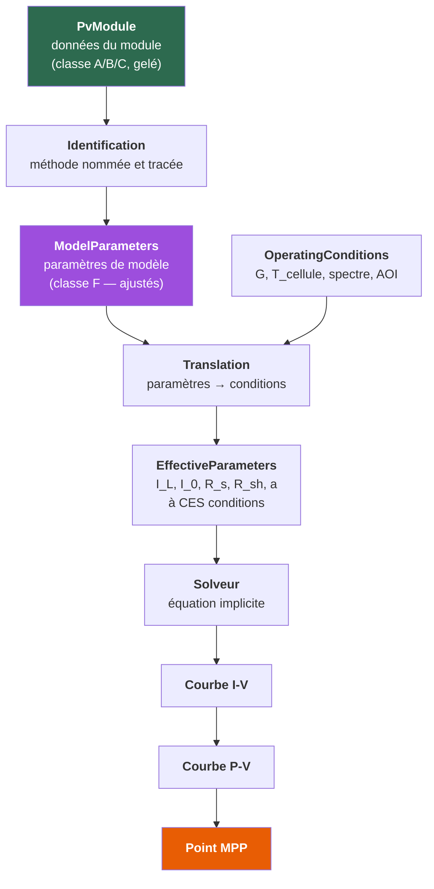
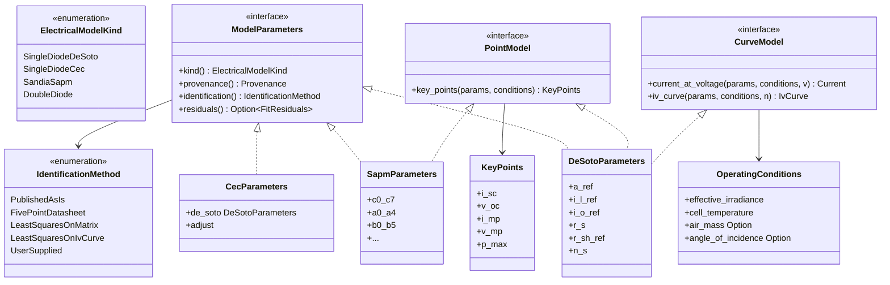
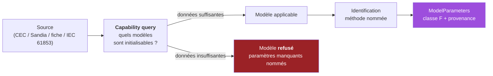

# 30. Spécification scientifique — `electrical_model`

**Date** : 2026-08-11
**Statut** : conception — **aucun code de calcul**
**Prérequis** : `pv_module` gelé (doc 29)
**Référence normative amont** : `docs/design/27-specification-finale-pv-module.md`

---

> ## ⚠️ Avis de correction — 2026-08-12
>
> Les §8 (méthode numérique) et §15 (décisions ouvertes) de ce document
> sont **remplacés** par la doc 32 (revue scientifique), la doc 34 (audit
> mathématique) et les ADR-0009 et ADR-0010. Notamment : Lambert W n'est
> **pas** implémentée, le MPP se résout comme racine de `dP/dV` et son
> unicité est **démontrée**, et les sept décisions ouvertes sont fermées.
> Le texte est conservé pour la traçabilité.

## 0. Principe directeur

> `pv_module` décrit **ce qu'est** le module.
> `electrical_model` décrit **comment il se comporte électriquement**.

Cette frontière n'est pas une commodité d'organisation : c'est la
séparation entre une **description** et une **interprétation**. Un module
a une tension de circuit ouvert ; il n'a pas de résistance série. `R_s`
n'existe que dans un modèle qui postule un circuit équivalent. Deux
modèles ajustés sur le même module donneront deux `R_s` différents, tous
deux corrects dans leur cadre et dénués de sens hors de lui.

Le test de frontière, énoncé dans `pv_module` et conservé ici :

> Si une fonction a besoin d'une irradiance ou d'une température **de
> fonctionnement** en entrée, elle n'appartient pas à `pv_module`.

Sa réciproque définit le présent crate :

> Si une grandeur n'a de sens que relativement à un modèle nommé, elle
> n'appartient pas à `pv_module` et doit porter l'identité de ce modèle.

---

## 1. Objet et périmètre

### 1.1 Ce que le moteur devra permettre

| Capacité | Nature |
|---|---|
| Courbe I-V à conditions données | Continue ou discrète selon le modèle (§5.6) |
| Courbe P-V | Dérivée de la courbe I-V |
| `V_oc`, `I_sc`, `V_mp`, `I_mp`, `P_max` hors STC | Points remarquables |
| Influence de l'irradiance | Translation de paramètres (§6.3) |
| Influence de la température | Translation de paramètres (§6.3) |
| Identification des paramètres | Depuis fiche, base, ou matrice mesurée (§7) |
| Recherche du MPP | Optimisation sous contrainte (§8.5) |

### 1.2 Ce qui est explicitement hors périmètre

Ni maintenant, ni dans la sous-phase d'implémentation qui suivra :

modules bifaciaux (gain de site), mismatch, chaînes, MPPT, onduleurs,
ombrage, température variable calculée, vieillissement, dégradation,
tandem à terminaux multiples, pertes de câblage, salissure.

Le §13 montre comment l'architecture les accueillera **plus tard** sans
être modifiée. Aucun de ces éléments n'est spécifié ici.

### 1.3 Ce que ce document ne fait pas

Il ne choisit pas encore la méthode numérique par décret : le §8 compare
les candidates et **justifie** une recommandation. Il ne fixe pas non
plus la grille IEC 61853-1, qui reste un point ouvert (§9.4).

---

## 2. La chaîne de transformation



Trois frontières y sont infranchissables :

1. **`PvModule` → `ModelParameters`** ne se fait que par une
   identification **nommée**, dont le résultat porte la méthode employée.
2. **`ModelParameters` → `EffectiveParameters`** exige des conditions
   explicites. Il n'existe pas de « paramètres » sans conditions, sauf
   ceux de référence, qui portent leur condition de référence.
3. **`EffectiveParameters` → courbe** est le seul endroit où un solveur
   numérique intervient.

---

## 3. Données constructeur contre paramètres de modèle

### 3.1 La confusion à rendre impossible

| Grandeur | Nature | Classe | Où elle vit |
|---|---|---|---|
| `V_oc`, `I_sc`, `V_mp`, `I_mp`, `P_max` | Mesurables sur un module réel | A ou B | `pv_module` |
| `α_Isc`, `β_Voc`, `γ_Pmax` | Mesurables (IEC 61215) | A ou B | `pv_module` |
| `I_L`, `I_0`, `R_s`, `R_sh`, `a`, `n` | **Inobservables** — inférées dans un cadre | **F** | `electrical_model` |
| `C0`–`C7`, `A0`–`A4`, `B0`–`B5` | Coefficients de régression SAPM | **F** | `electrical_model` |
| `Adjust` | Correctif propre au CEC | **F** | `electrical_model` |

**Le critère de partage est l'observabilité, pas l'unité.** `a` s'exprime
en volts et n'est pas une tension du module : c'est le produit
`n·N_s·k·T/q`, où `n` n'est mesurable par aucun instrument. Une grandeur
qui ne peut être mesurée que *via* un modèle appartient au modèle.

Cette règle est déjà appliquée et vérifiée : sur les 42 champs d'un
enregistrement Sandia, **28 sont des coefficients propres au SAPM**, et
sur les 25 champs CEC, **6 sont des paramètres De Soto**
(`docs/design/26-validation-empirique-cec-sandia.md` §2.6, §3).

### 3.2 Ce que tout paramètre de modèle devra porter

Obligatoire, sans exception :

| Attribut | Pourquoi |
|---|---|
| **Modèle d'appartenance** | Un `R_s` De Soto n'est pas un `R_s` à deux diodes ; les confondre est une erreur de catégorie |
| **Classification** | `DataClass::Fitted` (F) systématiquement — jamais A ni B |
| **Provenance** | Base source, version, date, adaptateur |
| **Méthode d'obtention** | §7.2 — publiée telle quelle, ajustée par moindres carrés, résolue à cinq points… |
| **Données d'ajustement** | Quels points ont servi, à quelles conditions |
| **Incertitude** | Quand la méthode en produit une (§7.5) |
| **Résidus** | La qualité d'ajustement effectivement atteinte |

`pv_module` fournit déjà `Measurement<T>` et `DataClass::Fitted` ;
`INV-PRV-003` refuse d'ailleurs déjà qu'un paramètre ajusté occupe un
champ physique. `electrical_model` en est le pendant : un champ de
paramètre ne doit jamais accepter une valeur de classe A présentée
comme ajustée.

### 3.3 Sûreté de typage exigée

Quatre confusions doivent être **impossibles à écrire**, pas seulement
détectées à l'exécution :

1. Utiliser un jeu de paramètres De Soto avec un évaluateur SAPM.
2. Utiliser des paramètres de référence comme s'ils étaient effectifs.
3. Confondre température de cellule et température ambiante — déjà résolu
   en amont par `TemperatureSpecification`, à propager ici.
4. Confondre irradiance dans le plan des modules et irradiance
   **effective** (après IAM et correction spectrale) : ce sont deux
   grandeurs différentes en W/m², et le SAPM les distingue explicitement.

---

## 4. Le modèle à diode unique

### 4.1 Équation

Pour un module de `N_s` cellules en série, à conditions de
fonctionnement fixées :

$$
I = I_L - I_0\left[\exp\!\left(\frac{V + I R_s}{a}\right) - 1\right] - \frac{V + I R_s}{R_{sh}}
$$

**Elle est implicite en `I`** : `I` figure des deux côtés. C'est la source
de toute la difficulté numérique du §8.

### 4.2 Les sept grandeurs

| Symbole | Nom | Unité SI | Nature | Domaine |
|---|---|---|---|---|
| `I_L` | Photocourant | A | Ajustée (F) | `> 0` |
| `I_0` | Courant de saturation inverse | A | Ajustée (F) | `> 0`, typiquement 1e-12 à 1e-9 |
| `R_s` | Résistance série | Ω | Ajustée (F) | `≥ 0` |
| `R_sh` | Résistance shunt | Ω | Ajustée (F) | `> 0`, typiquement 1e2 à 1e4 |
| `a` | Facteur d'idéalité modifié | V | Ajustée (F) | `> 0` |
| `n` | Facteur d'idéalité de la diode | — | Ajustée (F) | typiquement 0,5 à 2 |
| `N_s` | Cellules en série | — | **Donnée du module (A)** | `≥ 1` |
| `V_t` | Tension thermique | V | Calculée | `k T_c / q` |

Avec :

$$
a = n \, N_s \, V_t = \frac{n \, N_s \, k \, T_c}{q}
$$

`k` = constante de Boltzmann, `q` = charge élémentaire, `T_c` =
température **de cellule** en kelvins. `k` et `q` sont des constantes
CODATA déjà disponibles dans `core_constants`.

**`N_s` est la seule des sept à venir du module.** C'est ce qui rend le
couplage `pv_module` → `electrical_model` unidirectionnel et mince.

### 4.3 Interprétation physique des termes

| Terme | Signification | Effet dominant |
|---|---|---|
| `I_L` | Génération photonique | Fixe le plateau de courant, `I_sc` |
| `I_0[exp(·) − 1]` | Recombinaison dans la jonction | Fixe le coude et `V_oc` |
| `(V + I R_s)/R_sh` | Fuite parallèle | Pente non nulle à faible tension |
| `I R_s` | Chute ohmique série | Pente finie près de `V_oc`, perte de facteur de forme |

Une conséquence à retenir pour §10 : **`R_sh` domine à faible
irradiance**. C'est pourquoi la loi `R_sh(G)` distingue le plus nettement
les modèles entre eux.

### 4.4 Dérivée analytique

Nécessaire à Newton (§8.2). En différentiant l'équation implicite :

$$
\frac{dI}{dV} = -\;\frac{\dfrac{I_0}{a}\exp\!\left(\dfrac{V + I R_s}{a}\right) + \dfrac{1}{R_{sh}}}
{1 + \dfrac{I_0 R_s}{a}\exp\!\left(\dfrac{V + I R_s}{a}\right) + \dfrac{R_s}{R_{sh}}}
$$

Le dénominateur est **toujours ≥ 1** pour des paramètres physiques
(`R_s ≥ 0`, `R_sh > 0`, `I_0 > 0`) : la dérivée ne peut donc pas exploser.
C'est une propriété utile, à vérifier par test.

### 4.5 Propriété de monotonie — le fondement de la robustesse

À tension `V` fixée, posons le résidu :

$$
f(I) = I_L - I_0\left[\exp\!\left(\frac{V + I R_s}{a}\right) - 1\right] - \frac{V + I R_s}{R_{sh}} - I
$$

$$
\frac{df}{dI} = -\frac{I_0 R_s}{a}\exp\!\left(\frac{V + I R_s}{a}\right) - \frac{R_s}{R_{sh}} - 1 \;\le\; -1
$$

**`f` est strictement décroissante en `I`, de dérivée majorée par −1.**

Trois conséquences, qui décident du §8 :

1. **La racine est unique.** Aucun risque de converger vers la mauvaise.
2. **Elle est encadrable *a priori*** : `f(0) ≥ f(I_L + I_0)` et
   `f(I_L + I_0) < 0`. L'intervalle `[0, I_L + I_0]` contient la racine
   dès que `f(0) ≥ 0`, ce qui est le cas pour tout `V` du quadrant utile.
3. **Une méthode à encadrement converge de façon garantie.** Ce n'est
   donc pas un pari : c'est un théorème, et la boucle numérique a une
   borne démontrée, non postulée.

Cette propriété doit faire l'objet d'une **démonstration écrite** dans
l'annexe technique, au même titre que les deux preuves de la doc 18.

---

## 5. Comparaison des modèles

### 5.1 Modèles retenus pour l'étude

| Modèle | Référence | Nature |
|---|---|---|
| Diode unique / De Soto | De Soto, Klein & Beckman, *Solar Energy* 80(1), 2006 | Physique, 5 paramètres |
| CEC | De Soto + paramètre `Adjust`, NREL SAM | Physique + correctif empirique |
| Sandia SAPM | King, Boyson & Kratochvil, SAND2004-3535 | **Empirique**, régression |
| Deux diodes | Littérature classique (p. ex. Ishaque *et al.*, 2011) | Physique, 7 paramètres |
| PVsyst | Mermoud & Lejeune, EU PVSEC 2010 | Physique, `R_sh(G)` exponentielle |

### 5.2 Tableau comparatif

| Critère | De Soto | CEC | SAPM | Deux diodes | PVsyst |
|---|---|---|---|---|---|
| Paramètres | 5 | 6 | ~28 | 7 | 6–7 |
| Courbe I-V continue | **Oui** | **Oui** | **Non** (§5.6) | Oui | Oui |
| Identifiable depuis une fiche seule | Oui | Non (`Adjust` fourni) | **Non** | Difficile | Oui |
| Base publique de paramètres | CEC (~2×10⁴ modules) | CEC | Sandia (~500) | Aucune | `.PAN` (**bloqué**) |
| Effet spectral | Optionnel (`M/M_ref`) | Optionnel | **Intégré** (`f1(AM_a)`) | Optionnel | Optionnel |
| Effet d'angle d'incidence | Externe | Externe | **Intégré** (`f2(AOI)`) | Externe | Externe |
| Faible irradiance | Moyen | Amélioré | Bon (régressé) | Bon | Bon (`R_sh(G)`) |
| Couches minces | Faible | Moyen | Bon | Moyen | Bon |
| Extrapolation hors domaine mesuré | Correcte (physique) | Correcte | **Risquée** (régression) | Correcte | Correcte |
| Coût de calcul | Résolution implicite | Idem | **Explicite, direct** | Plus lourd | Résolution implicite |

### 5.3 Le constat décisif

> **Aucun modèle unique ne convient à toutes les données.**

Ce n'est pas une prudence de rédaction, c'est la conséquence directe du
§8 : les données disponibles diffèrent d'une source à l'autre, et un
modèle qu'on ne peut pas initialiser est inutilisable quelles que soient
ses qualités.

- Un enregistrement **CEC** apporte les six paramètres De Soto/CEC tout
  faits. Le SAPM y est inapplicable : ses 28 coefficients sont absents.
- Un enregistrement **Sandia** apporte les coefficients SAPM. En tirer
  des paramètres De Soto exigerait une identification à partir des seuls
  points STC.
- Une **fiche constructeur** seule ne donne ni l'un ni l'autre : elle
  impose une identification à cinq points (§7.3).
- Une **matrice IEC 61853-1** permet un ajustement bien mieux contraint
  que n'importe quelle fiche, pour n'importe lequel des modèles physiques.

L'architecture doit donc être **multi-modèles par construction**, et la
sélection doit être **explicite et justifiée**, jamais implicite.

### 5.4 Ce qu'aucun de ces modèles ne fait

Rappel nécessaire avant l'implémentation : aucun ne modélise le
vieillissement, le mismatch entre cellules, l'ombrage partiel (qui casse
l'hypothèse d'uniformité), ni l'hystérésis. Le domaine de validité
devra être porté par le code, pas seulement par ce document.

### 5.5 PVsyst — statut

Le modèle est **décrit dans une publication de conférence accessible**
(Mermoud & Lejeune, 2010) : sa physique est de la science publiée, pas un
secret industriel. Le format `.PAN`, lui, reste **bloqué** (doc 27 §12.4).

Distinguer les deux est nécessaire pour rester honnête, mais le risque de
reproduire par inadvertance une interface propriétaire en implémentant le
modèle *et* son format est réel. **Décision : différé.** Aucune
implémentation avant un ADR dédié statuant séparément sur le modèle et
sur le format.

### 5.6 SAPM ne produit pas une courbe

Point d'architecture le plus important de cette comparaison.

Le SAPM fournit **cinq points** de la courbe : `I_sc`, `I_x` (à
`V_oc/2`), `I_mp`, `I_xx` (à `(V_oc + V_mp)/2`), `V_oc`, `V_mp`. Il ne
fournit **aucune** relation `I(V)` continue.

Exposer le SAPM derrière une interface « donne-moi `I` à n'importe quel
`V` » obligerait à interpoler entre ces points et **présenterait
l'interpolation comme le modèle**. Ce serait une invention de données.

**Conséquence de conception** : la hiérarchie d'abstraction doit séparer

- les modèles qui produisent des **points remarquables** ;
- les modèles qui produisent une **courbe continue**.

Le diode unique fait les deux. Le SAPM ne fait que le premier. Cette
distinction est portée par le §11.2 et par l'ADR-0008.

---

## 6. Équations par modèle

### 6.1 De Soto — équations de translation

Depuis les paramètres de référence `(a_ref, I_L,ref, I_0,ref, R_s,
R_sh,ref)` établis à `(G_ref = 1000 W/m², T_ref = 25 °C)` :

**Facteur d'idéalité modifié**

$$ \frac{a}{a_{ref}} = \frac{T_c}{T_{ref}} $$

**Photocourant**

$$ I_L = \frac{G_{eff}}{G_{ref}} \cdot \frac{M}{M_{ref}} \left[ I_{L,ref} + \alpha_{Isc}\,(T_c - T_{ref}) \right] $$

`M/M_ref` est le facteur de correction spectrale, **optionnel** ; en son
absence il vaut 1 et cette hypothèse doit être **déclarée**, non tue.

**Courant de saturation**

$$ \frac{I_0}{I_{0,ref}} = \left(\frac{T_c}{T_{ref}}\right)^{3} \exp\left[\frac{1}{k}\left(\frac{E_{g,ref}}{T_{ref}} - \frac{E_g}{T_c}\right)\right] $$

avec, pour le silicium, `E_g,ref = 1,121 eV` et

$$ \frac{E_g}{E_{g,ref}} = 1 - 0{,}0002677\,(T_c - T_{ref}) $$

`k` en eV/K ici. **Le coefficient 0,0002677 est propre au silicium** :
l'appliquer à un CdTe ou à une pérovskite serait une extrapolation non
justifiée. Le code devra soit disposer d'une valeur par matériau, soit
refuser, soit signaler. Il ne devra jamais l'appliquer silencieusement.

**Résistances**

$$ R_{sh} = R_{sh,ref}\,\frac{G_{ref}}{G_{eff}} \qquad\qquad R_s = R_{s,ref} $$

`R_s` constant est une **hypothèse du modèle**, pas un fait physique ; à
documenter comme telle.

### 6.2 CEC — l'écart avec De Soto

Le modèle CEC est le modèle De Soto avec un unique correctif appliqué au
coefficient de température du courant :

$$ \alpha_{Isc}^{\text{ajusté}} = \alpha_{Isc}\left(1 - \frac{\text{Adjust}}{100}\right) $$

puis les équations du §6.1 à l'identique. `Adjust` est un paramètre
**ajusté** (classe F) qui corrige empiriquement le comportement en
température ; il n'a pas d'interprétation physique directe.

### 6.3 SAPM — équations principales

Irradiance effective, adimensionnelle :

$$ E_e = \frac{I_{sc}}{I_{sco}\left[1 + \alpha_{Isc}(T_c - T_0)\right]} $$

$$ I_{mp} = I_{mpo}\left(C_0 E_e + C_1 E_e^2\right)\left[1 + \alpha_{Imp}(T_c - T_0)\right] $$

$$ V_{oc} = V_{oco} + N_s\,\delta(T_c)\ln E_e + \beta_{Voc}(E_e)\,(T_c - T_0) $$

$$ V_{mp} = V_{mpo} + C_2 N_s \delta(T_c)\ln E_e + C_3 N_s \left[\delta(T_c)\ln E_e\right]^2 + \beta_{Vmp}(E_e)(T_c - T_0) $$

avec `δ(T_c) = n k (T_c + 273,15)/q` et
`β_Voc(E_e) = β_Voco + m_{βVoc}(1 - E_e)`.

Les fonctions `f1(AM_a)` (masse d'air) et `f2(AOI)` (incidence) sont des
polynômes de degré 4 et 5, de coefficients `A0`–`A4` et `B0`–`B5`.

**`ln E_e` diverge quand `E_e → 0`.** C'est le cas limite dominant du
SAPM, traité au §10.

### 6.4 Résolution explicite par la fonction W de Lambert

L'équation implicite du §4.1 admet une solution explicite.

**Courant à tension donnée** :

$$ I = \frac{R_{sh}(I_L + I_0) - V}{R_s + R_{sh}} - \frac{a}{R_s}\,W_0(\theta) $$

$$ \theta = \frac{R_s I_0 R_{sh}}{a\,(R_s + R_{sh})}\exp\!\left[\frac{R_{sh}\left(R_s I_L + R_s I_0 + V\right)}{a\,(R_s + R_{sh})}\right] $$

**Tension à courant donné** :

$$ V = (I_L + I_0 - I)R_{sh} - I R_s - a\,W_0(\theta') $$

$$ \theta' = \frac{I_0 R_{sh}}{a}\exp\!\left[\frac{R_{sh}(I_L + I_0 - I)}{a}\right] $$

Référence : Jain & Kapoor, *Solar Energy Materials and Solar Cells* 81,
2004.

**Deux réserves sérieuses**, développées au §8.3 :

1. `θ` contient une exponentielle dont l'argument atteint couramment 25 à
   60 pour un module de 72 cellules, et davantage pour un `a` faible.
   `exp` déborde en `f64` au-delà d'environ 709 ; le produit
   préfacteur × exponentielle est donc à évaluer en domaine
   logarithmique, jamais naïvement.
2. La formule pour `I` **divise par `R_s`** : elle est singulière en
   `R_s = 0`, cas parfaitement admissible physiquement, qui possède
   d'ailleurs une forme fermée distincte.

« Explicite » ne signifie donc pas « robuste ». C'est le cœur de la
recommandation du §8.6.

---

## 7. Identification des paramètres

### 7.1 Le problème

Cinq inconnues (`a_ref`, `I_L,ref`, `I_0,ref`, `R_s`, `R_sh,ref`), et une
fiche constructeur qui fournit cinq contraintes :

| # | Contrainte | Origine |
|---|---|---|
| 1 | `I = 0` en `V = V_oc` | Définition |
| 2 | `I = I_sc` en `V = 0` | Définition |
| 3 | `I = I_mp` en `V = V_mp` | Définition |
| 4 | `dP/dV = 0` au MPP | Le MPP est un extremum |
| 5 | `dV_oc/dT = β_Voc` | Coefficient thermique mesuré |

Système non linéaire 5×5, sans solution analytique.

### 7.2 Méthodes d'obtention à distinguer

Chacune produit des paramètres de qualité et d'incertitude différentes ;
la méthode doit voyager avec le résultat.

| Méthode | Entrée | Contrainte |
|---|---|---|
| `PublishedAsIs` | Base CEC | Aucun calcul — les six valeurs sont reprises telles quelles |
| `FivePointDatasheet` | Fiche | Système 5×5, §7.3 |
| `LeastSquaresOnMatrix` | Matrice IEC 61853-1 | Sur-déterminé, §7.4 |
| `LeastSquaresOnIvCurve` | Courbe I-V mesurée | Le mieux contraint |
| `UserSupplied` | Saisie | Classe E, justification obligatoire |

**`PublishedAsIs` doit rester distincte de tout ajustement.** Reprendre
les paramètres CEC n'est pas les recalculer ; les résidus qu'on leur
associerait n'auraient pas le même sens.

### 7.3 Identification à cinq points

Le système est mal conditionné : `I_0,ref` s'étend sur des ordres de
grandeur (1e-12 à 1e-9) tandis que `I_L,ref` est de l'ordre de 10.
Résoudre en `ln(I_0)` plutôt qu'en `I_0` est indispensable, et devra être
justifié dans l'annexe.

Conditions d'échec à traiter explicitement, jamais à masquer :

- `β_Voc` absent → une contrainte manque, le système est sous-déterminé ;
- la solution converge vers `R_sh < 0` ou `R_s < 0`, non physique ;
- non-convergence.

Dans les trois cas, la réponse est une **erreur typée**, pas une valeur
de repli.

### 7.4 Ajustement sur matrice

La matrice IEC 61853-1 fournit bien plus de points que d'inconnues :
l'ajustement est sur-déterminé, donc mieux conditionné, et **produit des
résidus exploitables** — seule méthode qui permette de dire à quel point
le modèle décrit réellement ce module.

Elle permet en outre de **comparer les modèles entre eux sur pièces**,
puisque tous peuvent être ajustés sur la même matrice.

### 7.5 Incertitude des paramètres

Trois sources, à ne jamais confondre (la même exigence qu'en amont) :

1. l'incertitude des données d'entrée, propagée ;
2. l'incertitude d'ajustement, issue de la matrice de covariance ;
3. l'**erreur de modèle** — l'écart irréductible entre le modèle et le
   module réel, qui n'est pas une incertitude statistique et ne doit pas
   être additionnée aux deux autres.

Seules 1 et 2 se combinent selon le GUM. La troisième se **rapporte**,
via les résidus.

---

## 8. Méthode numérique

### 8.1 Ce qui doit être fixé avant toute ligne de code

| Élément | Exigence |
|---|---|
| Tolérance en courant | Relative à `I_sc`, pas absolue |
| Tolérance en tension | Relative à `V_oc` |
| Tolérance en puissance | Relative à `P_max` |
| Critère de convergence | Sur le **résidu** *et* sur le **pas** |
| Itérations maximales | Borne finie, toujours |
| Non-convergence | **Erreur typée** — jamais un résultat approché rendu comme exact |

Le principe : *aucune boucle numérique sans critère de convergence
formel*. Une boucle sans borne démontrée est un défaut, pas une
optimisation.

### 8.2 Newton-Raphson

Convergence quadratique, dérivée analytique disponible (§4.4).

Contre : rien ne garantit la convergence depuis un mauvais point de
départ ; le pas peut sortir du domaine physique et produire un argument
d'exponentielle qui déborde.

### 8.3 Fonction W de Lambert

Pour : explicite, sans itération sur l'équation elle-même.

Contre : `W_0` s'évalue elle-même itérativement (Halley) ; l'argument
déborde (§6.4) ; la formule en courant est singulière en `R_s = 0` ; la
précision se dégrade pour les très grands arguments, là précisément où
les modules réels se situent.

**Le caractère explicite déplace la difficulté numérique, il ne la
supprime pas.**

### 8.4 Brent

Pour : convergence **garantie** sur un intervalle encadrant, sans
dérivée, superlinéaire en pratique. Le §4.5 démontre que l'encadrement
existe et que la racine est unique — les hypothèses de Brent sont donc
satisfaites par construction, pas par chance.

Contre : plus lent que Newton près de la solution ; exige un encadrement
valide.

### 8.5 Recherche du MPP

Deux formulations :

1. maximiser `P(V) = V·I(V)` sur `[0, V_oc]` ;
2. résoudre `dP/dV = 0`.

La recherche par section dorée suppose l'**unimodalité** de `P(V)`.
Cette hypothèse est raisonnable pour des paramètres physiques mais
**n'est pas garantie** pour des paramètres pathologiques, notamment
`R_sh` très faible.

**Elle ne doit donc pas être supposée en silence** : le point trouvé sera
vérifié comme maximum, et les cas où la vérification échoue seront
signalés plutôt qu'ignorés. Un MPP faux est plus dangereux qu'un MPP
absent, parce qu'il est plausible.

### 8.6 Recommandation

**Stratégie hybride, à trois niveaux.**

1. **Estimation initiale** par Lambert W lorsque l'argument est
   numériquement sûr, sinon par une approximation explicite grossière.
2. **Raffinement par Newton-Raphson**, borné en itérations, chaque pas
   contraint à rester dans `[0, I_L + I_0]`.
3. **Repli sur Brent** sur l'encadrement démontré au §4.5 dès que Newton
   sort du domaine, stagne, ou épuise ses itérations.

Justification : le §4.5 fournit un encadrement et une unicité **prouvés**.
Le repli est donc une garantie de terminaison, pas un filet de sécurité
optimiste. Newton apporte la vitesse ; Brent apporte la certitude ;
Lambert W apporte un bon départ sans qu'on lui confie la robustesse.

**Cette recommandation reste à confirmer par mesure** avant d'être
gravée : le §11 prévoit une campagne de comparaison des trois méthodes
sur la même population de modules. Le choix définitif sera acté par
ADR-0008 après cette mesure — pas avant.

### 8.7 Valeurs à fixer, et comment

Ordres de grandeur envisagés, **à confirmer expérimentalement** :

| Grandeur | Piste | Fondement |
|---|---|---|
| Tolérance résidu en courant | ~1e-10 relatif à `I_sc` | Bien en deçà de toute incertitude de mesure |
| Tolérance en tension | ~1e-10 relatif à `V_oc` | Idem |
| Itérations Newton | ~50 | Une convergence quadratique saine en demande moins de 10 |
| Itérations Brent | ~100 | Borne de sécurité |

Aucune de ces valeurs n'est arrêtée par ce document. Elles seront
mesurées, puis inscrites en constantes nommées et documentées — jamais
en littéraux, conformément à la règle du projet.

---

## 9. Matrice modèle × données

### 9.1 Lecture

Établie à partir des schémas **réellement inspectés** des bases CEC et
Sandia (doc 26 §2 et §3), non reconstitués.

### 9.2 Matrice

| Modèle | Données requises | Disponibles depuis | Manquant | Méthode d'identification |
|---|---|---|---|---|
| **De Soto** | `a_ref`, `I_L,ref`, `I_0,ref`, `R_s`, `R_sh,ref`, `N_s`, `α_Isc` | **CEC** : tout | Rien | `PublishedAsIs` |
| **De Soto** | idem | **Fiche** : `V_oc`, `I_sc`, `V_mp`, `I_mp`, `α_Isc`, `β_Voc`, `N_s` | Les 5 paramètres | `FivePointDatasheet` |
| **De Soto** | idem | **Sandia** : `Isco`, `Voco`, `Impo`, `Vmpo`, `Aisc`, `Bvoco`, `Cells_in_Series` | Les 5 paramètres | `FivePointDatasheet` sur le point STC |
| **CEC** | De Soto + `Adjust` | **CEC** : tout | Rien | `PublishedAsIs` |
| **CEC** | idem | Fiche | `Adjust` **non identifiable** depuis une fiche | Aucune — modèle **inapplicable** |
| **SAPM** | ~28 coefficients | **Sandia** : tout | Rien | `PublishedAsIs` |
| **SAPM** | idem | CEC ou fiche | 28 coefficients | Aucune — modèle **inapplicable** |
| **Deux diodes** | 7 paramètres | Fiche | Tous | Sous-déterminé sans hypothèse supplémentaire |
| **Tous physiques** | — | **IEC 61853-1** | — | `LeastSquaresOnMatrix` (le mieux contraint) |

### 9.3 Ce que la matrice établit

Trois cases portent « modèle inapplicable ». Ce n'est pas un défaut de la
matrice : c'est le fait central que l'architecture doit respecter.

**Le moteur devra répondre à la question « quels modèles cette source
permet-elle d'initialiser ? » et refuser les autres**, plutôt que
d'inventer les paramètres manquants par défaut. Un `Adjust` mis à zéro
parce qu'il est absent transformerait silencieusement un modèle CEC en
modèle De Soto sous une étiquette fausse.

### 9.4 Point ouvert — la grille IEC 61853-1

La grille exacte (irradiances × températures, et les combinaisons
déclarées non requises) **doit être lue dans le texte normatif**. Elle
n'est pas reproduite ici de mémoire.

Ce point reste ouvert, comme dans la doc 29. Aucune valeur ne sera
inventée.

---

## 10. Cas limites

Chacun devra avoir un comportement **spécifié avant d'être codé**, et au
moins un test dédié.

| # | Cas | Comportement exigé |
|---|---|---|
| 1 | `G → 0` | `I_L → 0` ; `V_oc → 0` par continuité ; `P = 0`. Ni NaN ni `−∞`. Le SAPM diverge (`ln E_e`) et doit être **refusé** sous un seuil déclaré, non extrapolé |
| 2 | `G` exactement nul | Court-circuit du calcul : tous les points à zéro, sans passer par le solveur |
| 3 | Température extrême | Hors du domaine de validité déclaré → avertissement porté par le résultat |
| 4 | `R_s = 0` | Forme fermée distincte ; la formule Lambert W en courant est **singulière** |
| 5 | `R_s` très faible | Perte de précision par annulation catastrophique — à mesurer |
| 6 | `R_sh → ∞` | Le terme de fuite disparaît ; forme limite explicite |
| 7 | `R_sh` faible | Facteur de forme effondré ; l'unimodalité de `P(V)` peut tomber (§8.5) |
| 8 | `I = 0` | Cas `V_oc`, régulier |
| 9 | `V = 0` | Cas `I_sc`, régulier |
| 10 | Pas de MPP identifiable | **Erreur typée**, jamais un point arbitraire |
| 11 | Paramètres incompatibles | `I_0 ≤ 0`, `R_sh ≤ 0`, `a ≤ 0` → refus avant tout calcul |
| 12 | Données insuffisantes | Modèle déclaré inapplicable (§9.3), pas de valeur par défaut |
| 13 | Sources contradictoires | **Conflit** au sens de `pv_module` — jamais arbitré silencieusement |
| 14 | Débordement de l'exponentielle | Détection **avant** évaluation, pas après (§6.4) |

Le cas 13 mérite qu'on s'y arrête : si une fiche donne `V_oc = 49,5 V` et
la base CEC 48,9 V pour le même module, le moteur ne choisit pas. Le
mécanisme existe déjà en amont et sera **réutilisé**, pas réinventé.

---

## 11. Stratégie de validation

### 11.1 Principe

> Une implémentation de référence n'est jamais une preuve de vérité.

pvlib sert d'**oracle externe indépendant** : un écart signale une
divergence à expliquer, dans un sens ou dans l'autre. La campagne de
position solaire a déjà montré la valeur de cette discipline — deux
divergences réelles y ont été trouvées et documentées plutôt que
masquées.

### 11.2 Cinq niveaux, du plus fort au plus faible

| Niveau | Source de vérité | Ce qu'il prouve |
|---|---|---|
| **1. Analytique** | Solutions fermées de cas dégénérés (`R_s = 0`, `R_sh = ∞`) | Exactitude du solveur, sans référence externe |
| **2. Auto-cohérence** | Propriétés que le modèle doit satisfaire | Cohérence interne |
| **3. Synthétique** | Paramètres choisis, courbe engendrée, paramètres ré-identifiés | Que l'identification retrouve ce qui a été mis |
| **4. Bases publiques** | CEC, Sandia | Comportement sur données réelles à grande échelle |
| **5. Oracle externe** | pvlib | Divergence à expliquer, jamais à absorber |

Le niveau 1 est le plus fort et le plus négligé : `R_s = 0` et
`R_sh → ∞` donnent une équation explicite dont la solution exacte est
connue. Aucun oracle n'est nécessaire pour la vérifier.

### 11.3 Invariants d'auto-cohérence

Vérifiables sans aucune référence externe :

1. `P(V_mp) ≥ P(V)` pour tout `V` du balayage ;
2. `I(0) = I_sc` et `I(V_oc) = 0` à la tolérance près ;
3. `I(V)` strictement décroissante sur `[0, V_oc]` ;
4. `P_max(G, T)` croissante en `G` à `T` fixée ;
5. `P_max(G, T)` décroissante en `T` à `G` fixée, si `γ < 0` ;
6. `γ_Pmax` reconstitué depuis le modèle cohérent avec celui de la fiche ;
7. `V_oc(G, T)` cohérent avec `β_Voc` ;
8. le résidu de l'équation implicite au point rendu est sous la tolérance
   — vérification que le solveur a bien résolu ce qu'il prétend.

L'invariant 8 mérite d'être souligné : il vérifie le **solveur**, pas le
modèle. Les deux échouent différemment et doivent être testés séparément.

### 11.4 Ce que la validation ne pourra pas établir

Qu'un modèle décrit correctement un module réel. Cela demanderait des
mesures I-V de terrain. À déclarer comme limite, non comme acquis.

---

## 12. Unités

Tout reste en SI à l'intérieur ; les conversions ont lieu aux frontières.

| Grandeur | Unité SI | Type |
|---|---|---|
| Tension | V | `Voltage` (existe) |
| Courant | A | `Current` (existe) |
| Puissance | W | `Power` (existe) |
| Température | K | `Temperature` (existe) |
| Irradiance | W/m² | `Irradiance` (existe) |
| **Résistance** | **Ω** | **`Resistance` — à créer** |
| Énergie / bande interdite | J (eV aux frontières) | À décider |

### 12.1 Le cas de `a`

`a` s'exprime en volts sans être une tension du module. Deux options :

- le typer `Voltage`, au risque qu'il soit additionné à une tension
  réelle, ce qui n'aurait aucun sens ;
- lui donner un type propre, qui empêche l'addition mais alourdit
  l'écriture.

**Recommandation : type propre.** L'unité seule ne fait pas la
compatibilité sémantique, et c'est précisément la confusion que la
politique de typage du projet vise. À trancher dans l'ADR-0008.

### 12.2 L'électron-volt

`E_g` se publie en eV. Le facteur `1/k` du §6.1 n'est cohérent que si `k`
et `E_g` partagent leur système. La conversion doit se faire **une fois,
à l'entrée**, et la constante `k` en eV/K doit être **dérivée** de la
valeur CODATA en J/K, jamais saisie séparément — sans quoi deux
constantes indépendantes finiront par diverger.

---

## 13. Architecture

### 13.1 Diagramme de types



**`SapmParameters` implémente `PointModel` et non `CurveModel`** : c'est
le §5.6 rendu structurel. Le compilateur, et non une note de bas de page,
empêchera de demander une courbe continue au SAPM.

### 13.2 Flux d'identification



### 13.3 Dépendances autorisées

```
core_constants ← core_units ← core_math
                      ↑            ↑
                   pv_module       |
                      ↑            |
              electrical_model ────┘
```

Autorisé : `core_constants`, `core_units`, `core_math`, `pv_module`.
**Interdit** : toute dépendance externe ; toute dépendance vers `losses`,
`simulation`, ou tout crate aval ; toute dépendance de `pv_module` vers
`electrical_model` (le sens reste unique).

### 13.4 Extensions futures accueillies sans modification

| Extension | Point d'accroche |
|---|---|
| Bifacial | Une irradiance effective composite en entrée d'`OperatingConditions` |
| Mismatch | Composition de plusieurs `KeyPoints`/courbes, en aval |
| Chaînes, MPPT, onduleurs | Consommateurs de ce crate, jamais l'inverse |
| Ombrage | Modifie l'irradiance effective en amont |
| Vieillissement | Transforme les paramètres, ne change pas le modèle |
| Tandem | Plusieurs jeux de paramètres, un par sortie électrique — `pv_module` porte déjà `ElectricalOutput` |
| Technologies futures | Nouveau membre de `ElectricalModelKind` |

Aucune n'est implémentée ni spécifiée ici : la seule exigence est que
l'architecture ne les interdise pas.

---

## 14. Livrables et critère de sortie

| # | Livrable | Emplacement |
|---|---|---|
| 1 | Spécification scientifique | Ce document |
| 2 | Comparaison des modèles | §5 |
| 3 | Architecture | §13 |
| 4 | Équations | §4, §6 |
| 5 | Méthode numérique proposée | §8 |
| 6 | Stratégie de validation | §11 |
| 7 | Plan de tests | `docs/design/31-plan-tests-electrical-model.md` |
| 8 | ADR | `docs/adr/0008-electrical-model-architecture.md` |
| 9 | Matrice de traçabilité | `docs/design/21-matrice-tracabilite.md`, Partie D |
| 10 | Diagrammes UML | §2, §13.1, §13.2 |

**État du code** : `engine/crates/electrical_model/` demeure le squelette
documenté livré en Phase 1. **Zéro logique de calcul.**

L'implémentation ne commencera qu'après validation explicite.

---

## 15. Décisions restant à trancher

Consignées ici pour qu'aucune ne soit prise par défaut pendant
l'implémentation.

| # | Décision | Tranchée par |
|---|---|---|
| D-1 | Méthode numérique définitive | ADR-0008, **après mesure** (§8.6) |
| D-2 | Type propre pour `a`, ou `Voltage` | ADR-0008 (§12.1) |
| D-3 | Modèle par défaut lorsque plusieurs sont applicables | ADR-0008 — ou refus de choisir, cohérent avec la politique de conflits |
| D-4 | Seuil d'irradiance sous lequel le SAPM est refusé | À mesurer (§10, cas 1) |
| D-5 | `E_g` et son coefficient thermique pour les non-silicium | Recherche bibliographique (§6.1) |
| D-6 | PVsyst — modèle et format | ADR dédié (§5.5) |
| D-7 | Tolérances et bornes d'itération | À mesurer (§8.7) |

Aucune de ces sept décisions ne doit être prise implicitement par le
premier code écrit.
