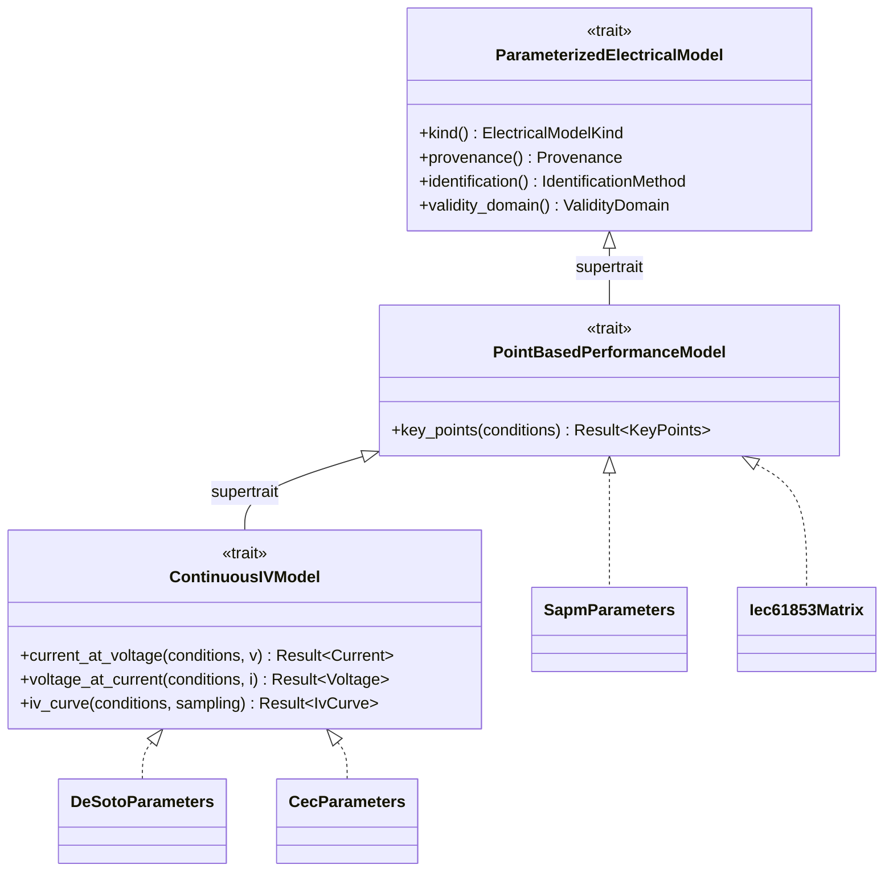

# 32. Revue scientifique finale — `electrical_model`

**Date** : 2026-08-12
**Statut** : conception — **aucune logique métier, aucun solveur, aucune courbe**
**Objet** : fermer les sept décisions laissées ouvertes par la doc 30 §15
**Principe** : *le code est la conséquence de la science validée ; la science ne s'adapte pas au code déjà écrit.*

---

## 0. Résumé des renversements

Cette revue a produit trois résultats qui **contredisent** les
recommandations provisoires de la doc 30. Ils sont signalés d'emblée
plutôt que noyés dans le texte.

| # | Recommandation provisoire (doc 30) | Résultat de la revue | Où |
|---|---|---|---|
| R-1 | Brent comme garantie, Newton comme chemin rapide | **Newton est globalement convergent** pour ce problème — démonstration §4.3. Brent devient un filet contre la pathologie *numérique*, pas *mathématique* | §4 |
| R-2 | Lambert W comme estimation initiale | **Lambert W n'est pas implémentée.** Elle ne paie pas son coût une fois Newton prouvé convergent | §5 |
| R-3 | MPP par recherche de maximum de `P(V)` | **Interdit** : maximiser une fonction lisse plafonne la précision à `√ε ≈ 1,5·10⁻⁸`. Il faut résoudre `dP/dV = 0` | §7.4 |

Un quatrième résultat, non prévu, est apparu de l'analyse dimensionnelle
et concerne la sécurité des unités : **`α_Isc` n'a pas la même dimension
dans De Soto et dans le SAPM** (§10.4).

---

## 1. Matrice comparative complète des modèles

### 1.1 Les modèles retenus pour l'étude

Cinq, dont un absent de la doc 30 et ajouté par cette revue.

| Modèle | Référence | Nature |
|---|---|---|
| **Single Diode / De Soto** | De Soto, Klein & Beckman, *Solar Energy* 80(1), 78–88, 2006 | Physique, 5 paramètres |
| **CEC** | De Soto + `Adjust`, NREL System Advisor Model | Physique + correctif empirique |
| **Sandia SAPM** | King, Boyson & Kratochvil, SAND2004-3535 | Empirique (régression) |
| **IEC 61853 — interpolation matricielle** | IEC 61853-1 (matrice), -3 (calcul de rendement énergétique) | **Sans paramètre** — données mesurées + interpolation |
| **Deux diodes** | Ishaque, Salam & Taheri, *Sol. Energy Mater. Sol. Cells* 95, 2011 | Physique, 7 paramètres |

**Ajout de cette revue** : le §5 de la doc 30 traitait IEC 61853 comme une
source de données, pas comme un modèle. C'est une erreur de classement.
La norme -3 définit un calcul de performance qui **interpole la matrice
mesurée** sans postuler aucun circuit équivalent. C'est un modèle à part
entière — le seul à n'avoir aucun paramètre ajusté, donc aucune classe F.

### 1.2 Matrice comparative — 16 critères

| Critère | De Soto | CEC | SAPM | IEC 61853 interp. | Deux diodes |
|---|---|---|---|---|---|
| **Équations** | doc 30 §4.1, §6.1 | §6.1 + §6.2 | §6.3 | §1.3 ci-dessous | §1.4 |
| **Paramètres requis** | `a_ref`, `I_L,ref`, `I_0,ref`, `R_s`, `R_sh,ref` | + `Adjust` | ~28 coefficients | **aucun** | 7 |
| **Données d'entrée** | `G_eff`, `T_c` | `G_eff`, `T_c` | `E_e`, `T_c`, `AM_a`, `AOI` | `G`, `T_c` | `G_eff`, `T_c` |
| **Sorties** | `I(V)` continue, tous points | idem | 5 points | `P_max` (grille), points si mesurés | `I(V)` continue |
| **Domaine de validité** | Physique, extrapolable | idem | Enveloppe de régression | **Enveloppe convexe de la grille** | Physique |
| **Depuis fiche constructeur** | Identifiable (§3) | **Impossible** (`Adjust`) | **Impossible** | Impossible | Sous-déterminé |
| **Depuis données CEC** | ✔ direct | ✔ direct | ✘ | ✘ | ✘ |
| **Depuis données Sandia** | Partiel (point STC seul) | ✘ | ✔ direct | ✘ | ✘ |
| **Produit une courbe I-V** | **Oui** | **Oui** | **Non** (§2) | **Non** | **Oui** |
| **Produit une courbe P-V** | Oui | Oui | Non | Non | Oui |
| **Calcule le MPP** | Oui (§7.4) | Oui | Rend `V_mp`,`I_mp` mesurés/régressés | Interpolation de `P_max` | Oui |
| **Dépendance en température** | Physique : `a∝T`, `I_0∝T³exp(·)` | idem + `Adjust` sur `α_Isc` | Régression linéaire/quadratique | **Mesurée** | Physique, 2 termes |
| **Dépendance en irradiance** | `I_L∝G`, `R_sh∝1/G` | idem | Régression en `E_e`, `ln E_e` | **Mesurée** | idem De Soto |
| **Précision** | Bonne près de STC ; dégrade à faible `G` | Améliorée par `Adjust` | Excellente dans l'enveloppe | **La meilleure** dans la grille ; nulle hors grille | Meilleure à faible `G` |
| **Coût numérique** | Résolution implicite (§4) | idem | **Explicite** | Interpolation | Implicite, plus lourd |
| **Références** | De Soto 2006 | SAM / De Soto | King 2004 | IEC 61853-1/-3 | Ishaque 2011 |

### 1.3 IEC 61853 — interpolation matricielle

Le modèle : `P_max(G, T_c)` est **lu** dans la matrice mesurée, et
interpolé entre ses nœuds. Aucune équation de circuit, aucun paramètre.

| Propriété | Conséquence |
|---|---|
| Aucun paramètre ajusté | Aucune classe F — les valeurs restent de classe B (mesurées) |
| Aucune hypothèse de modèle | Pas d'erreur de modèle, seulement une erreur d'interpolation |
| **Extrapolation interdite** | Hors de l'enveloppe convexe de la grille, le modèle **refuse** |
| Ne produit pas `I(V)` | La matrice ne donne que des points de puissance |

**C'est le modèle le plus exact et le moins général.** Il mérite d'exister
précisément parce que sa faiblesse est explicite : il ne prétend rien
hors du domaine mesuré, là où les modèles physiques extrapolent avec une
confiance qu'ils ne justifient pas toujours.

### 1.4 Deux diodes — écarté pour cette phase

$$
I = I_L - I_{01}\left[\exp\!\left(\frac{V+IR_s}{a_1}\right)-1\right] - I_{02}\left[\exp\!\left(\frac{V+IR_s}{a_2}\right)-1\right] - \frac{V+IR_s}{R_{sh}}
$$

Sept paramètres pour cinq contraintes de fiche : **sous-déterminé**. La
littérature le referme en fixant `a_1 = 1`, `a_2 = 2` par hypothèse
physique (diffusion / recombinaison). Ces valeurs imposées sont des
**hypothèses de modèle**, pas des mesures.

**Décision : hors périmètre de la première implémentation.** Non parce
qu'il serait mauvais — il est meilleur à faible irradiance — mais parce
qu'il ne peut être identifié qu'au prix d'hypothèses supplémentaires que
rien dans nos données ne justifie. Il sera réexaminé quand des matrices
IEC 61853 réelles seront disponibles, qui le contraindraient correctement.

---

## 2. Architecture — décision définitive

### 2.1 Les trois abstractions

| Abstraction | Ce qu'elle garantit | Qui l'implémente |
|---|---|---|
| **`ParameterizedElectricalModel`** | Un jeu de paramètres nommé, avec identité de modèle, provenance, méthode d'obtention et **domaine de validité** | De Soto, CEC, SAPM, Deux diodes |
| **`PointBasedPerformanceModel`** | Rend les points remarquables `I_sc`, `V_oc`, `I_mp`, `V_mp`, `P_max` à conditions données | Tous, y compris IEC 61853 |
| **`ContinuousIVModel`** | Rend `I(V)` pour **tout** `V` du domaine | De Soto, CEC, Deux diodes — **jamais** SAPM ni IEC 61853 |

### 2.2 Relations

**`ContinuousIVModel` a `PointBasedPerformanceModel` pour supertrait**, et
non l'inverse : qui sait rendre la courbe sait en extraire les points ; la
réciproque est fausse. La hiérarchie est donc orientée par ce qui est
réellement dérivable.

### 2.3 Ce que le compilateur interdit

Une fonction générique écrite `fn trace<M: ContinuousIVModel>(m: &M)`
**n'accepte pas** `SapmParameters`, parce que ce type n'implémente pas ce
trait. Le refus a lieu à la compilation, sans exécution, sans message
d'erreur à rédiger, sans note de documentation à lire.

Pourquoi c'est nécessaire et non décoratif : offrir `I(V)` au SAPM
obligerait à **interpoler entre ses cinq points et à présenter
l'interpolation comme le modèle**. L'appelant recevrait une valeur d'aspect
identique à celle d'un modèle physique, sans moyen de savoir qu'elle a
été inventée. C'est exactement la faute que la classification A–H
empêche en amont.

Le plan de tests prévoit des tests `compile_fail` qui vérifient ce refus
(doc 31, E7.2) : la garantie est elle-même testée.

### 2.4 `ValidityDomain` — ajout de cette revue

Chaque modèle porte son domaine. Ce n'est pas une commodité : le §1.3
montre que le domaine d'IEC 61853 est **structurellement fini**, et le
SAPM a une enveloppe de régression hors de laquelle il extrapole sans
fondement. Un modèle qui ne connaît pas son domaine ne peut pas refuser,
et un modèle qui ne peut pas refuser finit par répondre n'importe quoi.

---

## 3. Identification des paramètres du single-diode

### 3.1 Les six grandeurs, et leur statut

| Grandeur | Statut | Origine |
|---|---|---|
| `N_s` | **Donnée du module (classe A)** | `pv_module`, jamais identifiée |
| `I_L` (`Iph`) | Ajustée (F) | Identification |
| `I_0` | Ajustée (F) | Identification |
| `R_s` | Ajustée (F) | Identification |
| `R_sh` | Ajustée (F) | Identification |
| `n` | Ajustée (F) | Identification, **via `a`** |

`n` n'est jamais identifié directement : c'est `a = n N_s k T/q` qui est
la vraie inconnue, et `n` s'en déduit. Identifier `n` séparément
supposerait `N_s` exact, ce qui est vrai mais inutile — et introduirait
une seconde route vers la même grandeur, donc une occasion de divergence.

### 3.2 Comparaison des méthodes

| Méthode | Données minimales | Hypothèses | Stabilité | Sensibilité au bruit | Cas d'échec | Précision attendue |
|---|---|---|---|---|---|---|
| **Explicite (Phang 1984)** | `I_sc`,`V_oc`,`I_mp`,`V_mp` | `R_sh ≫ R_s` ; `exp(V_oc/a) ≫ 1` | Inconditionnelle (formules fermées) | Faible (pas d'itération) | Aucun — mais résultat approché | **Quelques %** |
| **De Soto 5 points** | + `β_Voc`, `N_s`, `E_g` | `R_s` constant ; `E_g(T)` du matériau | Newton 5×5, **non garantie** | Modérée | `β_Voc` absent ; solution non physique ; divergence | **Exacte aux 5 contraintes** |
| **Villalva 2009** | `I_sc`,`V_oc`,`I_mp`,`V_mp` | **`n` fixé arbitrairement** | Bonne | Faible | — | Bonne sur `P_max`, **arbitraire sur `n`** |
| **CEC `PublishedAsIs`** | Enregistrement CEC | Celles du CEC, non documentées | Sans objet (aucun calcul) | Sans objet | Aucun | Celle du CEC |
| **Moindres carrés sur matrice** | Matrice IEC 61853 | `R_s` constant | Bonne (sur-déterminé) | **Faible** (moyennage) | Matrice absente | **La meilleure**, avec résidus |
| **Moindres carrés sur courbe I-V** | Courbe mesurée | idem | Excellente | Faible | Courbe absente | La meilleure |

### 3.3 Villalva — écartée, et pourquoi

La méthode ajuste itérativement `R_s` et `R_sh` jusqu'à ce que la `P_max`
calculée égale celle de la fiche. Elle est simple, robuste, largement
citée — et **fixe `n` arbitrairement**, typiquement entre 1,0 et 1,5,
sans que rien dans les données ne le justifie.

Un paramètre libre choisi par commodité est exactement ce que la règle
fondatrice du projet interdit. La méthode est **écartée**, non pour un
défaut technique mais pour un défaut épistémique : elle produit un `n` qui
a l'apparence d'un résultat et la nature d'une convention.

Elle resterait admissible si `n` était déclaré `DataClass::Estimated`
avec justification obligatoire — mais alors les quatre autres paramètres,
ajustés autour de ce choix, en héritent l'arbitraire. Le gain ne vaut pas
la contamination.

### 3.4 Décision — méthode d'identification

**Retenu, par source :**

| Source | Méthode | Raison |
|---|---|---|
| CEC | `PublishedAsIs` | Les paramètres existent ; les recalculer serait perdre l'ajustement d'origine |
| Matrice IEC 61853 | `LeastSquaresOnMatrix` | Sur-déterminé, **produit des résidus** |
| Courbe I-V mesurée | `LeastSquaresOnIvCurve` | Le mieux contraint |
| Fiche constructeur | **`FivePointDeSoto`** | Seule méthode n'utilisant que des grandeurs mesurées, sans paramètre libre |

**Et un rôle précis pour la méthode explicite** : Phang (1984) fournit
l'**estimation initiale** du système 5×5 de De Soto.

C'est là qu'une approximation explicite paie réellement — parce que le
système 5×5 n'a, lui, **aucune garantie de convergence globale**
(contrairement à l'équation I-V, §4). La symétrie avec le rejet de
Lambert W (§5) n'est donc pas une incohérence : les deux problèmes
diffèrent, et c'est cette différence qui décide.

### 3.5 Conditionnement — `ln(I_0)` obligatoire

`I_0` s'étend sur 1e-12 à 1e-9 A tandis que `I_L` est de l'ordre de 10 A :
neuf ordres de grandeur séparent deux inconnues du même système. Résoudre
en `I_0` ferait perdre toute précision sur la plus petite.

**Le système est résolu en `ln(I_0)`.** Ce n'est pas une astuce
d'implémentation : c'est une condition de bien-posé, et elle sera
vérifiée par test (doc 31, E6.6).

### 3.6 Cas d'échec — réponses exigées

| Cas | Réponse |
|---|---|
| `β_Voc` absent | `INSUFFICIENT_DATA` — 4 contraintes pour 5 inconnues |
| `E_g` inconnu pour le matériau | `INSUFFICIENT_DATA` (§6) |
| Convergence vers `R_s < 0` ou `R_sh < 0` | **Rejet** — non physique, jamais tronqué à zéro |
| Non-convergence en `N` itérations | Erreur typée, avec résidu et dernier itéré |
| `I_mp ≥ I_sc` ou `V_mp ≥ V_oc` | Déjà refusé en amont par `INV-ELE-001/002` |

---

## 4. Résolution numérique — vérification formelle

### 4.1 Le problème

À `V` fixé, trouver `I` tel que `f(I) = 0` avec

$$
f(I) = I_L - I_0\left[\exp\!\left(\frac{V + I R_s}{a}\right) - 1\right] - \frac{V + I R_s}{R_{sh}} - I
$$

### 4.2 Existence, unicité, encadrement

**Hypothèses** : `I_0 > 0`, `a > 0`, `R_{sh} > 0`, `R_s ≥ 0`, toutes
finies. Ce sont exactement les conditions de physicité, vérifiées avant
tout appel (§8).

**Dérivée première**

$$
f'(I) = -\frac{I_0 R_s}{a}\exp\!\left(\frac{V + I R_s}{a}\right) - \frac{R_s}{R_{sh}} - 1 \;\le\; -1
$$

Les trois termes sont négatifs ou nuls et le dernier vaut exactement −1.
Donc **`f` est strictement décroissante, de dérivée majorée par −1**.

**Unicité** — immédiate : une fonction strictement monotone s'annule au
plus une fois.

**Existence** — `f` est continue sur ℝ. Quand `I → +∞`, le terme `−I`
et l'exponentielle divergent vers `−∞`. Quand `I → −∞`, `−I → +∞` domine
et l'exponentielle tend vers 0 (si `R_s > 0`) ou reste constante (si
`R_s = 0`). Donc `f(−∞) = +∞` et `f(+∞) = −∞` : par le théorème des
valeurs intermédiaires, **une racine existe**. Avec l'unicité : **il en
existe exactement une**.

**Encadrement explicite** pour `V ∈ [0, V_oc]`, le domaine spécifié :

- *Borne supérieure* : en `I = I_L + I_0`,
  $$ f(I_L + I_0) = -I_0\exp\!\left(\frac{V + I R_s}{a}\right) - \frac{V + I R_s}{R_{sh}} < 0 $$
  les deux termes étant strictement négatifs pour `V ≥ 0`. Donc
  `I* < I_L + I_0`.
- *Borne inférieure* : en `I = 0`,
  `f(0) = I_L − I_0[exp(V/a) − 1] − V/R_sh`, qui est `≥ 0` pour tout
  `V ≤ V_oc` par définition même de `V_oc`. Donc `I* ≥ 0`.

**`[0, I_L + I_0]` est un encadrement valide, calculable sans itération.**

Hors du domaine (`V > V_oc`), l'encadrement s'obtient par élargissement
géométrique vers les courants négatifs ; la terminaison en un nombre
borné d'étapes découle de `f(−∞) = +∞`. Ce cas relève du fonctionnement
en polarisation inverse, **hors périmètre** (mismatch, ombrage).

### 4.3 Résultat central — Newton est globalement convergent

**Dérivée seconde**

$$
f''(I) = -\frac{I_0 R_s^2}{a^2}\exp\!\left(\frac{V + I R_s}{a}\right) < 0 \quad \text{pour } R_s > 0
$$

**`f` est strictement concave.**

*Proposition.* Pour `f` strictement décroissante et strictement concave,
l'itération de Newton `I_{n+1} = I_n − f(I_n)/f'(I_n)` converge vers `I*`
**depuis tout point de départ**, en décroissant de façon monotone à partir
de la première itération.

*Démonstration.* Par concavité, la tangente en `I_n` majore `f`
partout : `T_n(x) ≥ f(x)` pour tout `x`. Par construction
`T_n(I_{n+1}) = 0`. Or `T_n(I^*) ≥ f(I^*) = 0 = T_n(I_{n+1})`, et `T_n`
est décroissante (sa pente est `f'(I_n) < 0`), donc `I^* ≤ I_{n+1}`.
Ainsi **dès la première itération, l'itéré est à droite de la racine**.
Pour `n ≥ 1` : `I_n ≥ I^*` donne `f(I_n) ≤ 0`, et comme `f'(I_n) < 0`,
le pas `−f(I_n)/f'(I_n) ≤ 0`, donc `I_{n+1} ≤ I_n`. La suite est
décroissante et minorée par `I^*` : elle converge, et sa limite annule
`f`, donc vaut `I^*`. ∎

**Conséquence** : Newton n'a besoin d'aucune stratégie de globalisation,
d'aucun amortissement de pas, d'aucune garde de domaine. La convergence
est acquise mathématiquement, et elle est quadratique au voisinage de la
racine puisque `f'(I^*) ≤ −1 ≠ 0`.

**Le premier pas est borné** : `|I_1 − I_0| = |f(I_0)/f'(I_0)| ≤ |f(I_0)|`
puisque `|f'| ≥ 1`. Depuis `I_0 = 0`, `|f(0)| ≤ I_L`, donc
`I_1 ∈ [I^*, I_L]`. Aucune explosion possible.

**Ceci renverse la recommandation R-1 de la doc 30**, qui présentait
Newton comme le chemin rapide et Brent comme la garantie. La garantie est
en réalité portée par Newton lui-même.

### 4.4 Borne d'erreur *a posteriori* — résultat exploitable

Par le théorème des accroissements finis, il existe `ξ` entre `I_n` et
`I*` tel que `f(I_n) = f(I_n) − f(I^*) = f'(ξ)(I_n − I^*)`. Comme
`|f'| ≥ 1` :

$$
\boxed{\;|I_n - I^*| \;\le\; |f(I_n)|\;}
$$

**Le résidu majore rigoureusement l'erreur.** Ce n'est pas une heuristique :
tester `|f(I_n)| < τ` garantit `|I_n − I^*| < τ`. Un critère sur le pas
devient superflu, et la tolérance du §7 se transporte directement en
borne d'erreur sur le courant rendu.

### 4.5 Le cas `R_s = 0` — résolution exacte, sans itération

Si `R_s = 0`, alors `f''= 0` : `f` devient **affine** en `I`.

$$
f(I) = I_L - I_0\left[\exp\!\left(\frac{V}{a}\right) - 1\right] - \frac{V}{R_{sh}} - I
$$

$$
\boxed{\;I^* = I_L - I_0\left[\exp\!\left(\frac{V}{a}\right) - 1\right] - \frac{V}{R_{sh}}\;}
$$

**Aucune itération, aucune tolérance, résultat exact à l'arrondi près.**
Le cas que la doc 30 signalait comme un piège (singularité de la formule
Lambert W) est en réalité le cas le plus simple de tous.

### 4.6 Les autres cas limites, vérifiés

| Cas | Comportement établi |
|---|---|
| `R_sh → ∞` | Le terme de fuite disparaît ; `f' ≤ −1` tient toujours ; convergence inchangée. Forme limite explicite si `R_s = 0` aussi |
| `R_sh` faible | `f'` devient plus négative → convergence **plus rapide**. Aucun risque sur le solveur. Le risque porte sur l'unimodalité de `P(V)` (§7.4), pas sur `I(V)` |
| `G → 0` | `I_L → 0`, `R_sh → ∞`. La racine tend vers `−V/R_sh → 0`. Continu, sans singularité |
| `G = 0` exactement | **Court-circuit du calcul** : tous les points nuls, le solveur n'est pas appelé |
| Température extrême | `a ∝ T` reste fini et positif ; le risque est le **débordement de `exp`**, traité §4.7 |
| Paramètres non physiques | `I_0 ≤ 0`, `a ≤ 0`, `R_sh ≤ 0`, `R_s < 0`, ou non finis → **refus avant appel**. Les démonstrations ci-dessus supposent la physicité ; hors d'elle, rien n'est garanti et rien n'est tenté |

### 4.7 La seule vraie menace : le débordement de l'exponentielle

L'argument `u = (V + I R_s)/a` est le seul point de rupture. En `f64`,
`exp(u)` déborde pour `u > 709,78`.

Ordre de grandeur pour un module courant : `a ≈ 1,85 V` (72 cellules,
`n = 1`, 25 °C), `V ≤ 50 V`, `I R_s ≤ 3 V` → `u ≈ 29`. Marge
confortable. Mais `u` croît si `a` est petit (faible `n`, peu de
cellules) ou si `V` est grand (nombreux segments en couche mince).

**C'est une pathologie numérique, pas mathématique.** La fonction reste
parfaitement régulière ; c'est sa représentation en `f64` qui échoue.
D'où la stratégie du §4.8 : le repli n'existe **que** pour ce cas.

### 4.8 Décision — méthode principale, secondaire, repli

| Rang | Méthode | Rôle | Justification |
|---|---|---|---|
| 0 | **Forme fermée** | `R_s = 0` | §4.5 — exacte, sans itération |
| 1 | **Newton-Raphson** | Méthode principale | §4.3 — convergence globale démontrée, quadratique, pas borné |
| 2 | **Brent** | Repli | §4.2 — encadrement démontré ; utilisé si Newton rencontre une valeur non finie ou épuise ses itérations |
| — | **Bisection** | Référence de test uniquement | Lente mais indiscutable ; sert d'oracle interne (doc 31, E1.6) |

**Brent n'est plus la garantie mathématique** — Newton l'est. Brent est la
réponse à la pathologie en virgule flottante du §4.7. Cette distinction
est le principal apport de cette revue sur le plan numérique.

**Comparaison chiffrée**

| Méthode | Convergence | Itérations typiques | Borne d'itérations | Dérivée requise |
|---|---|---|---|---|
| Newton | Quadratique, **globale ici** | 4 à 8 | 30 (au-delà : pathologie) | Oui (analytique, §4.9) |
| Brent | Superlinéaire, garantie | 8 à 15 | **81, dérivée §7.3** | Non |
| Bisection | Linéaire, garantie | ~41 | 41, dérivée §7.3 | Non |

### 4.9 Dérivée analytique

$$
\frac{dI}{dV} = -\;\frac{\dfrac{I_0}{a}\exp(u) + \dfrac{1}{R_{sh}}}{1 + \dfrac{I_0 R_s}{a}\exp(u) + \dfrac{R_s}{R_{sh}}}, \qquad u = \frac{V + I R_s}{a}
$$

Le dénominateur est **toujours ≥ 1**, donc `|dI/dV|` est majorée et ne
peut pas exploser. Propriété à vérifier par test.

---

## 5. Lambert W — décision : **ne pas implémenter**

### 5.1 Ce qui était proposé

La doc 30 §8.6 retenait Lambert W comme estimation initiale du solveur.
Cette revue **annule** cette recommandation.

### 5.2 Analyse demandée

| Aspect | Constat |
|---|---|
| **Domaine de validité** | La solution utilise la branche principale `W_0`, définie pour `x ≥ −1/e`. L'argument `θ` du §6.4 de la doc 30 est toujours positif, donc la branche est bien `W_0` — **pas d'ambiguïté de branche** |
| **Branches** | `W_{−1}` n'intervient jamais dans ce problème. Le risque théorique est nul |
| **Débordement** | `θ` contient `exp[R_sh(R_s I_L + R_s I_0 + V)/(a(R_s+R_sh))]`. L'argument est du même ordre que `u` (§4.7), avec le même seuil de rupture. **Lambert W ne résout pas le problème de débordement : elle le partage** |
| **Sous-flux** | Le préfacteur `R_s I_0 R_{sh}/(a(R_s+R_{sh}))` vaut ~1e-10 ; multiplié par une exponentielle très petite (faible `V`), il peut passer sous le plus petit dénormal et donner `θ = 0`, d'où `W_0(0) = 0` et une perte totale d'information |
| **Cas `R_s = 0`** | La formule en courant contient `−(a/R_s)·W_0(θ)` : **singularité**. Or ce cas a une solution exacte triviale (§4.5) |
| **Stabilité numérique** | Pour `θ` grand, `W_0(θ) ≈ ln θ − ln ln θ` : on soustrait deux grands nombres proches → **annulation catastrophique** précisément dans le régime des modules réels |
| **Intérêt réel comme initialisation** | Newton converge globalement depuis `I = 0` (§4.3) en 4 à 8 itérations. Le gain maximal est de 2 à 3 itérations, chacune coûtant une `exp` |

### 5.3 Le coût qu'elle imposerait

`W_0` n'existe pas dans la bibliothèque standard de Rust, et la politique
« zéro dépendance externe » interdit de l'importer. Il faudrait donc
l'implémenter : itération de Halley, estimation initiale par branches
selon la magnitude, traitement du domaine `[−1/e, 0)`, reformulation en
domaine logarithmique pour éviter le débordement — puis la **valider**,
c'est-à-dire lui consacrer sa propre campagne de précision et son propre
jeu de tests, pour une primitive qui n'apparaît nulle part ailleurs dans
le moteur.

### 5.4 Décision

**Lambert W n'est pas implémentée.**

Elle partage le seul défaut numérique sérieux du problème (le
débordement), est singulière là où la solution exacte est triviale,
souffre d'annulation dans le régime utile, et n'apporterait que deux ou
trois itérations à une méthode dont la convergence est déjà démontrée.

Le critère posé — *« si elle n'apporte pas suffisamment de valeur, ne pas
l'implémenter »* — est tranché sans ambiguïté : **elle ne la vaut pas.**

Ce qui reste vrai : la formulation de Jain & Kapoor (2004) demeure un
résultat exact, utile comme **vérification croisée indépendante** dans un
test hors chemin critique si le besoin s'en fait sentir. Elle est écartée
comme composant du moteur, pas comme référence mathématique.

---

## 6. Politique `E_g(T)`

### 6.1 Le rôle de `E_g`

`E_g` n'intervient que dans la translation en température de `I_0` :

$$
\frac{I_0}{I_{0,ref}} = \left(\frac{T_c}{T_{ref}}\right)^{3}\exp\left[\frac{1}{k}\left(\frac{E_{g,ref}}{T_{ref}} - \frac{E_g}{T_c}\right)\right]
$$

C'est donc un paramètre du **modèle De Soto**, sur le chemin critique de
toute extrapolation hors de 25 °C.

### 6.2 `E_g` est une propriété du matériau, jamais de l'architecture

La question posée incluait « `E_g` pour HJT/TOPCon ». **La réponse est
1,121 eV, celle du silicium** : HJT et TOPCon sont des *architectures de
contact* appliquées à du silicium cristallin. Le gap est fixé par le
matériau semi-conducteur, pas par la manière de le contacter.

Ce n'est pas un détail de vocabulaire : c'est exactement
l'orthogonalité `CellTechnology` / `CellArchitecture` déjà inscrite dans
`pv_module`. **`E_g` se sélectionne sur `CellTechnology` seule.** Toute
indexation sur l'architecture serait une erreur de catégorie.

### 6.3 Valeurs et disponibilité

| Technologie | `E_g` | `dE_g/dT` | Statut |
|---|---|---|---|
| Silicium monocristallin | 1,121 eV | modèle De Soto : `E_g/E_{g,ref} = 1 − 2,677·10⁻⁴ (T_c − T_{ref})` | **Publié** (De Soto 2006) |
| Silicium multicristallin | idem | idem | **Publié** — même matériau |
| HJT, TOPCon, PERC, IBC | idem | idem | **Publié** — architectures du silicium (§6.2) |
| CdTe | ~1,5 eV | négatif, valeur dispersée dans la littérature | **À sourcer** |
| CIGS | **1,0 à 1,7 eV selon la teneur en gallium** | dépend de la composition | **Non représentable par une valeur unique** |
| Silicium amorphe | ~1,7–1,8 eV | — | **À sourcer** |
| Pérovskite | dépend de la composition | — | **Non représentable par une valeur unique** |
| Tandem | sans objet | — | Le single-diode ne modélise pas deux jonctions |
| `Unknown`, `Other` | — | — | **`INSUFFICIENT_DATA`** |

Le cas CIGS mérite d'être souligné : son gap est **réglé par la
composition** du matériau. Publier une valeur unique pour « CIGS »
serait une fiction, pas une approximation.

### 6.4 Le piège découvert : cohérence entre identification et translation

Les paramètres De Soto de la base CEC ont été ajustés **en supposant une
valeur de `E_g`**. Les implémentations de référence (SAM, pvlib) utilisent
`E_g,ref = 1,121 eV` et `dE_g/dT = −2,677·10⁻⁴` **pour tous les modules,
quelle que soit leur technologie**.

Conséquence : pour un module CdTe de la base CEC, les six paramètres
publiés sont **auto-cohérents avec une valeur silicium**. Les traduire
ensuite avec le vrai gap du CdTe produirait une incohérence — un mélange
de deux cadres.

**Décision : `E_g` appartient au jeu de paramètres, pas au module.**

| Méthode d'identification | `E_g` retenu |
|---|---|
| `PublishedAsIs` (CEC) | 1,121 eV / −2,677·10⁻⁴ — **enregistré comme convention d'ajustement de la source**, signalé quand la technologie n'est pas du silicium |
| `FivePointDeSoto` | `E_g` du matériau, **sourcé** ; à défaut `INSUFFICIENT_DATA` |
| `LeastSquaresOnMatrix` | idem |

Quand la technologie n'est pas du silicium et que la source est le CEC,
le moteur **signale** que `E_g` est une convention d'ajustement et non le
gap physique du matériau. Il ne corrige pas : corriger casserait
l'auto-cohérence du jeu.

### 6.5 Interdiction

> **Le moteur n'attribue jamais silencieusement une valeur silicium à une
> technologie non silicium.**

Deux issues seulement : une valeur sourcée pour le matériau, ou
`INSUFFICIENT_DATA`. Jamais de constante inventée, jamais de repli
implicite.

---

## 7. Tolérances numériques

### 7.1 Méthode d'établissement

Aucun seuil n'est choisi par habitude. Chacun découle de quatre
contraintes, dans cet ordre :

1. **le plancher d'arrondi** — sous lequel l'itération poursuit du bruit
   et risque de ne jamais terminer ;
2. **la précision des données d'entrée** — au-delà de laquelle la
   précision numérique n'a plus de signification physique ;
3. **la résolution des fiches constructeurs** — ce que la source publie
   réellement ;
4. **la borne d'erreur du §4.4** — qui transporte la tolérance en erreur
   garantie.

### 7.2 Analyse

**Plancher d'arrondi.** L'évaluation de `f` combine des termes dont le
plus grand est de l'ordre de `I_sc`. Avec `ε = 2,220446·10⁻¹⁶` et un
facteur de conditionnement modeste (~10 opérations), le plancher vaut
`≈ 10 ε I_sc ≈ 2,2·10⁻¹⁵ A` pour `I_sc = 10 A`.

**Précision des données.** Les fiches publient `I_sc` au centiampère,
`V_oc` au décivolt, `P_max` au watt : résolution relative ~10⁻³.
L'incertitude de mesure IEC 60904 sur la puissance est de 2 à 3 %
(élargie). La donnée d'entrée est donc connue à ~10⁻² près en relatif.

**Choix.** Une tolérance **relative** `τ = 10⁻¹² · I_sc` place le seuil :

| Rapport | Valeur | Lecture |
|---|---|---|
| `τ` / plancher d'arrondi | **≈ 450** | Terminaison sûre, sans poursuite du bruit |
| `τ` / incertitude des données | **≈ 10⁻¹⁰** | Erreur numérique physiquement indétectable |

La mise à l'échelle **relative** est ce qui rend ces deux rapports
**constants** quel que soit le module : vérifié pour `I_sc` de 0,5 A à
20 A, le rapport au plancher reste exactement 450. Une tolérance absolue
briserait cette invariance et serait trop lâche pour les petits modules,
trop serrée pour les grands.

### 7.3 Valeurs retenues

| Grandeur | Valeur | Justification |
|---|---|---|
| **Tolérance résidu courant** | `10⁻¹² · I_sc` | §7.2 — 450× le plancher, 10⁻¹⁰ de l'incertitude des données |
| **Tolérance résidu tension** | `10⁻¹² · V_oc` | Même raisonnement sur la forme en tension |
| **Erreur garantie sur `I`** | `≤ 10⁻¹² · I_sc` | §4.4 — le résidu **majore** l'erreur, pas d'estimation |
| **Tolérance sur `P`** | `2·10⁻¹² · P` | Propagation : `P = V·I`, les relatifs s'ajoutent |
| **Critère de convergence** | `|f(I_n)| < τ` **seul** | §4.4 rend un critère sur le pas redondant |
| **Itérations Newton** | **30** | Convergence quadratique : 4 à 8 typiques. Au-delà de 30, c'est une pathologie numérique, pas une difficulté — d'où le repli |
| **Itérations Brent** | **81** | **Dérivé** : bisection nécessite `log₂((I_L+I_0)/τ) ≈ 40,4` étapes ; Brent réduit l'intervalle d'au moins moitié toutes les deux itérations, d'où `2 × 40,4 ≈ 81` |
| **Itérations bisection (test)** | **41** | `⌈log₂((I_L+I_0)/τ)⌉` |
| **Tolérance MPP en tension** | `10⁻¹² · V_oc` | Atteignable **parce que** `dP/dV = 0` est résolu comme racine (§7.4) |

**La borne de Brent est calculée, pas choisie.** Elle ne dépend pas de la
taille du module : le rapport `(I_L + I_0)/τ` vaut `1,5/10⁻¹² = 1,5·10¹²`
quel que soit `I_sc`, puisque numérateur et dénominateur sont tous deux
proportionnels à `I_sc`. Vérifié numériquement pour `I_sc` de 0,5 à 20 A :
40,4 étapes dans les trois cas.

### 7.4 Résultat majeur — comment chercher le MPP

**Maximiser `P(V)` directement est numériquement inadmissible.**

Au voisinage du maximum, `P(V) ≈ P_max − ½|P''|(V − V_{mp})²`. Une erreur
`δ` sur la position ne se traduit que par une erreur `O(δ²)` sur la
valeur. Dès que `δ² < ε`, les valeurs de `P` deviennent
indiscernables : la position ne peut plus être affinée. La précision
plafonne à

$$ \delta \;\approx\; \sqrt{\varepsilon} \;=\; 1{,}49\cdot 10^{-8} \quad \text{(relatif)} $$

Soit, pour `V_oc = 50 V`, une incertitude de **0,75 µV** sur `V_mp` —
quatre ordres de grandeur au-dessus de la tolérance visée. Toute méthode
de recherche de maximum (section dorée, parabolique, Brent sur `P`)
subit cette limite : elle est intrinsèque au problème, pas à la méthode.

**Résoudre `g(V) = dP/dV = I(V) + V·dI/dV = 0`** est un problème de
recherche de racine avec `g'(V_mp) ≠ 0` : la **pleine précision machine
est atteignable**.

*Encadrement.* `g(0) = I_sc > 0` et `g(V_oc) = V_oc · dI/dV|_{V_oc} < 0`
puisque `dI/dV < 0` partout. **Le changement de signe est garanti**, donc
un encadrement `[0, V_oc]` existe toujours et Brent y converge.

*Unicité.* Elle **n'est pas démontrée** en général : elle équivaut à
l'unimodalité de `P`, qui peut tomber pour `R_sh` très faible. La réponse
n'est donc pas de la supposer, mais de **vérifier** que le point trouvé
est bien un maximum, et de **signaler** l'échec de vérification.

> Un MPP faux est plus dangereux qu'un MPP absent, parce qu'il est
> plausible.

**Ceci renverse la recommandation R-3 de la doc 30**, qui envisageait la
section dorée.

---

## 8. Données insuffisantes — les cinq statuts

### 8.1 Sémantique

| Statut | Signification | Réversible ? |
|---|---|---|
| `SUPPORTED` | Le modèle est initialisable, sans hypothèse ajoutée | — |
| `PARTIALLY_SUPPORTED` | Initialisable, mais au prix d'une perte d'information ou d'une hypothèse **déclarée** | — |
| `INSUFFICIENT_DATA` | Ce type de source **pourrait** suffire ; cet enregistrement-ci ne suffit pas | Oui — en complétant l'enregistrement |
| `INCONSISTENT_DATA` | Les données se contredisent ; le moteur **n'arbitre pas** | Oui — par résolution explicite |
| `NOT_SUPPORTED` | Ce type de source ne peut **jamais** initialiser ce modèle | Non |

La distinction `INSUFFICIENT_DATA` / `NOT_SUPPORTED` porte sur la nature
du manque : un champ absent d'un enregistrement particulier, ou une
grandeur qu'aucun enregistrement de ce type ne contient jamais. La
première invite à compléter, la seconde à changer de modèle. Les
confondre enverrait l'utilisateur chercher une donnée qui n'existe pas.

### 8.2 Matrice source × modèle

| Source | De Soto | CEC | SAPM | IEC 61853 interp. |
|---|---|---|---|---|
| **STC seul** (`I_sc`,`V_oc`,`I_mp`,`V_mp`,`N_s`) | `INSUFFICIENT_DATA` — `β_Voc` manque, 4 contraintes pour 5 inconnues | `NOT_SUPPORTED` — `Adjust` n'est identifiable d'aucune fiche | `NOT_SUPPORTED` | `NOT_SUPPORTED` |
| **STC + coefficients thermiques** | `SUPPORTED` **si `E_g` connu** ; sinon `INSUFFICIENT_DATA` (§6) | `NOT_SUPPORTED` | `NOT_SUPPORTED` | `NOT_SUPPORTED` |
| **Enregistrement CEC** | `SUPPORTED` — `PublishedAsIs` | `SUPPORTED` | `NOT_SUPPORTED` — 28 coefficients absents | `NOT_SUPPORTED` |
| **Enregistrement Sandia** | `PARTIALLY_SUPPORTED` — identifiable depuis le point STC, mais **28 coefficients mesurés sont abandonnés** ; perte déclarée | `NOT_SUPPORTED` | `SUPPORTED` | `NOT_SUPPORTED` |
| **Matrice IEC 61853-1** | `SUPPORTED` — le mieux conditionné, avec résidus | `PARTIALLY_SUPPORTED` — `Adjust` devient *notre* paramètre libre, plus celui du CEC ; changement de sens à déclarer | `INSUFFICIENT_DATA` — `f1(AM_a)` et `f2(AOI)` exigent la partie -2 | `SUPPORTED` |
| **Fiche complète** | `SUPPORTED` si `E_g` connu | `NOT_SUPPORTED` | `NOT_SUPPORTED` | `NOT_SUPPORTED` |
| **Fiche incomplète** | `INSUFFICIENT_DATA`, champs manquants **nommés** | `NOT_SUPPORTED` | `NOT_SUPPORTED` | `NOT_SUPPORTED` |
| **Données contradictoires** | `INCONSISTENT_DATA` | `INCONSISTENT_DATA` | `INCONSISTENT_DATA` | `INCONSISTENT_DATA` |
| **Paramètres fournis par l'utilisateur** | `SUPPORTED`, classe E, **justification obligatoire** | idem | idem | sans objet |

### 8.3 Exigences de forme

Tout statut autre que `SUPPORTED` doit **nommer** :

- ce qui manque, champ par champ ;
- pourquoi ce manque bloque ;
- ce qui le lèverait, quand il est levable.

Et dans **aucun** cas une valeur par défaut ne comble le manque. Un
`Adjust` mis à zéro parce qu'absent transformerait un modèle CEC en
modèle De Soto sous une étiquette fausse.

### 8.4 `INCONSISTENT_DATA` réutilise le mécanisme existant

Le système de conflits de `pv_module` — cinq statuts, résolution
explicite nommant décideur et justification — est **réutilisé tel quel**,
pas réinventé. Une contradiction entre une fiche et la base CEC sur
`V_oc` est un conflit au sens déjà défini, et la même règle s'applique :

> Une donnée en conflit n'est jamais arbitrée silencieusement.

---

## 9. Stratégie de validation

### 9.1 Cinq niveaux, par force décroissante

| Niveau | Source de vérité | Ce qu'il établit | Indépendance |
|---|---|---|---|
| **1. Analytique** | Formes fermées `R_s = 0`, `R_sh → ∞`, `I_0 → 0` | Exactitude du solveur | **Totale** |
| **2. Croisement interne** | Newton / Brent / bisection sur le même cas | Cohérence des méthodes | Totale |
| **3. Auto-cohérence** | Propriétés que tout modèle doit satisfaire | Cohérence interne | Totale |
| **4. Synthétique** | Paramètres imposés → courbe → paramètres ré-identifiés | Justesse de l'identification | Totale |
| **5. Externe** | pvlib ; PVsyst si accessible | Divergence à expliquer | **Nulle** — ce sont des implémentations, pas des vérités |

Le niveau 1 est le plus fort et le plus négligé : `R_s = 0` donne une
solution exacte (§4.5) qu'aucun oracle n'est requis pour vérifier.

### 9.2 Position sur les oracles externes

> **Ni pvlib ni PVsyst ne sont un oracle absolu.**

pvlib est une implémentation de référence largement utilisée et
auditable ; PVsyst est un logiciel commercial dont les résultats peuvent
servir de **comparaison externe** quand ils sont accessibles. Un écart
avec l'un ou l'autre signale une divergence **à expliquer**, dans un sens
ou dans l'autre — jamais une erreur présumée de notre côté, jamais une
tolérance à élargir jusqu'à ce que l'écart rentre.

La campagne de position solaire a validé cette discipline : deux
divergences réelles y ont été trouvées, comprises et documentées.

### 9.3 Tests de conservation

Exigés sur **tout** résultat, quel que soit le modèle :

| # | Conservation | Portée |
|---|---|---|
| C-1 | `P = V · I` à la précision machine | Tout point |
| C-2 | `P_max` cohérent avec `V_mp × I_mp` | Tout MPP |
| C-3 | `I(V)` décroissante sur `[0, V_oc]` | Modèles continus |
| C-4 | `P(V_mp) ≥ P(V)` sur tout le balayage | Modèles continus |
| C-5 | MPP dans `[0, V_oc] × [0, I_sc]` | Tout MPP |
| C-6 | **Aucun `NaN`, aucun `±∞`** en sortie | **Tout résultat** |
| C-7 | Résidu de l'équation implicite sous tolérance | Modèles à diode |
| C-8 | Déterminisme bit-à-bit entre deux appels identiques | Tout |

C-6 est absolu : une valeur non finie qui franchit la frontière du crate
est un défaut, jamais un résultat. C-7 vérifie le **solveur** et non le
modèle : les deux échouent différemment.

---

## 10. Vérification dimensionnelle

Exigée avant implémentation. Chaque équation, terme à terme.

### 10.1 Équation du single-diode

| Terme | Dimension | Vérification |
|---|---|---|
| `I` | A | — |
| `I_L` | A | ✔ |
| `I_0` | A | ✔ |
| `V + I·R_s` | V + A·Ω = V + V = **V** | ✔ (A·Ω = V) |
| `(V + I R_s)/a` | V/V = **1** | ✔ argument d'exponentielle sans dimension |
| `I_0·[exp(·) − 1]` | A | ✔ |
| `(V + I R_s)/R_sh` | V/Ω = **A** | ✔ |

**Équation homogène en ampères.** ✔

### 10.2 Facteur d'idéalité modifié

`a = n · N_s · k · T / q` avec `[k] = J/K`, `[T] = K`, `[q] = C` :

$$ \frac{k\,T}{q} = \frac{\mathrm{J}}{\mathrm{C}} = \mathrm{V} \qquad \Rightarrow \qquad [a] = \mathrm{V} \;\checkmark $$

`n` et `N_s` sans dimension. ✔

### 10.3 Translations De Soto

| Équation | Vérification | Piège |
|---|---|---|
| `a/a_ref = T_c/T_ref` | Rapport de kelvins, sans dimension ✔ | **`T` DOIT être en kelvins.** En Celsius le rapport serait faux, et catastrophiquement : `25/25 = 1` mais `298,15/298,15 = 1` aussi — l'erreur ne se voit qu'hors référence |
| `I_L = (G/G_ref)(M/M_ref)[I_L,ref + α_Isc ΔT]` | `1 × 1 × [A + (A/K)·K] = A` ✔ | **`α_Isc` doit être ABSOLU (A/K)** — §10.4 |
| `I_0/I_0,ref = (T_c/T_ref)³ exp[(1/k)(E_g,ref/T_ref − E_g/T_c)]` | `[E_g/T] = eV/K` ; `[1/k] = K/eV` → produit sans dimension ✔ | **`k` doit être en eV/K** ici, pas en J/K. À **dériver** de la valeur CODATA en J/K, jamais saisir deux constantes indépendantes |
| `R_sh = R_sh,ref · G_ref/G` | `Ω × 1 = Ω` ✔ | — |

**Note sur `ΔT`** : les différences de température sont identiques en
kelvins et en degrés Celsius, donc `α_Isc·(T_c − T_ref)` est sûr dans les
deux unités. Les **rapports** ne le sont pas. Cette asymétrie est une
source d'erreur classique et doit être portée par le typage.

### 10.4 Découverte — `α_Isc` n'a pas la même dimension dans les deux modèles

| Modèle | Équation | Dimension imposée à `α_Isc` |
|---|---|---|
| **De Soto** | `I_L,ref + α_Isc·(T_c − T_ref)` doit être en **A** | `α_Isc` en **A/K** — **absolu** |
| **SAPM** | `E_e = I_sc / (I_sco·[1 + α_Isc·(T_c − T_0)])`, le crochet doit être **sans dimension** | `α_Isc` en **1/K** — **relatif** |

**Le même symbole désigne deux grandeurs différentes selon le modèle.**
Le rapport entre elles est `I_sco ≈ 10 A` : confondre les deux introduit
une erreur d'un facteur dix.

Ce n'est pas une hypothèse : c'est ce que l'homogénéité dimensionnelle
**impose**, et cela concorde avec les sources — la colonne CEC `alpha_sc`
est en A/°C, tandis que King *et al.* définissent `αIsc` comme
« normalized temperature coefficient (1/°C) »
(`docs/design/26-validation-empirique-cec-sandia.md` §2.4).

**Le SAPM mélange en outre les deux bases dans un même jeu** : `α_Isc`
relatif, mais `β_Voco` absolu (V/°C), puisque `β_Voc(E_e)·(T_c − T_0)`
doit donner des volts.

**Conséquence** : le type `TemperatureCoefficient` portant sa
`CoefficientBasis`, créé pour `pv_module`, n'était pas une précaution —
c'était une **nécessité dimensionnelle**, que cette analyse démontre
après coup. Toute équation consommant un coefficient thermique devra
exiger la base attendue et refuser l'autre.

### 10.5 SAPM

| Équation | Vérification |
|---|---|
| `E_e = I_sc/(I_sco[1 + α_Isc ΔT])` | `A/(A·1) = 1` ✔ sans dimension |
| `I_mp = I_mpo(C_0 E_e + C_1 E_e²)[1 + α_Imp ΔT]` | `A · 1 · 1 = A` ✔ ; `C_0`, `C_1` sans dimension ; `α_Imp` **relatif** |
| `δ(T_c) = n k (T_c + 273,15)/q` | `J/C = V` ✔ ; **la conversion +273,15 est explicite dans la définition du SAPM** |
| `V_oc = V_oco + N_s δ(T_c) ln E_e + β_Voc(E_e) ΔT` | `V + 1·V·1 + (V/K)·K = V` ✔ ; `β_Voc` **absolu** |
| `V_mp = V_mpo + C_2 N_s δ ln E_e + C_3 N_s (δ ln E_e)² + β_Vmp ΔT` | `V + V + [C_3]·V² + V` → **`C_3` doit être en V⁻¹** |

Le dernier point mérite attention : `C_3` n'est **pas** sans dimension,
contrairement à `C_0`, `C_1`, `C_2`. Un type « coefficient SAPM » unique
et adimensionnel serait dimensionnellement faux.

### 10.6 Dérivée de puissance

`dP/dV = I + V·dI/dV` → `A + V·(A/V) = A + A = A` ✔

### 10.7 Bilan

| Équation | Statut |
|---|---|
| Single-diode | ✔ homogène |
| `a = n N_s kT/q` | ✔ |
| Translations De Soto | ✔ sous réserve de `T` en K et `k` en eV/K |
| SAPM | ✔ sous réserve des bases de coefficients et de `[C_3] = V⁻¹` |
| `dP/dV` | ✔ |
| **Conversions à documenter** | °C → K (rapports) ; J/K → eV/K (dérivée, non saisie) ; %/K → A/K (via `I_sc,ref`) |

---

## 11. Unités — types requis

| Grandeur | Unité SI | Type | État |
|---|---|---|---|
| Tension, courant, puissance, température, irradiance | V, A, W, K, W/m² | existants | ✔ |
| **Résistance** | Ω | `Resistance` | **à créer** |
| **Facteur d'idéalité modifié `a`** | V | **type propre** | **à créer** — §11.1 |
| **Énergie de bande interdite** | eV (frontière), J (interne) | `BandGapEnergy` | **à créer** |
| Coefficient thermique | K⁻¹ ou X/K | `TemperatureCoefficient` + `CoefficientBasis` | ✔ — §10.4 en démontre la nécessité |

### 11.1 `a` reçoit un type propre — décision

`a` s'exprime en volts sans être une tension du module. Lui donner le
type `Voltage` autoriserait `a + V_oc`, expression syntaxiquement valide
et physiquement vide de sens.

**Décision : type distinct.** L'unité seule ne fait pas la compatibilité
sémantique — c'est précisément la confusion que la politique de typage du
projet vise. Le surcoût d'écriture est le prix de l'interdiction.

---

## 12. Les sept décisions — fermeture

| # | Décision ouverte | **Fermée par** | Référence |
|---|---|---|---|
| **D-1** | Méthode numérique définitive | **Newton principal** (convergence globale démontrée), forme fermée si `R_s = 0`, **Brent en repli** contre la pathologie flottante, bisection comme oracle de test | §4.8 |
| **D-2** | Type propre pour `a` | **Type distinct**, `Voltage` refusé | §11.1 |
| **D-3** | Modèle par défaut si plusieurs applicables | **Le moteur ne choisit pas.** Il expose les modèles applicables avec leur statut ; le choix revient à l'appelant, cohérent avec la politique de conflits | §8 |
| **D-4** | Seuil d'irradiance sous lequel le SAPM est refusé | Le SAPM est refusé **hors de son enveloppe de régression**, portée par `ValidityDomain` ; `E_e → 0` fait diverger `ln E_e`, d'où refus et non extrapolation. Le seuil numérique se lit dans l'enveloppe du jeu de coefficients, il n'est pas une constante universelle | §1.2, §2.4 |
| **D-5** | `E_g` pour les non-silicium | `E_g` est une propriété du **matériau** (jamais de l'architecture), appartient au **jeu de paramètres** (jamais au module) ; valeur sourcée ou `INSUFFICIENT_DATA` ; CIGS et pérovskite **non représentables** par une valeur unique | §6 |
| **D-6** | PVsyst — modèle et format | **Différé**, ADR dédié. Le modèle est publié, le format `.PAN` reste bloqué. PVsyst utilisable en **comparaison externe**, jamais en oracle | §9.2 |
| **D-7** | Tolérances et bornes d'itération | `10⁻¹²·I_sc` (relatif, 450× le plancher d'arrondi, 10⁻¹⁰ de l'incertitude des données) ; Newton 30 ; **Brent 81, dérivé** ; critère sur le seul résidu, qui **majore l'erreur** | §7 |

**Aucune n'est laissée implicite. Aucune valeur n'est arbitraire.**

---

## 13. Ce que cette revue n'a pas établi

Par honnêteté, et pour que ces limites ne soient pas découvertes plus tard
comme des surprises :

| Limite | Portée |
|---|---|
| **Unicité du MPP** | Non démontrée en général ; l'existence d'une racine de `dP/dV` l'est. D'où la vérification obligatoire (§7.4) |
| **Convergence du système 5×5 d'identification** | Non démontrée. Contrairement à l'équation I-V, aucune propriété de convexité n'a été établie. D'où l'estimation initiale par Phang et le traitement explicite de la non-convergence (§3.6) |
| **Adéquation des modèles au réel** | Aucun test ne peut l'établir sans mesures I-V de terrain, dont nous ne disposons pas |
| **Grille IEC 61853-1** | Toujours ouverte — à lire dans le texte normatif, non reconstituée de mémoire |
| **Cinq fiches constructeurs réelles** | Toujours ouvertes — **à ne pas simuler** |
| **`E_g` des matériaux non silicium** | Valeurs à sourcer avant tout usage ; aucune n'est retenue à ce stade |
| **Tolérances confirmées par mesure** | Les seuils du §7 sont **dérivés** par analyse numérique. Une campagne de sensibilité reste à mener pour les confirmer sur données réelles |

Ces limites ne bloquent pas l'implémentation du solveur et du modèle De
Soto depuis données CEC. Elles bloquent la prétention à une validation
complète, et restent visibles à ce titre.

---

## 14. Livrables de la phase 2A

| # | Livrable | Emplacement |
|---|---|---|
| 1 | Matrice comparative finale des modèles | §1 |
| 2 | Décision architecturale finale | §2, ADR-0009 D-1 |
| 3 | Décision sur la méthode d'identification | §3, ADR-0009 D-3 |
| 4 | Décision sur le solveur | §4, ADR-0009 D-4 |
| 5 | Décision sur Lambert W | §5, ADR-0009 D-5 |
| 6 | Politique `E_g(T)` | §6, ADR-0009 D-6 |
| 7 | Tolérances numériques | §7, ADR-0009 D-7 |
| 8 | Stratégie de gestion des données insuffisantes | §8, ADR-0009 D-2 |
| 9 | Stratégie de validation | §9 |
| 10 | ADR mis à jour | `docs/adr/0009-electrical-model-decisions.md` |
| 11 | Matrice de traçabilité mise à jour | `docs/design/21-matrice-tracabilite.md`, Partie D |
| 12 | Rapport scientifique de décision | `docs/design/33-rapport-decision-electrical-model.md` |

**État du code** : `engine/crates/electrical_model/` demeure le squelette
livré en Phase 1. **Zéro logique métier, zéro solveur, zéro courbe I-V,
zéro paramètre par défaut.**
