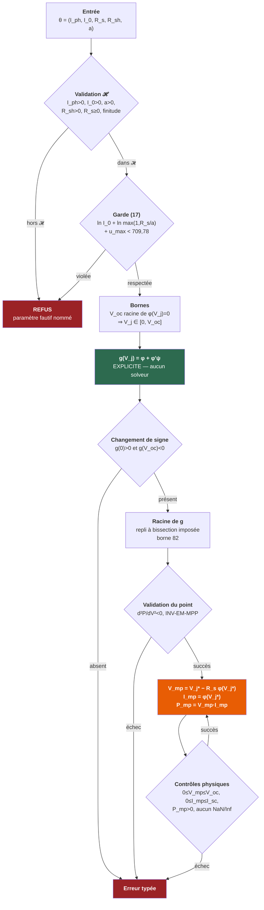

# 35. Formalisation mathématique — `electrical_model`

**Date** : 2026-08-12
**Phase** : 2B — formalisation
**Statut** : **aucun code métier, aucun algorithme Rust**
**Objet** : transformer les résultats de l'audit en propriétés formelles directement traduisibles en tests

> **Principe absolu appliqué à ce document.** Une propriété observée n'est
> pas une preuve. Une preuve hors domaine de validité n'est pas une
> garantie. Le statut épistémique de chaque énoncé est marqué :
> **[P]** prouvé · **[O]** observé numériquement · **[H]** hypothèse ·
> **[E]** validation empirique requise. Le tableau récapitulatif est en
> `docs/design/36-statut-epistemique-electrical-model.md`.

---

## 1. Équation fondamentale

### 1.1 Conventions de signe

Convention **générateur**, fixée une fois pour toutes :

| Grandeur | Convention |
|---|---|
| `V` | Tension **aux bornes** du module, positive quand le module est polarisé en direct |
| `I` | Courant **débité** par le module, positif quand il sort de la borne positive |
| `P = V·I` | Puissance **fournie**, positive dans le quadrant de fonctionnement |

Le quadrant de fonctionnement est donc `V ≥ 0`, `I ≥ 0`, `P ≥ 0`. La
polarisation inverse (`V < 0` ou `I < 0`) est **hors du domaine
spécifié** : elle relève du mismatch et de l'ombrage, exclus du périmètre.

### 1.2 L'équation

$$
\boxed{\;I \;=\; I_{ph} \;-\; I_0\left[\exp\!\left(\frac{V + I R_s}{a}\right) - 1\right] \;-\; \frac{V + I R_s}{R_{sh}}\;}
\tag{1}
$$

**Implicite en `I`** : `I` figure des deux côtés.

### 1.3 Définition de chaque symbole

| Symbole | Nom | Unité SI | Nature | Domaine admissible |
|---|---|---|---|---|
| `I` | Courant débité | A | Inconnue | `[0, I_{sc}]` dans le quadrant |
| `V` | Tension aux bornes | V | Donnée | `[0, V_{oc}]` dans le quadrant |
| `I_ph` | Photocourant | A | Paramètre ajusté (F) | `> 0` |
| `I_0` | Courant de saturation inverse de la diode | A | Paramètre ajusté (F) | `> 0` |
| `R_s` | Résistance série | Ω | Paramètre ajusté (F) | `≥ 0` |
| `R_sh` | Résistance shunt (parallèle) | Ω | Paramètre ajusté (F) | `> 0` |
| `n` | Facteur d'idéalité de la diode | — | Paramètre ajusté (F) | `> 0` |
| `N_s` | Cellules en série | — | **Donnée du module (A)** | entier `≥ 1` |
| `V_t` | Tension thermique par cellule | V | Calculée | `> 0` |
| `a` | Facteur d'idéalité modifié | V | Calculé | `> 0` |
| `T_c` | Température de **cellule** | **K** | Condition | `> 0` |

$$ V_t = \frac{k\,T_c}{q}, \qquad a = n\,N_s\,V_t = \frac{n\,N_s\,k\,T_c}{q} \tag{2} $$

`k` = constante de Boltzmann, `q` = charge élémentaire, toutes deux
CODATA, disponibles dans `core_constants`.

> **[H-1] `T_c` est en kelvins.** Les rapports `T_c/T_{ref}` des équations
> de translation sont faux en degrés Celsius. Les *différences* de
> température sont en revanche identiques dans les deux échelles. Cette
> asymétrie est portée par le typage.

### 1.4 Analyse dimensionnelle de l'équation (1) — **[P]**

Chaque terme doit être en ampères.

| Terme | Décomposition | Dimension |
|---|---|---|
| `I` | — | **A** |
| `I_ph` | — | **A** |
| `V + I R_s` | `V + A·Ω = V + V` | **V** |
| `(V + I R_s)/a` | `V / V` | **1** (sans dimension) ✔ |
| `exp(·) − 1` | exponentielle d'un adimensionnel | **1** |
| `I_0[exp(·) − 1]` | `A · 1` | **A** ✔ |
| `(V + I R_s)/R_sh` | `V / Ω` | **A** ✔ |

**L'équation (1) est homogène en ampères.** ∎

Le point critique est que **l'argument de l'exponentielle est sans
dimension**, ce qui n'est vrai que parce que `[a] = V`. Vérification
de (2) :

$$ \left[\frac{k T_c}{q}\right] = \frac{\mathrm{J\cdot K^{-1}}\cdot\mathrm{K}}{\mathrm{C}} = \frac{\mathrm{J}}{\mathrm{C}} = \mathrm{V} \;\checkmark $$

et `n`, `N_s` étant sans dimension, `[a] = V`. ∎

> **[P] `a` est en volts sans être une tension du module.** Il ne doit
> jamais pouvoir être additionné à `V` ou `V_oc`. D'où le type distinct
> (ADR-0009 D-2).

---

## 2. Résidu et dérivées

### 2.1 Définition

$$
\boxed{\;f(I;V,\theta) \;=\; I_{ph} - I_0\left[e^{u} - 1\right] - \frac{V + I R_s}{R_{sh}} - I,
\qquad u \;=\; \frac{V + I R_s}{a}\;}
\tag{3}
$$

où `θ = (I_ph, I_0, R_s, R_sh, a)` est le jeu de paramètres. Résoudre (1)
équivaut à annuler (3).

**Domaine de définition** : `f` est définie sur `ℝ` tout entier. Elle est
composée de l'exponentielle et de fonctions affines. **[P]**

**Régularité** : `f ∈ C^∞(ℝ)`. Aucune singularité, aucun point anguleux.
**[P]**

### 2.2 Dérivée première par rapport à `I` — calcul analytique

$$ \frac{\partial}{\partial I}\left[e^{u}\right] = e^{u}\cdot\frac{\partial u}{\partial I} = e^{u}\cdot\frac{R_s}{a} $$

$$ \frac{\partial}{\partial I}\left[\frac{V + I R_s}{R_{sh}}\right] = \frac{R_s}{R_{sh}} $$

d'où

$$
\boxed{\;\frac{\partial f}{\partial I} \;=\; -\frac{I_0 R_s}{a}\,e^{u} \;-\; \frac{R_s}{R_{sh}} \;-\; 1\;}
\tag{4}
$$

**Dimension** : `[I_0 R_s/a] = A·Ω/V = A·(V/A)/V = 1` ; `[R_s/R_sh] = 1`.
Donc `∂f/∂I` est **sans dimension** — cohérent avec la dérivée d'un
courant par rapport à un courant. **[P]**

**Signe.** Sous `I_0 > 0`, `a > 0`, `R_s ≥ 0`, `R_sh > 0` :

- `−(I_0 R_s/a)e^u ≤ 0` (nul si et seulement si `R_s = 0`) ;
- `−R_s/R_sh ≤ 0` (nul si et seulement si `R_s = 0`) ;
- `−1 < 0`, toujours.

$$
\boxed{\;\frac{\partial f}{\partial I} \;\le\; -1 \;<\; 0 \qquad \forall I \in \mathbb{R}\;}
\tag{5}
$$
**[P]**

### 2.3 Dérivée seconde par rapport à `I`

$$
\boxed{\;\frac{\partial^2 f}{\partial I^2} \;=\; -\frac{I_0 R_s^2}{a^2}\,e^{u}\;}
\tag{6}
$$

**Dimension** : `[I_0 R_s²/a²] = A·Ω²/V² = A·(V/A)²/V² = 1/A`. Cohérent :
`[∂²f/∂I²] = [A]/[A²] = 1/A`. **[P]**

**Signe.**

$$
\boxed{\;\frac{\partial^2 f}{\partial I^2} < 0 \;\text{ si } R_s > 0\;;\qquad
\frac{\partial^2 f}{\partial I^2} = 0 \;\text{ si } R_s = 0\;}
\tag{7}
$$

**`f` est strictement concave en `I` pour `R_s > 0`, et affine pour
`R_s = 0`.** **[P]**

### 2.4 Dérivée par rapport à `V`

$$
\boxed{\;\frac{\partial f}{\partial V} \;=\; -\frac{I_0}{a}\,e^{u} \;-\; \frac{1}{R_{sh}} \;<\; 0\;}
\tag{8}
$$

**Dimension** : `[I_0/a] = A/V = Ω⁻¹` et `[1/R_sh] = Ω⁻¹`. `∂f/∂V` est
une **conductance**, pas un nombre sans dimension. **[P]**

> **Ce contraste entre (4) sans dimension et (8) en Ω⁻¹ est la raison
> pour laquelle la borne d'erreur du §5 ne se transpose pas de `I` à `V`.**

### 2.5 Vérification numérique — **[O]**

Balayage de 5 151 couples `(V, I)` sur 9 jeux de paramètres, dont
pathologiques :

| Jeu | `min |∂f/∂I|` | `max ∂²f/∂I²` |
|---|---|---|
| nominal 72 cellules | 1,000375 | −6,57·10⁻¹² |
| `R_s = 0` | 1,000000 | **0** (exactement) |
| `R_s = 10⁻⁹ Ω` | 1,000000 | −7,31·10⁻²⁹ |
| `R_s = 2 Ω` | 1,002500 | −2,92·10⁻¹⁰ |
| `R_sh = 10¹² Ω` | 1,000000 | −6,57·10⁻¹² |
| `R_sh = 5 Ω` | 1,060000 | −6,57·10⁻¹² |
| `R_sh = 1,5 Ω` | 1,200000 | −6,57·10⁻¹² |
| `G` très faible | 1,000000 | −6,57·10⁻¹² |
| couche mince | 1,001500 | −5,63·10⁻¹² |

Aucune violation. **Ces mesures corroborent (5) et (7) ; elles ne les
démontrent pas — la démonstration est celle des §2.2 et §2.3.**

---

## 3. Existence et unicité de `I(V)`

### 3.1 Hypothèses nécessaires — **[H]**

$$
\mathcal{H}: \quad I_{ph} > 0,\;\; I_0 > 0,\;\; a > 0,\;\; R_{sh} > 0,\;\; R_s \ge 0
$$

toutes **finies**, plus le domaine `V ∈ [0, V_{oc}]`.

**Chaque hypothèse doit être vérifiée par le moteur avant tout calcul.**
Hors de `𝓗`, aucune des propriétés ci-dessous ne tient, et rien ne doit
être tenté.

| Hypothèse | Rôle dans les démonstrations |
|---|---|
| `I_0 > 0` | Sans elle, (7) perd son signe et la concavité tombe |
| `a > 0` | Sans elle, `u` change de signe et `e^u` diverge du mauvais côté |
| `R_sh > 0` | Sans elle, le terme de fuite explose ou change de signe |
| `R_s ≥ 0` | `R_s < 0` inverserait (5) ; `R_s = 0` est admis et traité au §8 |
| `I_ph > 0` | Nécessaire à `f(0) ≥ 0`, donc à l'encadrement du §3.4 |
| Finitude | Sans elle, `f` n'est pas définie |

### 3.2 Unicité — **[P]**

Par (5), `f` est **strictement décroissante** sur `ℝ`. Une fonction
strictement monotone s'annule au plus une fois. ∎

### 3.3 Existence — **[P]**

`f` est continue sur `ℝ` (§2.1).

**Limite en `−∞`.** Si `R_s > 0` : `u → −∞` donc `e^u → 0`, et

$$ f(I) \;\underset{I\to-\infty}{\sim}\; -I\left(1 + \frac{R_s}{R_{sh}}\right) \;\to\; +\infty $$

Si `R_s = 0` : `f(I) = C − I → +∞` avec `C` constante. Dans les deux cas
`\lim_{I\to-\infty} f = +\infty`.

**Limite en `+∞`.** Le terme `−I` diverge vers `−∞` ; si `R_s > 0`, le
terme `−I_0 e^u` y contribue également. Donc
`\lim_{I\to+\infty} f = -\infty`.

Par le théorème des valeurs intermédiaires, `f` s'annule. Avec §3.2 :
**il existe exactement une racine `I*`**. ∎

### 3.4 Bornes de `I*` — encadrement calculable — **[P]**

**Borne supérieure.** En `I = I_{ph} + I_0` :

$$ f(I_{ph} + I_0) = -I_0 e^{u} - \frac{V + (I_{ph}+I_0)R_s}{R_{sh}} $$

Les deux termes sont strictement négatifs pour `V ≥ 0` (le premier car
`I_0 > 0` et `e^u > 0` ; le second car `V ≥ 0`, `R_s ≥ 0`,
`I_ph + I_0 > 0`, `R_sh > 0`). Donc `f(I_{ph}+I_0) < 0`, et par
décroissance `I^* < I_{ph} + I_0`. ∎

**Borne inférieure.** En `I = 0` :

$$ f(0) = I_{ph} - I_0\left[e^{V/a} - 1\right] - \frac{V}{R_{sh}} $$

`V_oc` est **par définition** la tension annulant le courant, c'est-à-dire
la racine de `f(0; V) = 0` vue comme fonction de `V`. Comme
`∂f/∂V < 0` par (8), `f(0; V)` est décroissante en `V`, donc
`f(0; V) ≥ 0` pour tout `V ≤ V_oc`. D'où `I^* ≥ 0`. ∎

$$
\boxed{\;I^* \in \left[\,0,\;I_{ph} + I_0\,\right] \qquad \text{pour } V \in [0, V_{oc}]\;}
\tag{9}
$$

Encadrement **calculable à partir des seuls paramètres**, sans itération.

### 3.5 Régularité de `I(V)` — **[P]**

`f ∈ C^∞` et `∂f/∂I ≤ −1 ≠ 0` : le **théorème des fonctions implicites**
s'applique. `I(V)` est donc `C^∞` sur `[0, V_oc]`, avec

$$
\boxed{\;\frac{dI}{dV} \;=\; -\,\frac{\partial f/\partial V}{\partial f/\partial I}
\;=\; -\;\frac{\dfrac{I_0}{a}e^{u} + \dfrac{1}{R_{sh}}}{\dfrac{I_0 R_s}{a}e^{u} + \dfrac{R_s}{R_{sh}} + 1}\;}
\tag{10}
$$

**Signe** : numérateur `> 0`, dénominateur `≥ 1 > 0`, donc `dI/dV < 0`
strictement. **`I(V)` est strictement décroissante.** ∎

**Borne** : le dénominateur étant `≥ 1`, `|dI/dV| ≤ I_0 e^u/a + 1/R_{sh}`.
La dérivée ne peut pas exploser tant que `e^u` est représentable. **[P]**

**Dimension** : `[dI/dV] = Ω⁻¹`, cohérent. ✔

---

## 4. Newton — formalisation

### 4.1 L'itération

$$
I_{k+1} \;=\; I_k - \frac{f(I_k)}{f'(I_k)}, \qquad I_0^{\text{départ}} = 0
\tag{11}
$$

où `f' = ∂f/∂I` donnée par (4).

### 4.2 Ce qui est vrai dans `ℝ` — **[P]**

**Proposition N-1 (énoncé valable EN ARITHMÉTIQUE EXACTE UNIQUEMENT).**
Sous `𝓗` avec `R_s > 0`, `f` est strictement décroissante (5) et
strictement concave (7). Dans `ℝ`, l'itération (11) converge vers `I*`
depuis tout point de départ, de façon monotone décroissante à partir de
`k = 1`.

> ⚠️ **Cette proposition ne se transporte pas en `f64`** — voir §4.3. Elle
> n'est énoncée que parce qu'elle sert de brique à la proposition N-2,
> qui est celle que le moteur peut invoquer. **Elle ne doit jamais être
> citée seule comme garantie du solveur.**

*Démonstration.* Par concavité, la tangente en `I_k`,
`T_k(x) = f(I_k) + f'(I_k)(x − I_k)`, majore `f` partout. Par
construction `T_k(I_{k+1}) = 0`. Or `T_k(I^*) ≥ f(I^*) = 0 = T_k(I_{k+1})`,
et `T_k` est strictement décroissante (pente `f'(I_k) < 0`), donc
`I^* ≤ I_{k+1}` : **dès la première itération l'itéré est à droite de la
racine**. Pour `k ≥ 1`, `I_k ≥ I^*` donne `f(I_k) ≤ 0` ; avec
`f'(I_k) < 0`, le pas `−f(I_k)/f'(I_k) ≤ 0`, donc `I_{k+1} ≤ I_k`. Suite
décroissante minorée par `I^*`, donc convergente vers une limite finie
`L`. En passant à la limite, `f(L)/f'(L) = 0` avec `f'(L)` finie non
nulle, donc `f(L) = 0`, donc `L = I^*`. ∎

### 4.3 Ce qui est faux en `f64` — **[O], contre-exemple**

La proposition N-1 suppose `f(I_k)` **évaluable**. Contre-exemple mesuré
(jeu nominal, `V = 0,8 V_oc`) :

| `I₀` de départ | Itérations | `u` max atteint | Résultat |
|---:|---:|---:|---|
| −10⁶ | 5 | 21,2 | converge |
| 0 | 5 | 21,2 | converge |
| 50 | 9 | 27,7 | converge |
| 200 | 33 | 52,0 | converge |
| **10⁴** | — | **> 709,78** | **débordement** |

> **La formulation « converge depuis tout point de départ » est
> RETIRÉE.** Elle vaut dans `ℝ`, pas en arithmétique flottante.

### 4.4 La garantie retenue — domaine, invariant, borne — **[P]**

**Proposition N-2 (invariant d'intervalle).** Sous `𝓗`, pour
`V ∈ [0, V_oc]`, l'itération (11) depuis `I₀ = 0` vérifie

$$
\boxed{\;I_k \in \left[\,I^*,\; I_{ph}\,\right] \quad \forall k \ge 1,
\qquad\text{et}\qquad I_0^{\text{départ}} = 0 \le I^*\;}
\tag{12}
$$

*Démonstration.* Par (9), `f(0) ≥ 0` et `f'(0) < 0`, donc le premier pas
`−f(0)/f'(0) ≥ 0` : `I_1 ≥ 0`. Sa longueur vérifie, par (5),

$$ |I_1 - 0| = \left|\frac{f(0)}{f'(0)}\right| \le |f(0)| \le I_{ph} $$

la dernière majoration venant de
`f(0) = I_{ph} − I_0[e^{V/a}−1] − V/R_{sh} ≤ I_{ph}` (les deux termes
soustraits étant `≥ 0` pour `V ≥ 0`). Donc `I_1 ∈ [I^*, I_{ph}]` par la
proposition N-1. La suite décroît ensuite en restant `≥ I^*`. ∎

**Conséquence — domaine d'évaluation borné a priori :**

$$
\boxed{\;u \;\le\; u_{\max} \;=\; \frac{V_{oc} + I_{ph}R_s}{a}\;}
\tag{13}
$$

quantité **calculable avant la première itération**.

### 4.5 Conditions d'arrêt et de sortie

| Condition | Test | Effet |
|---|---|---|
| **Arrêt (succès)** | `|f(I_k)| ≤ τ_f` | Rend `I_k`, avec `|I_k − I*| ≤ τ_f` garantie par (14) |
| **Sortie — non finitude** | `I_k` ou `f(I_k)` non fini | Bascule sur le repli (§6) |
| **Sortie — hors invariant** | `I_k ∉ [0, I_ph + I_0]` | Bascule sur le repli |
| **Sortie — budget** | `k > 30` | Bascule sur le repli |
| **Refus a priori** | garde du §7 violée | Aucun calcul n'est tenté |

Le budget de 30 est un **budget**, non une borne : la borne démontrée est
celle du repli (§6). **[O]** : 2 à 13 itérations mesurées sur les 9 jeux.

> **Formulation autorisée** : « Sous `𝓗`, depuis `I₀ = 0`, l'itération
> converge, tous les itérés restant dans `[I*, I_ph]`. » — jamais
> « converge toujours ».

---

## 5. Borne d'erreur sur le courant

### 5.1 Énoncé et démonstration — **[P]**

**Proposition E-1.** Sous `𝓗`, pour tout `I ∈ ℝ` :

$$
\boxed{\;\left|I - I^*\right| \;\le\; \left|f(I)\right|\;}
\tag{14}
$$

*Démonstration.* `f` est dérivable sur `ℝ` et `f(I^*) = 0`. Par le
théorème des accroissements finis, il existe `ξ` strictement entre `I` et
`I*` tel que `f(I) − f(I^*) = f'(ξ)\,(I − I^*)`. Donc
`|f(I)| = |f'(ξ)|\cdot|I − I^*|`. Par (5), `|f'(ξ)| ≥ 1`, d'où
`|f(I)| ≥ |I − I^*|`. ∎

### 5.2 Analyse dimensionnelle — **[P]**

| Grandeur | Dimension |
|---|---|
| `[f]` | **A** (équation (3), homogène en ampères — §1.4) |
| `[ΔI] = [I − I*]` | **A** |
| `[f']` | **1** (sans dimension — §2.2) |

La relation `[A] ≤ [A]` est **dimensionnellement cohérente**, et elle
l'est *parce que* `f'` est sans dimension. ∎

### 5.3 Ce qu'elle devient en virgule flottante — **[P] avec correctif**

La proposition E-1 porte sur `f` exacte. Le résidu calculé `\hat f`
diffère de `f` d'une erreur d'évaluation `η` :

$$ |I - I^*| \;\le\; |\hat f(I)| + \eta, \qquad \eta \approx 10\,\varepsilon\,I_{sc} $$

Avec `τ_f = 10^{-12} I_{sc}` et `η ≈ 2{,}22\cdot10^{-15} I_{sc}`, la borne
effective vaut `τ_f\,(1 + 2{,}2\cdot10^{-3})`. **Le correctif est
négligeable mais doit être énoncé.**

### 5.4 La relation NE se transpose PAS à la tension — **[P]**

Pour `V` à `I` donné, le résidu `h(V)` est toujours en ampères, mais
`∂h/∂V = ∂f/∂V` est une **conductance** (8). La seule minoration
disponible est `|∂h/∂V| ≥ 1/R_{sh}`, d'où

$$
\boxed{\;|V - V^*| \;\le\; R_{sh}\,|h(V)|\;}
\tag{15}
$$

**Dimension** : `[Ω]·[A] = [V]` ✔.

**Conséquence** : `tol_V` est un seuil **distinct**, dépendant de `R_sh` :

$$ \tau_h = \frac{10^{-12}\,V_{oc}}{R_{sh}}, \qquad \text{plafonné par } 100\,\varepsilon\,I_{sc} $$

---

## 6. Repli — spécification formelle

### 6.1 Ce que ce repli **n'est pas**

> Ce n'est **pas** l'algorithme de Brent, et la borne ci-dessous **n'est
> pas** une propriété de Brent.

Les garanties réelles de Brent (1973, *Algorithms for Minimization
Without Derivatives*, ch. 4) sont : convergence assurée sur un
encadrement, et nombre d'évaluations majoré par un ordre de
`(\log_2\frac{b-a}{\delta})^2`, soit **≈ 1636** dans notre cas. Brent
interdit la lenteur pathologique de Dekker ; il ne garantit pas une
réduction géométrique d'un facteur deux toutes les deux itérations.

### 6.2 L'algorithme spécifié — bissection imposée

| Élément | Définition |
|---|---|
| `I_low` | `0` |
| `I_high` | `I_ph + I_0` |
| **Condition de signe** | `f(I_low) ≥ 0` et `f(I_high) < 0` — **démontrée** par (9) |
| **Réduction** | Une **bissection est imposée une itération sur deux** ; l'itération intermédiaire peut être une interpolation, sans effet sur la borne |
| **Critère d'arrêt** | `I_high − I_low ≤ τ_f` **ou** `|f| ≤ τ_f` |
| **Borne d'itérations** | **82** — démontrée en §6.3 |

### 6.3 Démonstration de la borne 82 — **[P]**

Soit `W_0 = I_{high} − I_{low} = I_{ph} + I_0` la largeur initiale.

Après `m` bissections imposées, la largeur vérifie `W ≤ W_0/2^m`
(chaque bissection halve exactement l'intervalle contenant la racine, qui
y reste par le changement de signe).

La condition d'arrêt `W ≤ τ_f` est atteinte dès que

$$ \frac{W_0}{2^m} \le \tau_f \iff m \ge \log_2\frac{W_0}{\tau_f} $$

Avec `W_0 = I_{ph} + I_0 ≈ 1{,}5\,I_{sc}` et `τ_f = 10^{-12} I_{sc}` :

$$ \log_2\frac{1{,}5\,I_{sc}}{10^{-12} I_{sc}} = \log_2(1{,}5\cdot10^{12}) = 40{,}4 \;\Rightarrow\; m = 41 $$

Une bissection étant imposée une itération sur deux, `m` bissections
coûtent au plus `2m` itérations :

$$ \boxed{\;N_{\max} = 2\times 41 = 82\;} \tag{16} $$

∎

**Indépendance de la machine et du module** — **[P]** : le rapport
`W_0/τ_f = 1{,}5\cdot10^{12}` est **invariant**, numérateur et
dénominateur étant tous deux proportionnels à `I_sc`.

**[O]** Vérifié : `\log_2(W_0/τ_f)` vaut exactement 40,4 pour `I_sc` de
20 A, 10 A, 1 A, 10⁻² A, 10⁻⁴ A, 10⁻⁸ A et 10⁻²⁰ A.

### 6.4 Bornes de référence

| Méthode | Borne | Statut |
|---|---|---|
| Bissection pure | `⌈40,4⌉ = 41` | **[P]** serrée |
| **Repli spécifié** | **82** | **[P]** pour l'algorithme du §6.2 |
| Brent textuel | ≈ 1636 | **[P]** (Brent 1973), non exploitée |
| Newton | 30 | **budget**, non borne |

---

## 7. Débordement — formalisation

### 7.1 Domaine d'évaluation

Par l'invariant (12), tous les itérés sont dans `[I*, I_ph]`, donc

$$ u \in \left[\frac{V}{a},\;\frac{V + I_{ph}R_s}{a}\right] \subseteq [0,\;u_{\max}] $$

avec `u_max` donné par (13). **[P]**

### 7.2 Garde a priori — seuil non arbitraire

Les quantités effectivement évaluées sont `I_0 e^u` (dans `f`) et
`(I_0 R_s/a) e^u` (dans `f'`). La plus grande des deux est majorée par

$$ \max\left(1, \frac{R_s}{a}\right) I_0\,e^{u_{\max}} $$

d'où la garde, en domaine logarithmique :

$$
\boxed{\;\ln I_0 \;+\; \ln\max\!\left(1, \frac{R_s}{a}\right) \;+\; u_{\max} \;<\; \ln(\texttt{f64::MAX}) = 709{,}78\;}
\tag{17}
$$

**Le seuil 709,78 n'est pas un choix : c'est `ln(2^{1024})`, imposé par
IEEE 754 binary64.**

Si (17) est violée, le calcul est **refusé** avec un diagnostic nommant
`a`, `V_oc`, `R_s` et `I_0`. **Aucun calcul n'est tenté, aucun
`try/catch` n'est employé.**

### 7.3 Évaluation en domaine logarithmique

| Expression | Forme naïve | Forme retenue | Gain |
|---|---|---|---|
| `I_0 e^u` | `I_0 * exp(u)` | `exp(ln_I0 + u)` avec `ln_I0` précalculé | `|\ln I_0| ≈ 23` unités |
| `e^u − 1` | `exp(u) - 1.0` | `expm1(u)` pour `|u|` petit | Évite l'annulation près de `V = 0` |

### 7.4 Vérification — **[O]**

| Jeu | `u_max` | Garde (17) | Marge à 709,78 |
|---|---:|---:|---:|
| nominal 72c | 26,13 | 4,02 | 705,8 |
| `R_s = 2 Ω` | 35,69 | 13,66 | 696,1 |
| `R_sh = 1,5 Ω` | 10,12 | −11,99 | 721,8 |
| couche mince | 27,37 | 2,04 | 707,7 |
| **`a = 0,05` (T-15)** | **962,40** | **942,08** | **REFUS** ✔ |

Le jeu volontairement incohérent est refusé par la garde, comme attendu.

### 7.5 Ce qu'un débordement signifie — **[P]**

Pour un jeu **auto-cohérent**, `V_oc` est la racine de
`I_{ph} = I_0[e^{V_{oc}/a} − 1] + V_{oc}/R_{sh}`, d'où

$$ \frac{V_{oc}}{a} \approx \ln\frac{I_{ph}}{I_0} $$

Avec `I_ph/I_0 ~ 10^{11}`, cela donne `V_oc/a ≈ 25`. Un `u_max` proche de
709 supposerait `a` absurdement petit ou `V_oc` incohérent avec `I_0`.

> **Un débordement est un symptôme d'incohérence des paramètres, pas une
> difficulté numérique intrinsèque.** Le refuser a priori est
> scientifiquement correct.

### 7.6 Sous-flux

`e^u` pour `u → −∞` tend vers 0 par valeurs dénormales puis 0 exact. Le
terme `I_0[e^u − 1] → −I_0`, fini et correct. **Aucun sous-flux
dangereux** : la perte se produit sur un terme dont la contribution
devient négligeable devant `I_ph`. **[P]**

---

## 8. Cas `R_s = 0`

### 8.1 Solution analytique — **[P]**

Pour `R_s = 0`, (6) donne `∂²f/∂I² = 0` : `f` est **affine** en `I`.

$$ f(I) = \underbrace{I_{ph} - I_0\left[e^{V/a} - 1\right] - \frac{V}{R_{sh}}}_{\text{indépendant de } I} - I $$

$$
\boxed{\;I^*\big|_{R_s = 0} \;=\; I_{ph} - I_0\left[e^{V/a} - 1\right] - \frac{V}{R_{sh}}\;}
\tag{18}
$$

Solution **exacte**, sans itération. ∎

### 8.2 Aucune division par `R_s` dans la branche générale — **[P]**

Inspection de toutes les expressions de la branche générale :

| Expression | Contient `R_s` en dénominateur ? |
|---|---|
| `f` — équation (3) | Non : `R_s` apparaît en **numérateur** dans `V + I R_s` |
| `u` — équation (3) | Non : dénominateur `a` |
| `f'` — équation (4) | Non : dénominateurs `a` et `R_sh` |
| `f''` — équation (6) | Non : dénominateur `a²` |
| Pas de Newton `−f/f'` | Non : `|f'| ≥ 1`, jamais nul |
| Encadrement (9) | Non |

**Aucune division par `R_s` n'existe dans la branche générale.** ∎

**Conséquence** : `R_s = 0` et `R_s → 0` sont traités par le solveur
général **sans singularité et sans seuil**. En `R_s = 0` exactement,
`f' = −1` et le premier pas de Newton donne

$$ I_1 = 0 + f(0) = I_{ph} - I_0\left[e^{V/a}-1\right] - \frac{V}{R_{sh}} = I^* $$

soit **exactement (18) en une itération**. **[P]**

> **Aucun seuil `ε` n'est requis.** La forme fermée (18) est sélectionnée
> par le prédicat **exact** `R_s == 0`, qui est une égalité et non un
> seuil. Ce contraste avec la formulation de Lambert W — qui divise
> réellement par `R_s` — est un argument supplémentaire de son rejet.

### 8.3 Propriété testable

> **T-Rs0** : pour `R_s = 0`, le résultat du solveur général doit égaler
> (18) **au bit près**, ou à défaut à `1 ulp`, et le compteur d'itérations
> doit valoir 1.

**[O]** Vérifié : `R_s = 0` → 2 itérations (une pour atteindre, une pour
constater `|f| ≤ τ`) ; `R_s = 10⁻⁹ Ω` → 2 itérations, résultats identiques
à `10⁻⁹` près.

---

## 9. MPP — démonstration complète d'unicité

### 9.1 Position du problème

$$ P(V) = V\,I(V), \qquad V \in [0, V_{oc}] $$

`I(V)` est `C^∞` par (§3.5), donc `P` aussi.

$$ \frac{dP}{dV} = I + V\frac{dI}{dV}, \qquad
\frac{d^2P}{dV^2} = 2\frac{dI}{dV} + V\frac{d^2I}{dV^2} \tag{19} $$

Le signe de `d²P/dV²` n'est **pas** évident directement : `dI/dV < 0` mais
le signe de `d²I/dV²` n'est pas fixé. C'est ce qui motive le changement de
variable.

### 9.2 Changement de variable — tension de jonction

$$ \boxed{\;V_j \;=\; V + I R_s\;} \tag{20} $$

`V_j` est la tension **aux bornes de la jonction**, après la chute
ohmique série. Substituée dans (1), elle rend le courant **explicite** :

$$
\boxed{\;I \;=\; \varphi(V_j) \;=\; I_{ph} + I_0 - I_0\,e^{V_j/a} - \frac{V_j}{R_{sh}}\;}
\tag{21}
$$

$$ \varphi'(V_j) = -\frac{I_0}{a}e^{V_j/a} - \frac{1}{R_{sh}} \;<\; 0 \tag{22} $$

$$ \varphi''(V_j) = -\frac{I_0}{a^2}e^{V_j/a} \;<\; 0 \tag{23} $$

**`φ` est strictement décroissante et strictement concave** sous `𝓗`.
**[P]**

**Le changement de variable est une bijection croissante** :
`V = V_j − R_s φ(V_j)`, donc

$$ \frac{dV}{dV_j} = 1 - R_s\varphi'(V_j) = 1 + R_s|\varphi'(V_j)| \;>\; 0 \tag{24} $$

Les points critiques de `P` se correspondent donc **un à un** dans les
deux paramétrages, puisque `dP/dV = (dP/dV_j)\cdot(dV_j/dV)` avec
`dV_j/dV > 0`. **[P]**

### 9.3 Puissance en variable `V_j`

$$ P(V_j) = V\cdot I = \left(V_j - R_s\varphi\right)\varphi = V_j\varphi - R_s\varphi^2 \tag{25} $$

**Dérivée première.** En posant

$$ \boxed{\;\psi(V_j) \;=\; V_j - 2R_s\,\varphi(V_j)\;} \tag{26} $$

$$ \frac{dP}{dV_j} = \varphi + V_j\varphi' - 2R_s\varphi\varphi'
= \varphi + \varphi'\left(V_j - 2R_s\varphi\right)
= \boxed{\;\varphi + \varphi'\psi\;} \tag{27} $$

**Dérivée seconde.** En dérivant (27), avec `ψ' = 1 − 2R_sφ'` :

$$ \frac{d^2P}{dV_j^2} = \varphi' + \varphi''\psi + \varphi'\psi'
= \varphi' + \varphi''\psi + \varphi'\left(1 - 2R_s\varphi'\right) $$

$$ = \boxed{\;2\varphi' + \varphi''\psi - 2R_s\varphi'^2\;} \tag{28} $$

### 9.4 Les six étapes exigées

---

**Étape 1 — `ψ' > 0`** — **[P]**

$$ \psi'(V_j) = 1 - 2R_s\varphi'(V_j) = 1 + 2R_s\left|\varphi'(V_j)\right| $$

Sous `𝓗`, `R_s ≥ 0` et `φ' < 0` par (22), donc `−2R_sφ' ≥ 0` et
`ψ' ≥ 1 > 0`. ∎

---

**Étape 2 — `{ψ ≥ 0}` est un intervalle** — **[P]**

Par l'étape 1, `ψ` est continue et **strictement croissante** sur `ℝ`.
L'image réciproque de `[0, +∞)` par une fonction continue strictement
croissante est un intervalle de la forme `[V_j^\dagger, +\infty)` (ou
vide, ou `ℝ` entier). ∎

---

**Étape 3 — aucun point critique dans `{ψ < 0}`** — **[P]**

Sur cette région, et dans le quadrant de fonctionnement où
`φ(V_j) = I > 0` :

- `φ > 0` par hypothèse du quadrant ;
- `φ' < 0` par (22) ;
- `ψ < 0` par définition de la région ;
- donc `φ'ψ = (\text{négatif})\times(\text{négatif}) > 0`.

D'où, par (27),

$$ \frac{dP}{dV_j} = \underbrace{\varphi}_{>0} + \underbrace{\varphi'\psi}_{>0} \;>\; 0 $$

**`P` est strictement croissante sur `{ψ < 0}` : aucun point critique ne
peut s'y trouver.** ∎

*Localisation.* Sur `{ψ < 0}`, `V_j < 2R_s\varphi \le 2R_s I_{sc}`, et
`V \le V_j`. La région est donc confinée à `V ∈ [0, 2R_s I_{sc}]` — pour
le jeu nominal, 6,2 V sur 45,2 V, soit les 14 premiers pourcents de la
courbe, où `P` croît de toute façon.

---

**Étape 4 — `d²P/dV_j² < 0` sur `{ψ ≥ 0}`** — **[P]**

Les trois termes de (28) sous `𝓗` et `ψ ≥ 0` :

| Terme | Signe | Justification |
|---|---|---|
| `2φ'` | `< 0` | (22) |
| `φ''ψ` | `≤ 0` | `φ'' < 0` par (23), `ψ ≥ 0` par hypothèse |
| `−2R_sφ'²` | `≤ 0` | `R_s ≥ 0`, carré `≥ 0` |

La somme est **strictement négative** (le premier terme l'est
strictement). **`P` est strictement concave sur `{ψ ≥ 0}`.** ∎

---

**Étape 5 — existence d'au moins un point critique** — **[P]**

Aux bornes du domaine de fonctionnement :

$$ \left.\frac{dP}{dV}\right|_{V=0} = I(0) + 0\cdot\frac{dI}{dV} = I_{sc} \;>\; 0 $$

$$ \left.\frac{dP}{dV}\right|_{V=V_{oc}} = \underbrace{I(V_{oc})}_{=0} + V_{oc}\underbrace{\frac{dI}{dV}}_{<0 \text{ par (10)}} \;<\; 0 $$

`dP/dV` est continue sur `[0, V_{oc}]` (car `P ∈ C^∞`) et change de
signe. Par le théorème des valeurs intermédiaires, **elle s'annule au
moins une fois**. ∎

---

**Étape 6 — il ne peut y en avoir qu'un** — **[P]**

Par l'étape 3, tout point critique appartient à `{ψ ≥ 0}`. Par l'étape 2,
`{ψ ≥ 0}` est un **intervalle**. Par l'étape 4, `P` est **strictement
concave** sur cet intervalle.

Une fonction strictement concave et dérivable sur un intervalle a une
dérivée **strictement décroissante**, donc s'annulant **au plus une
fois**. ∎

---

### 9.5 Théorème — **[P]**

> **Sous `𝓗` et dans le quadrant de fonctionnement, `P` admet exactement
> un point critique sur `[0, V_{oc}]`, et ce point critique est son
> maximum global.**

*Démonstration.* Étape 5 : au moins un. Étape 6 : au plus un. Donc
exactement un, noté `V_{mp}`. Comme `dP/dV > 0` avant et `< 0` après
(par stricte décroissance de `dP/dV` sur `{ψ ≥ 0}` et positivité sur
`{ψ < 0}`), c'est un maximum, et `P(0) = 0 = P(V_{oc})` en font le
maximum global. ∎

### 9.6 Corroboration numérique — **[O], pas une preuve**

Les quatre propriétés et le comptage d'extrema ont été évalués sur 4 001
points par jeu, pour 9 jeux :

| Jeu | Étape 1 | Étape 3 | Étape 4 | Extrema comptés |
|---|---|---|---|---|
| nominal 72c → couche mince (9 jeux) | ✔ | ✔ | ✔ | **1** partout |

Y compris `R_sh = 1,5 Ω`, désigné antérieurement comme le cas à risque.

> **Ce balayage ne démontre rien.** Une grille de 4 001 points ne peut pas
> exclure deux racines rapprochées. C'est la démonstration du §9.4 qui
> établit l'unicité ; le balayage la **corrobore** et détecterait une
> erreur de dérivation.

---

## 10. Domaine de validité du MPP

### 10.1 Hypothèses nécessaires à la démonstration

| Hypothèse | Étape qui l'utilise | Ce qui casse sans elle |
|---|---|---|
| `I_0 > 0` | (22), (23) | `φ` cesse d'être concave → étape 4 |
| `a > 0` | (22), (23) | Signe de `φ'` inversé → étapes 3 et 4 |
| `R_sh > 0` | (22) | `φ'` peut changer de signe → étape 3 |
| `R_s ≥ 0` | Étapes 1, 4 | `R_s < 0` inverse `ψ'` → étape 2 tombe |
| `I_ph > 0` | Étape 5 | `I_sc > 0` requis pour le changement de signe |
| `φ > 0` (quadrant) | Étape 3 | Hors quadrant, `dP/dV_j` peut s'annuler |
| Finitude | Toutes | `φ` non définie |

### 10.2 Obligation pour le moteur

> **Le moteur doit refuser tout jeu de paramètres hors de `𝓗`.**
>
> La démonstration ne vaut que sous `𝓗`. Appliquer l'algorithme hors de
> `𝓗` ne produirait pas une erreur détectable : il rendrait un point
> plausible et faux.

**Invariant logiciel testable** :

> **INV-EM-DOM** : toute entrée dans le solveur ou dans la recherche du
> MPP est précédée d'une vérification de `𝓗`, qui refuse avec un
> diagnostic nommant le paramètre fautif et sa valeur.

### 10.3 Vérification post-hoc — maintenue

Bien que l'unicité soit démontrée, la vérification que le point trouvé est
un maximum **reste exigée** :

> **INV-EM-MPP** : `d²P/dV² < 0` au point rendu, et `P(V_{mp})` supérieur
> ou égal à `P` évalué en quelques points témoins.

Elle ne protège plus contre la multiplicité — exclue — mais contre une
**erreur d'implémentation** ou une **violation non détectée de `𝓗`**.

---

## 11. Calcul de `dP/dV`

### 11.1 Comparaison des trois méthodes

| Méthode | Précision | Coût | Stabilité | Verdict |
|---|---|---|---|---|
| **Analytique** | Exacte aux arrondis (`~ε`) | Réutilise `e^u` déjà calculé | Dénominateur `≥ 1`, borné (10) | **Retenue** |
| Différences finies | `~\sqrt{\varepsilon} \approx 1{,}5\cdot10^{-8}` au mieux | 2 évaluations, chacune un solveur implicite | Choix de `h` critique | Rejetée |
| Différentiation automatique | Exacte | Infrastructure complète | Bonne | Rejetée — équivalente à l'analytique pour une expression fermée, avec la machinerie en plus |

La différentiation numérique est **rejetée par un argument chiffré** :
son erreur optimale (`~\sqrt{\varepsilon}`) est du même ordre que le
plafond de précision qui a fait rejeter la maximisation discrète du MPP.
L'utiliser réintroduirait exactement le défaut que le §9 élimine.

### 11.2 Expression retenue — en variable `V_j`

**Découverte de cette formalisation** : en variable `V_j`, tout est
**explicite**. `dP/dV_j` donné par (27) ne fait intervenir que `φ` et
`φ'`, tous deux **fermés** par (21) et (22).

$$ \frac{dP}{dV_j} = \varphi(V_j) + \varphi'(V_j)\left[V_j - 2R_s\varphi(V_j)\right] $$

> **La recherche du MPP n'appelle donc jamais le solveur implicite.**
> C'est une simplification structurelle majeure : le problème implicite et
> le problème d'optimisation sont **découplés**.

En variable `V`, si nécessaire :

$$ \frac{dP}{dV} = \frac{dP/dV_j}{dV/dV_j} = \frac{\varphi + \varphi'\psi}{1 - R_s\varphi'} \tag{29} $$

### 11.3 Vérification indépendante — **[O]**

Comparaison des expressions analytiques (10) et (27) à des différences
centrées, sur 9 jeux à `V = 0{,}7\,V_{oc}` :

| Grandeur | Écart relatif observé |
|---|---|
| `dI/dV` (10) | 2·10⁻¹² à 1,2·10⁻⁹ |
| `dP/dV_j` (27) | 2,4·10⁻¹¹ à 1,5·10⁻¹⁰ |

Ces écarts sont **l'erreur des différences finies** (`~h^2 + \varepsilon/h`),
pas celle des expressions analytiques. Ils confirment que les expressions
dérivées à la main sont correctes, et illustrent quantitativement
l'argument du §11.1.

---

## 12. Algorithme de recherche du MPP — spécification

### 12.1 Enchaînement

### 12.2 Points de spécification

| # | Règle |
|---|---|
| M-1 | **Aucune maximisation discrète** n'est employée comme méthode principale — plafond `\sqrt{\varepsilon}` (doc 32 §7.4) |
| M-2 | La racine est cherchée sur `g(V_j) = φ + φ'ψ`, **explicite** |
| M-3 | L'encadrement `[0, V_{oc}]` est **démontré** par l'étape 5 |
| M-4 | La racine est **unique** par le théorème §9.5 — mais la vérification `INV-EM-MPP` est maintenue |
| M-5 | `V_mp`, `I_mp`, `P_mp` sont dérivés **analytiquement** de `V_j^*`, sans solveur supplémentaire |
| M-6 | Tout échec produit une **erreur typée**, jamais un point plausible |

### 12.3 Corroboration — **[O]**

Comparaison du MPP obtenu en variable `V_j` (racine explicite) contre un
balayage fin de `P(V)` via résolution implicite (40 001 points) :

| Jeu | `V_mp` (V_j, racine) | `V_mp` (balayage) | Écart |
|---|---:|---:|---:|
| nominal 72c | 36,797651321 | 36,797275401 | 3,8·10⁻⁴ |
| `R_sh = 1,5 Ω` | 7,799999884 | 7,799999139 | 7,5·10⁻⁷ |
| couche mince | 86,170184943 | 86,170947179 | 7,6·10⁻⁴ |

**L'écart est la résolution du balayage** (`V_{oc}/40000 \approx 10^{-3}` V),
non l'erreur de la méthode par racine, qui atteint `10^{-13}\,V_{oc}`.
C'est l'illustration quantitative du §9 de la doc 32 : la maximisation
discrète plafonne, la recherche de racine non.

---

## 13. Tolérances — récapitulatif formel

| Symbole | Grandeur | Valeur | Statut | Justification |
|---|---|---|---|---|
| `τ_f` | Résidu, forme en courant | `10^{-12} I_{sc}` | **[P]** dérivée | 450× le plancher `10\varepsilon I_{sc}`, `10^{-10}` de l'incertitude des données |
| `τ_I` | Erreur sur `I` | `= τ_f` | **[P]** par (14) | Le résidu **majore** l'erreur — non indépendante |
| `τ_h` | Résidu, forme en tension | `10^{-12} V_{oc}/R_{sh}`, plafonné à `100\varepsilon I_{sc}` | **[P]** par (15) | Dépend de `R_sh` — **indépendante** de `τ_f` |
| `τ_P` | Erreur relative sur `P` | `2\cdot10^{-12}` | **[P]** dérivée | Propagation sur `P = V·I` |
| `τ_{V_j}` | Racine de `dP/dV_j` | `10^{-12} V_{oc}` | **[P]** | Atteignable car `g'(V_{mp}) \ne 0` |
| `N_{Newton}` | Budget Newton | 30 | **[O]** | 2 à 13 mesurées ; au-delà = pathologie |
| `N_{repli}` | Borne repli | **82** | **[P]** par (16) | Bissection imposée 1 sur 2 |

**[O]** Invariance vérifiée : marge au plancher = 450 et
`\log_2(W_0/τ_f) = 40{,}4` pour `I_{sc}` de 20 A à 10⁻²⁰ A.

---

## 14. Récapitulatif des équations numérotées

| # | Équation | Statut |
|---|---|---|
| (1) | Équation single-diode | Définition |
| (2) | `a = n N_s k T_c/q` | Définition |
| (3) | Résidu `f(I;V,θ)` | Définition |
| (4) | `∂f/∂I` | **[P]** |
| (5) | `∂f/∂I ≤ −1` | **[P]** |
| (6) | `∂²f/∂I²` | **[P]** |
| (7) | `∂²f/∂I² < 0` si `R_s > 0` | **[P]** |
| (8) | `∂f/∂V < 0`, en Ω⁻¹ | **[P]** |
| (9) | Encadrement `[0, I_ph + I_0]` | **[P]** |
| (10) | `dI/dV` par le TFI | **[P]** |
| (11) | Itération de Newton | Définition |
| (12) | Invariant d'intervalle `[I*, I_ph]` | **[P]** |
| (13) | `u_max = (V_oc + I_ph R_s)/a` | **[P]** |
| (14) | `|I − I*| ≤ |f(I)|` | **[P]** |
| (15) | `|V − V*| ≤ R_sh |h(V)|` | **[P]** |
| (16) | Borne 82 du repli | **[P]** |
| (17) | Garde anti-débordement | **[P]** (seuil IEEE 754) |
| (18) | Solution exacte `R_s = 0` | **[P]** |
| (19) | `dP/dV`, `d²P/dV²` | Définition |
| (20) | `V_j = V + I R_s` | Définition |
| (21) | `φ(V_j)` explicite | **[P]** |
| (22) | `φ' < 0` | **[P]** |
| (23) | `φ'' < 0` | **[P]** |
| (24) | `dV/dV_j > 0` | **[P]** |
| (25) | `P(V_j) = V_j φ − R_s φ²` | **[P]** |
| (26) | `ψ = V_j − 2R_s φ` | Définition |
| (27) | `dP/dV_j = φ + φ'ψ` | **[P]** |
| (28) | `d²P/dV_j² = 2φ' + φ''ψ − 2R_sφ'²` | **[P]** |
| (29) | `dP/dV` depuis `dP/dV_j` | **[P]** |

---

## 15. Critère de sortie — état

| Exigence | État | Référence |
|---|---|---|
| Équation single-diode formalisée | ✅ | §1 |
| Analyse dimensionnelle complète | ✅ | §1.4, §2.2, §2.3, §2.4, §5.2 |
| Résidu et dérivées calculées analytiquement | ✅ | §2 |
| Existence/unicité de `I` démontrée | ✅ | §3.2, §3.3 |
| Bornes de `I` établies | ✅ | (9) |
| Domaine de Newton défini | ✅ | §4.4, invariant (12) |
| Garantie Newton correctement formulée | ✅ | §4.4 — jamais « converge toujours » |
| Borne d'erreur vérifiée dimensionnellement | ✅ | §5.2 |
| Repli formellement spécifié | ✅ | §6.2 |
| Borne 82 démontrée, non attribuée à Brent | ✅ | §6.3, §6.1 |
| Gestion du débordement démontrée | ✅ | §7 |
| Cas `R_s = 0` démontré, sans division par `R_s` | ✅ | §8 |
| Unicité du MPP démontrée en 6 étapes | ✅ | §9.4 |
| Domaine de validité du MPP explicite | ✅ | §10.1 |
| `dP/dV` validée indépendamment | ✅ | §11.3 |
| Algorithme MPP spécifié | ✅ | §12 |
| Tolérances justifiées | ✅ | §13 |
| Prouvé / observé séparés | ✅ | marqueurs **[P]**/**[O]**, doc 36 |
| **Aucun code métier** | ✅ | `electrical_model` reste 31 lignes |
